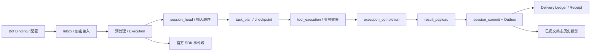

# 数据库全链路字典（当前实现至 000008）

本文按三个能力的实际依赖整理 65 张表，而非把整个仓库的所有业务模块当作本项目能力。字段来自 `000001`–`000008` 顺序应用后的有效定义，包含 CREATE 后追加的字段和替换约束；类型、默认值、主键、外键、CHECK 与索引分别展示。DDL未显式命名的约束标为未命名并保留精确表达式，不虚构数据库约束名。纯知识库索引、跨后端迁移和审计清理的内部表不属于本次主链路；其原始 DDL 仍在迁移目录。

**代码基线：`0f53489`。** 不是生产数据库实测报告；有表不代表所有组合根或所有供应商都启用同样的实现。所有引用路径以本仓库为准。

## 阅读约定

- `tenant_id` 必须进入查询与联合键，秘密正文不存入 `*_ref` 字段；AAD、摘要和原密钥版本共同保护密文。
- `version` 是行 CAS，`fence` 是执行资格，`input_seq` 是原会话顺序，`revision/config_version/policy_version` 是固定内容/控制版本，不能互换。
- `NULL` 不代表失败或未发送，须结合相应状态机；默认值只是建行默认，不代表状态转换授权。
- 此字典保留 SQL 精确类型和约束表达式，但用表格说明字段；逐字原始声明见各段迁移链接及能力 REFERENCE-IMPLEMENTATION。

## 数据层分工与关联

SDK 原事件可以先于平台终态持久化，不能把两者视作同一事务；历史续聊使用经过终态、原输入与冻结结果交叉核对的投影。详见[数据链路](END-TO-END-DATA-FLOW.md)。

## 全表导航

| 分组 | 表 | 作用 |
|---|---|---|
| 身份与固定配置 | [`tenant`](#tenant) | 租户状态、当前配置指针、配额和脱敏规则的权威控制面。 |
| 身份与固定配置 | [`agent_app`](#agent_app) | 应用控制行和当前发布修订指针。 |
| 身份与固定配置 | [`agent_app_revision`](#agent_app_revision) | 不可变发布内容；定义模型、工具、执行预算及业务完成条件。 |
| 身份与固定配置 | [`agent_app_revision_child`](#agent_app_revision_child) | 组合图节点到精确子应用修订的关系。 |
| 身份与固定配置 | [`agent_app_revision_tool`](#agent_app_revision_tool) | 某应用修订的精确工具允许列表。 |
| 身份与固定配置 | [`agent_app_revision_plugin`](#agent_app_revision_plugin) | 某应用修订的代码审核插件列表。 |
| 身份与固定配置 | [`config_snapshot`](#config_snapshot) | 原输入固定的配置发布快照。 |
| 身份与固定配置 | [`policy_snapshot`](#policy_snapshot) | 原输入固定的治理规则快照。 |
| 身份与固定配置 | [`channel_binding`](#channel_binding) | 渠道 Bot、租户、应用、凭据及身份派生密钥之间的绑定。 |
| 身份与固定配置 | [`channel_binding_locator`](#channel_binding_locator) | 验签/发送凭据查找所需的不透明定位与绑定版本。 |
| 身份与固定配置 | [`channel_public_route`](#channel_public_route) | 公开路由键摘要到不透明绑定的定位层。 |
| 身份与固定配置 | [`channel_ingress_candidate`](#channel_ingress_candidate) | 一次性协议验证候选与验签回执状态；不是 Worker 连接租约。 |
| 身份与固定配置 | [`agent_app_change`](#agent_app_change) | 应用发布/回滚/状态控制的审计事实，和应用版本推进同事务。 |
| 身份与固定配置 | [`tenant_status_change`](#tenant_status_change) | 租户启停/状态变化的审计事实，解释旧请求控制版本来源。 |
| 身份与固定配置 | [`config_release`](#config_release) | 入口选择有效配置时使用的发布/分流控制行；不是原请求执行记录。 |
| 身份与固定配置 | [`config_release_target`](#config_release_target) | 配置发布对某租户的基线、候选和允许名单；已接收请求仍沿其固定版本。 |
| 接收与执行输入 | [`inbox`](#inbox) | 原渠道消息的持久接收与去重事实，也是回复路由恢复来源。 |
| 接收与执行输入 | [`inbound_payload`](#inbound_payload) | 原始输入加密内容；状态和路由不替代正文。 |
| 接收与执行输入 | [`preprocess_job`](#preprocess_job) | 可回收的预处理工作及其租约、失败/重试状态。 |
| 接收与执行输入 | [`prepared_payload`](#prepared_payload) | 固定预处理结果，原任务接管复用已经生成的规范输入。 |
| 接收与执行输入 | [`interaction_payload`](#interaction_payload) | 确认提示等交互内容的加密载荷，区别于最终结果。 |
| 接收与执行输入 | [`result_payload`](#result_payload) | 经过完成/治理闸门的公开冻结结果；不存候选草稿。 |
| 接收与执行输入 | [`execution_record`](#execution_record) | 同一原输入的固定执行 envelope、取消意图和持久状态。 |
| 接收与执行输入 | [`execution_cancel_intent`](#execution_cancel_intent) | 独立取消控制幂等事实，接管者继续遵守原取消意图。 |
| 平台顺序与 SDK 状态 | [`session_head`](#session_head) | 会话顺序闸门、版本和已接受 Fence 高水位。 |
| 平台顺序与 SDK 状态 | [`session_commit`](#session_commit) | waiting/terminal 提交事实；成功与失败历史投影的权威入口。 |
| 平台顺序与 SDK 状态 | [`session_event`](#session_event) | 平台旧协调事件域，保留接口/模式兼容；当前不镜像官方 SDK 事件。 |
| 平台顺序与 SDK 状态 | [`session_summary`](#session_summary) | 平台摘要协调/生命周期元数据，不能冒充 SDK 摘要。 |
| 平台顺序与 SDK 状态 | [`session_summary_content`](#session_summary_content) | 平台摘要内容引用与认证数据。 |
| 平台顺序与 SDK 状态 | [`session_states`](#session_states) | 官方 SDK 的会话状态表。 |
| 平台顺序与 SDK 状态 | [`session_events`](#session_events) | 官方 SDK 原始事件（含模型草稿与工具轨迹）。 |
| 平台顺序与 SDK 状态 | [`session_track_events`](#session_track_events) | 官方 SDK 的分轨事件表。 |
| 平台顺序与 SDK 状态 | [`session_summaries`](#session_summaries) | 官方 SDK 的摘要表。 |
| 平台顺序与 SDK 状态 | [`app_states`](#app_states) | 官方 SDK 应用级状态，app_name 包含 tenant/app。 |
| 平台顺序与 SDK 状态 | [`user_states`](#user_states) | 官方 SDK 用户级状态，仍需 app_name/user 隔离。 |
| 平台顺序与 SDK 状态 | [`memories`](#memories) | 官方 SDK 持久记忆；不是在途任务完成账本。 |
| 长任务与完成候选 | [`execution_attempt`](#execution_attempt) | 同一原请求在不同 Worker/Fence 下的尝试流水。 |
| 长任务与完成候选 | [`task_plan`](#task_plan) | 原任务的当前加密计划、预算、完成合同与已验证进度。 |
| 长任务与完成候选 | [`task_checkpoint`](#task_checkpoint) | 每次任务计划修改的不可变加密快照。 |
| 长任务与完成候选 | [`execution_completion`](#execution_completion) | 治理结算前保存的私有完成候选，恢复不重新调用模型/定价。 |
| 工具、确认与治理 | [`tool_execution`](#tool_execution) | 普通和确认工具统一的原操作身份、恢复策略、租约和状态账本。 |
| 工具、确认与治理 | [`tool_execution_result`](#tool_execution_result) | 与工具成功状态原子提交的加密结果，摘要认证后才复用。 |
| 工具、确认与治理 | [`local_note`](#local_note) | 独立笔记业务效果表，按原稳定业务键创建/读回，不等于工具状态。 |
| 工具、确认与治理 | [`confirmation`](#confirmation) | 用户待确认、批准、拒绝、到期的持久流程。 |
| 工具、确认与治理 | [`confirmation_grant`](#confirmation_grant) | 绑定用户/原参数的执行授权，消费后不能盲目再执行。 |
| 工具、确认与治理 | [`tool_attempt`](#tool_attempt) | 确认授权消费后的效果状态镜像，不替代统一 tool_execution。 |
| 工具、确认与治理 | [`tool_result_payload`](#tool_result_payload) | 确认 grant 对应的加密工具结果镜像。 |
| 工具、确认与治理 | [`budget_reservation`](#budget_reservation) | 原请求的预算预约/结算状态；接管不能重置预约。 |
| 工具、确认与治理 | [`governance_decision`](#governance_decision) | 输入、输出、工具或失败阶段的稳定审核决定。 |
| 工具、确认与治理 | [`usage_ledger`](#usage_ledger) | 按固定模型/价格的用量与费用记录。 |
| 回复与投递 | [`outbox`](#outbox) | 与业务提交同事务创建的待发布事实；Redis 可重投而事实不丢。 |
| 回复与投递 | [`delivery_ledger`](#delivery_ledger) | 每个逻辑回复 segment 的发送、核对及 owner/version 状态。 |
| 回复与投递 | [`delivery_receipt`](#delivery_receipt) | 不可变渠道接受回执；弥合回执落库后、Ledger sent 前窗口。 |
| 回复与投递 | [`delivery_resolution`](#delivery_resolution) | 带版本、操作者标签和外部证据的人工投递裁决。 |
| 回复与投递 | [`webui_message`](#webui_message) | WebUI 持久邮箱，按完整目标和稳定请求键去重/查询。 |
| 运行依赖与证据 | [`model_profile`](#model_profile) | 模型配置控制头，不是某次原输入实际执行快照。 |
| 运行依赖与证据 | [`model_profile_revision`](#model_profile_revision) | 固定模型端点、模型名、凭据及选项。 |
| 运行依赖与证据 | [`backend_profile`](#backend_profile) | 共享存储后端配置控制头。 |
| 运行依赖与证据 | [`backend_profile_revision`](#backend_profile_revision) | 具体后端实现、能力和连接映射的版本化定义。 |
| 运行依赖与证据 | [`backend_binding`](#backend_binding) | 配置快照为某个存储域固定的后端绑定。 |
| 运行依赖与证据 | [`pricing_snapshot`](#pricing_snapshot) | 固定价格版本，用于幂等结算而非按当前报价重算。 |
| 运行依赖与证据 | [`media_artifact`](#media_artifact) | 预处理后的媒体对象、扫描证据和保留状态。 |
| 运行依赖与证据 | [`artifact_reference`](#artifact_reference) | 输入/结果持有的附件保留引用，接管不得提前失效。 |
| 运行依赖与证据 | [`artifact_object_upload`](#artifact_object_upload) | 对象写入/清理生命周期记录。 |
| 运行依赖与证据 | [`audit_event`](#audit_event) | 审计接收端数据；创建 audit Outbox 不等于本表或外部审计已经收到。 |

## 身份与固定配置

### tenant

租户状态、当前配置指针、配额和脱敏规则的权威控制面。

初始声明：[ 000001_service_schema.up.sql ](../../../migrations/000001_service_schema.up.sql)。

| 字段 | SQL 类型 | 可空 / 主键 | 默认值 | 设计与数据作用 |
|---|---|---|---|---|
| `tenant_id` | `text` | NOT NULL；PK | `无默认值` | 租户隔离坐标，查询、联合键及密钥解析必须使用同一租户。 |
| `tenant_key` | `text` | NOT NULL | `无默认值` | 租户的人类可读业务键，与内部 tenant_id 区分。 |
| `display_name` | `text` | NOT NULL | `无默认值` | 控制面展示名称，不是租户/路由安全键。 |
| `status` | `text` | NOT NULL | `'active'::text` | 控制面对象的当前状态，disabled/suspended 等不等于节点死亡。 |
| `request_limit_per_minute` | `bigint` | 可 NULL | `无默认值` | 租户输入限流配额。 |
| `max_concurrent_executions` | `integer` | 可 NULL | `无默认值` | 租户允许的并发执行上限。 |
| `monthly_token_budget` | `bigint` | 可 NULL | `无默认值` | 租户月度 token 额度。 |
| `monthly_cost_budget_micros` | `bigint` | 可 NULL | `无默认值` | 租户月度费用额度，单位为百万分之一货币。 |
| `billing_currency` | `character(3)` | NOT NULL | `'USD'::bpchar` | 租户计费货币。 |
| `audit_retention_days` | `integer` | NOT NULL | `180` | 租户审计保留期，不等于任务所有恢复材料可提前删除。 |
| `audit_payload_mode` | `text` | NOT NULL | `'redacted'::text` | 审计载荷处理模式，不改变业务恢复事实。 |
| `log_masking_level` | `text` | NOT NULL | `'basic'::text` | 日志脱敏策略等级。 |
| `trace_sampling_rate` | `numeric(5,4)` | NOT NULL | `0.0100` | 链路追踪采样参数；不能用采样日志替代数据库证据。 |
| `default_agent_app_id` | `text` | 可 NULL | `无默认值` | 该配置未显式选择应用时的默认应用。 |
| `default_backend_profile_id` | `text` | 可 NULL | `无默认值` | 后端域未单独指定时的默认后端配置。 |
| `active_config_version` | `bigint` | 可 NULL | `无默认值` | 租户当前选择的配置快照，不直接替换在途输入版本。 |
| `version` | `bigint` | NOT NULL | `1` | 本行的乐观锁/控制版本；不可与 fence、修订、配置版本混用。 |
| `created_at` | `timestamp with time zone` | NOT NULL | `clock_timestamp()` | 该持久记录的创建时间；不是下游最终可见时刻。 |
| `updated_at` | `timestamp with time zone` | NOT NULL | `clock_timestamp()` | 该持久记录最近更新时刻。 |
| `redaction_rules` | `jsonb` | NOT NULL | `'[]'::jsonb` | 租户固定版本的脱敏规则 JSON。 |

| 约束 / 索引 | 精确定义与作用边界 |
|---|---|
| `tenant_active_config_version_ck` | `CHECK (((active_config_version IS NULL) OR (active_config_version >= 1)))` |
| `tenant_audit_payload_mode_ck` | `CHECK ((audit_payload_mode = ANY (ARRAY['metadata_only'::text, 'redacted'::text, 'encrypted_reference'::text])))` |
| `tenant_audit_retention_ck` | `CHECK ((audit_retention_days >= 1))` |
| `tenant_concurrency_limit_ck` | `CHECK (((max_concurrent_executions IS NULL) OR (max_concurrent_executions >= 0)))` |
| `tenant_cost_budget_ck` | `CHECK (((monthly_cost_budget_micros IS NULL) OR (monthly_cost_budget_micros >= 0)))` |
| `tenant_currency_ck` | `CHECK ((billing_currency ~ '^[A-Z]{3}$'::text))` |
| `tenant_display_name_ck` | `CHECK (((length(btrim(display_name)) >= 1) AND (length(btrim(display_name)) <= 200)))` |
| `tenant_id_format_ck` | `CHECK ((tenant_id ~ '^t_[0-7][0-9A-HJKMNP-TV-Z]{25}$'::text))` |
| `tenant_key_format_ck` | `CHECK (((tenant_key = lower(tenant_key)) AND ((length(tenant_key) >= 2) AND (length(tenant_key) <= 64)) AND (tenant_key ~ '^[a-z][a-z0-9-]{1,63}$'::text)))` |
| `tenant_log_masking_level_ck` | `CHECK ((log_masking_level = ANY (ARRAY['none'::text, 'basic'::text, 'strict'::text])))` |
| `tenant_request_limit_ck` | `CHECK (((request_limit_per_minute IS NULL) OR (request_limit_per_minute >= 0)))` |
| `tenant_status_ck` | `CHECK ((status = ANY (ARRAY['active'::text, 'suspended'::text, 'disabled'::text])))` |
| `tenant_token_budget_ck` | `CHECK (((monthly_token_budget IS NULL) OR (monthly_token_budget >= 0)))` |
| `tenant_trace_sampling_ck` | `CHECK (((trace_sampling_rate >= (0)::numeric) AND (trace_sampling_rate <= (1)::numeric)))` |
| `tenant_version_ck` | `CHECK ((version >= 1))` |
| `tenant_pkey` | `PRIMARY KEY (tenant_id)` |
| `tenant_tenant_key_key` | `UNIQUE (tenant_key)` |
| `tenant_active_config_fk` | `FOREIGN KEY (tenant_id, active_config_version) REFERENCES public.config_snapshot(tenant_id, config_version) DEFERRABLE` |
| `tenant_default_agent_app_fk` | `FOREIGN KEY (tenant_id, default_agent_app_id) REFERENCES public.agent_app(tenant_id, agent_app_id) DEFERRABLE` |
| `tenant_default_backend_profile_fk` | `FOREIGN KEY (tenant_id, default_backend_profile_id) REFERENCES public.backend_profile(tenant_id, backend_profile_id) DEFERRABLE` |
| `tenant_redaction_rules_array_check` | `CHECK (jsonb_typeof(redaction_rules) = 'array')` |

### agent_app

应用控制行和当前发布修订指针。

初始声明：[ 000001_service_schema.up.sql ](../../../migrations/000001_service_schema.up.sql)。

| 字段 | SQL 类型 | 可空 / 主键 | 默认值 | 设计与数据作用 |
|---|---|---|---|---|
| `tenant_id` | `text` | NOT NULL；PK | `无默认值` | 租户隔离坐标，查询、联合键及密钥解析必须使用同一租户。 |
| `agent_app_id` | `text` | NOT NULL；PK | `无默认值` | 租户内应用身份，参与会话、执行及发布版本隔离。 |
| `agent_app_key` | `text` | NOT NULL | `无默认值` | 应用的人类可读业务键，不替代内部 ID。 |
| `display_name` | `text` | NOT NULL | `无默认值` | 控制面展示名称，不是租户/路由安全键。 |
| `description` | `text` | NOT NULL | `''::text` | 对象说明文本，不参与节点执行权的判定。 |
| `status` | `text` | NOT NULL | `'draft'::text` | 控制面对象的当前状态，disabled/suspended 等不等于节点死亡。 |
| `current_revision` | `bigint` | 可 NULL | `无默认值` | 应用当前选择的发布修订，不改变已接收输入冻结的修订。 |
| `next_revision` | `bigint` | NOT NULL | `1` | 下一次创建草稿使用的修订分配游标。 |
| `version` | `bigint` | NOT NULL | `1` | 本行的乐观锁/控制版本；不可与 fence、修订、配置版本混用。 |
| `created_at` | `timestamp with time zone` | NOT NULL | `now()` | 该持久记录的创建时间；不是下游最终可见时刻。 |
| `updated_at` | `timestamp with time zone` | NOT NULL | `now()` | 该持久记录最近更新时刻。 |

| 约束 / 索引 | 精确定义与作用边界 |
|---|---|
| `agent_app_agent_app_id_check` | `CHECK ((agent_app_id ~ '^app_[0-7][0-9A-HJKMNP-TV-Z]{25}$'::text))` |
| `agent_app_agent_app_key_check` | `CHECK ((agent_app_key ~ '^[a-z][a-z0-9-]{1,63}$'::text))` |
| `agent_app_check` | `CHECK ((((status = 'draft'::text) AND (current_revision IS NULL)) OR ((status = ANY (ARRAY['active'::text, 'suspended'::text])) AND (current_revision IS NOT NULL)) OR (status = 'disabled'::text)))` |
| `agent_app_description_check` | `CHECK ((length(description) <= 2000))` |
| `agent_app_display_name_check` | `CHECK (((length(btrim(display_name)) >= 1) AND (length(btrim(display_name)) <= 200)))` |
| `agent_app_next_revision_check` | `CHECK ((next_revision >= 1))` |
| `agent_app_status_check` | `CHECK ((status = ANY (ARRAY['draft'::text, 'active'::text, 'suspended'::text, 'disabled'::text])))` |
| `agent_app_version_check` | `CHECK ((version >= 1))` |
| `agent_app_pkey` | `PRIMARY KEY (tenant_id, agent_app_id)` |
| `agent_app_tenant_id_agent_app_key_key` | `UNIQUE (tenant_id, agent_app_key)` |
| `agent_app_current_revision_fk` | `FOREIGN KEY (tenant_id, agent_app_id, current_revision) REFERENCES public.agent_app_revision(tenant_id, agent_app_id, revision) DEFERRABLE` |
| `agent_app_tenant_id_fkey` | `FOREIGN KEY (tenant_id) REFERENCES public.tenant(tenant_id)` |

### agent_app_revision

不可变发布内容；定义模型、工具、执行预算及业务完成条件。

初始声明：[ 000001_service_schema.up.sql ](../../../migrations/000001_service_schema.up.sql)。

| 字段 | SQL 类型 | 可空 / 主键 | 默认值 | 设计与数据作用 |
|---|---|---|---|---|
| `tenant_id` | `text` | NOT NULL；PK | `无默认值` | 租户隔离坐标，查询、联合键及密钥解析必须使用同一租户。 |
| `agent_app_id` | `text` | NOT NULL；PK | `无默认值` | 租户内应用身份，参与会话、执行及发布版本隔离。 |
| `revision` | `bigint` | NOT NULL；PK | `无默认值` | 应用内容修订号；发布后该修订内容不可变。 |
| `state` | `text` | NOT NULL | `'draft'::text` | 本表状态或 SDK 状态 JSON；实际类型、约束和本表职责共同解释。 |
| `draft_version` | `bigint` | NOT NULL | `1` | 草稿乐观锁版本；更新/发布须提供预期版本。 |
| `agent_kind` | `text` | NOT NULL | `无默认值` | LLM、图或组合 Agent 的执行形态。 |
| `schema_version` | `integer` | NOT NULL | `1` | 对象序列化格式版本，不是数据库迁移版本。 |
| `description` | `text` | NOT NULL | `''::text` | 对象说明文本，不参与节点执行权的判定。 |
| `instruction` | `text` | NOT NULL | `''::text` | 已发布应用本地指令，恢复时不由检查点覆盖。 |
| `global_instruction` | `text` | NOT NULL | `''::text` | 发布版本中的全局指令；运行恢复信息以数据附加。 |
| `model_profile_id` | `text` | 可 NULL | `无默认值` | 模型配置 ID。 |
| `model_profile_version` | `bigint` | 可 NULL | `无默认值` | 固定模型配置内容版本。 |
| `generation_config` | `jsonb` | NOT NULL | `'{}'::jsonb` | 已发布模型采样/生成参数 JSON。 |
| `runtime_policy` | `jsonb` | NOT NULL | `'{}'::jsonb` | 应用执行策略 JSON；task_requirements 位于此对象。 |
| `content_digest` | `text` | 可 NULL | `无默认值` | 固定应用行为定义的规范摘要，包括工具/策略/预算等，不是描述文本摘要。 |
| `published_at` | `timestamp with time zone` | 可 NULL | `无默认值` | 发布/配置提交完成时间；不是必然已被消费者 ACK。 |
| `created_at` | `timestamp with time zone` | NOT NULL | `now()` | 该持久记录的创建时间；不是下游最终可见时刻。 |
| `updated_at` | `timestamp with time zone` | NOT NULL | `now()` | 该持久记录最近更新时刻。 |
| `agent_spec` | `jsonb` | NOT NULL | `'{}'::jsonb` | 组合 Agent 节点、边及子应用固定引用的 JSON 定义。 |
| `fallback_model_refs` | `jsonb` | NOT NULL | `'[]'::jsonb` | 允许使用的有序后备模型引用列表。 |
| `max_llm_calls` | `integer` | NOT NULL | `0` | 服务端模型逻辑调用预算，0 的含义由执行预算合并规则决定。 |
| `max_tool_calls` | `integer` | NOT NULL | `0` | 服务端工具调用预算，含受预算控制的检查点工具。 |
| `max_parallel_tools` | `integer` | NOT NULL | `0` | 同时执行工具数的预算上限。 |
| `execution_timeout_seconds` | `integer` | NOT NULL | `0` | 服务端固定执行时限；与任务整体年龄预算分别约束。 |

| 约束 / 索引 | 精确定义与作用边界 |
|---|---|
| `agent_app_revision_agent_kind_v1_check` | `CHECK ((agent_kind = ANY (ARRAY['llm'::text, 'graph'::text, 'chain'::text, 'parallel'::text, 'cycle'::text])))` |
| `agent_app_revision_agent_spec_v1_check` | `CHECK (((schema_version = 1) AND (jsonb_typeof(agent_spec) = 'object'::text)))` |
| `agent_app_revision_check` | `CHECK ((((state = 'draft'::text) AND (content_digest IS NULL) AND (published_at IS NULL)) OR ((state = 'published'::text) AND (content_digest ~ '^[0-9a-f]{64}$'::text) AND (published_at IS NOT NULL))))` |
| `agent_app_revision_description_check` | `CHECK ((length(description) <= 2000))` |
| `agent_app_revision_draft_version_check` | `CHECK ((draft_version >= 1))` |
| `agent_app_revision_generation_config_check` | `CHECK ((jsonb_typeof(generation_config) = 'object'::text))` |
| `agent_app_revision_global_instruction_check` | `CHECK ((length(global_instruction) <= 65536))` |
| `agent_app_revision_instruction_v1_check` | `CHECK ((length(instruction) <= 65536))` |
| `agent_app_revision_model_v1_check` | `CHECK ((((agent_kind = 'llm'::text) AND (length(btrim(instruction)) >= 1) AND (model_profile_id IS NOT NULL) AND (length(btrim(model_profile_id)) > 0) AND (model_profile_version IS NOT NULL) AND (model_profile_version >= 1)) OR ((agent_kind <> 'llm'::text) AND (model_profile_id IS NULL) AND (model_profile_version IS NULL))))` |
| `agent_app_revision_revision_check` | `CHECK ((revision >= 1))` |
| `agent_app_revision_runtime_policy_check` | `CHECK ((jsonb_typeof(runtime_policy) = 'object'::text))` |
| `agent_app_revision_schema_version_check` | `CHECK ((schema_version = 1))` |
| `agent_app_revision_state_check` | `CHECK ((state = ANY (ARRAY['draft'::text, 'published'::text])))` |
| `agent_app_revision_pkey` | `PRIMARY KEY (tenant_id, agent_app_id, revision)` |
| `agent_app_revision_tenant_id_agent_app_id_fkey` | `FOREIGN KEY (tenant_id, agent_app_id) REFERENCES public.agent_app(tenant_id, agent_app_id)` |
| `agent_revision_model_profile_version_fk` | `FOREIGN KEY (tenant_id, model_profile_id, model_profile_version) REFERENCES public.model_profile_revision(tenant_id, model_profile_id, profile_version)` |
| `agent_app_revision_fallback_model_refs_check` | `CHECK (jsonb_typeof(fallback_model_refs) = 'array' AND (agent_kind = 'llm'::text OR fallback_model_refs = '[]'::jsonb))` |
| `agent_app_revision_execution_budget_check` | `CHECK (max_llm_calls BETWEEN 0 AND 10000 AND max_tool_calls BETWEEN 0 AND 10000 AND max_parallel_tools BETWEEN 0 AND 1000 AND execution_timeout_seconds BETWEEN 0 AND 86400)` |

### agent_app_revision_child

组合图节点到精确子应用修订的关系。

初始声明：[ 000001_service_schema.up.sql ](../../../migrations/000001_service_schema.up.sql)。

| 字段 | SQL 类型 | 可空 / 主键 | 默认值 | 设计与数据作用 |
|---|---|---|---|---|
| `tenant_id` | `text` | NOT NULL；PK | `无默认值` | 租户隔离坐标，查询、联合键及密钥解析必须使用同一租户。 |
| `agent_app_id` | `text` | NOT NULL；PK | `无默认值` | 租户内应用身份，参与会话、执行及发布版本隔离。 |
| `revision` | `bigint` | NOT NULL；PK | `无默认值` | 应用内容修订号；发布后该修订内容不可变。 |
| `node_key` | `text` | NOT NULL；PK | `无默认值` | 组合图中的稳定节点键，不是容器节点身份。 |
| `ordinal` | `integer` | NOT NULL | `无默认值` | 同一父对象内的稳定排序号。 |
| `child_agent_app_id` | `text` | NOT NULL | `无默认值` | 组合节点固定引用的子应用。 |
| `child_revision` | `bigint` | NOT NULL | `无默认值` | 组合节点固定的子应用内容修订。 |
| `child_digest` | `text` | NOT NULL | `无默认值` | 子应用已发布内容摘要，防止动态换实现。 |

| 约束 / 索引 | 精确定义与作用边界 |
|---|---|
| `agent_app_revision_child_check` | `CHECK (((child_agent_app_id <> agent_app_id) OR (child_revision <> revision)))` |
| `agent_app_revision_child_child_digest_check` | `CHECK ((child_digest ~ '^[0-9a-f]{64}$'::text))` |
| `agent_app_revision_child_child_revision_check` | `CHECK ((child_revision >= 1))` |
| `agent_app_revision_child_node_key_check` | `CHECK ((node_key ~ '^[a-z][a-z0-9_-]{0,63}$'::text))` |
| `agent_app_revision_child_ordinal_check` | `CHECK ((ordinal >= 0))` |
| `agent_app_revision_child_pkey` | `PRIMARY KEY (tenant_id, agent_app_id, revision, node_key)` |
| `agent_app_revision_child_tenant_id_agent_app_id_revision_or_key` | `UNIQUE (tenant_id, agent_app_id, revision, ordinal)` |
| `agent_app_revision_child_tenant_id_agent_app_id_revision_fkey` | `FOREIGN KEY (tenant_id, agent_app_id, revision) REFERENCES public.agent_app_revision(tenant_id, agent_app_id, revision) ON DELETE CASCADE` |
| `agent_app_revision_child_tenant_id_child_agent_app_id_chil_fkey` | `FOREIGN KEY (tenant_id, child_agent_app_id, child_revision) REFERENCES public.agent_app_revision(tenant_id, agent_app_id, revision)` |

### agent_app_revision_tool

某应用修订的精确工具允许列表。

初始声明：[ 000001_service_schema.up.sql ](../../../migrations/000001_service_schema.up.sql)。

| 字段 | SQL 类型 | 可空 / 主键 | 默认值 | 设计与数据作用 |
|---|---|---|---|---|
| `tenant_id` | `text` | NOT NULL；PK | `无默认值` | 租户隔离坐标，查询、联合键及密钥解析必须使用同一租户。 |
| `agent_app_id` | `text` | NOT NULL；PK | `无默认值` | 租户内应用身份，参与会话、执行及发布版本隔离。 |
| `revision` | `bigint` | NOT NULL；PK | `无默认值` | 应用内容修订号；发布后该修订内容不可变。 |
| `tool_id` | `text` | NOT NULL；PK | `无默认值` | 审核注册的工具标识；须与固定版本及租户一起解析。 |
| `tool_version` | `bigint` | NOT NULL | `无默认值` | 该工具的精确版本，参与执行、幂等和证据校验。 |
| `content_digest` | `character(64)` | 可 NULL | `无默认值` | 该表内容的 SHA-256；范围以表的编码契约为准。 |
| `required` | `boolean` | NOT NULL | `false` | 依赖是否为强制要求；工具完成条件须引用强制工具。 |

| 约束 / 索引 | 精确定义与作用边界 |
|---|---|
| `agent_app_revision_tool_tool_version_check` | `CHECK ((tool_version >= 1))` |
| `agent_app_revision_tool_content_digest_check` | `CHECK (((content_digest IS NULL) OR (content_digest ~ '^[0-9a-f]{64}$'::text)))` |
| `agent_app_revision_tool_pkey` | `PRIMARY KEY (tenant_id, agent_app_id, revision, tool_id)` |
| `agent_app_revision_tool_tenant_id_agent_app_id_revision_fkey` | `FOREIGN KEY (tenant_id, agent_app_id, revision) REFERENCES public.agent_app_revision(tenant_id, agent_app_id, revision) ON DELETE CASCADE` |

### agent_app_revision_plugin

某应用修订的代码审核插件列表。

初始声明：[ 000001_service_schema.up.sql ](../../../migrations/000001_service_schema.up.sql)。

| 字段 | SQL 类型 | 可空 / 主键 | 默认值 | 设计与数据作用 |
|---|---|---|---|---|
| `tenant_id` | `text` | NOT NULL；PK | `无默认值` | 租户隔离坐标，查询、联合键及密钥解析必须使用同一租户。 |
| `agent_app_id` | `text` | NOT NULL；PK | `无默认值` | 租户内应用身份，参与会话、执行及发布版本隔离。 |
| `revision` | `bigint` | NOT NULL；PK | `无默认值` | 应用内容修订号；发布后该修订内容不可变。 |
| `plugin_id` | `text` | NOT NULL；PK | `无默认值` | 审核过的插件实现 ID。 |
| `plugin_version` | `bigint` | NOT NULL | `无默认值` | 固定插件版本，不允许运行时自由换插件。 |

| 约束 / 索引 | 精确定义与作用边界 |
|---|---|
| `DDL未显式命名：PRIMARY KEY` | `PRIMARY KEY (tenant_id, agent_app_id, revision, plugin_id)` |
| `agent_app_revision_plugin_version_check` | `CHECK (plugin_version = 1)` |
| `agent_app_revision_plugin_allowlist_check` | `CHECK (plugin_id IN ('tool_call_id', 'message_merger', 'tool_search', 'await_user_reply'))` |
| `agent_app_revision_plugin_revision_fk` | `FOREIGN KEY (tenant_id, agent_app_id, revision) REFERENCES public.agent_app_revision(tenant_id, agent_app_id, revision) ON DELETE CASCADE` |

### config_snapshot

原输入固定的配置发布快照。

初始声明：[ 000001_service_schema.up.sql ](../../../migrations/000001_service_schema.up.sql)。

| 字段 | SQL 类型 | 可空 / 主键 | 默认值 | 设计与数据作用 |
|---|---|---|---|---|
| `tenant_id` | `text` | NOT NULL；PK | `无默认值` | 租户隔离坐标，查询、联合键及密钥解析必须使用同一租户。 |
| `config_version` | `bigint` | NOT NULL；PK | `无默认值` | 原接收/路由冻结的配置快照版本，投递也按原版本解析。 |
| `schema_version` | `integer` | NOT NULL | `无默认值` | 对象序列化格式版本，不是数据库迁移版本。 |
| `payload` | `jsonb` | NOT NULL | `无默认值` | 版本化配置/事件的 JSON 载荷，具体对象在本表说明中限定。 |
| `content_digest` | `text` | NOT NULL | `无默认值` | 该表内容的 SHA-256；范围以表的编码契约为准。 |
| `state` | `text` | NOT NULL | `无默认值` | 本表状态或 SDK 状态 JSON；实际类型、约束和本表职责共同解释。 |
| `actor_id` | `text` | NOT NULL | `无默认值` | 发起控制/发布/取消的主体标识，需与授权入口关联。 |
| `reason_code` | `text` | NOT NULL | `无默认值` | 稳定控制或治理原因码，不是任意模型解释。 |
| `correlation_id` | `text` | NOT NULL | `无默认值` | 一次控制变更的关联 ID。 |
| `trace_id` | `text` | NOT NULL | `无默认值` | 观测链路标识，不是权限令牌或业务去重键。 |
| `published_at` | `timestamp with time zone` | NOT NULL | `now()` | 发布/配置提交完成时间；不是必然已被消费者 ACK。 |
| `created_at` | `timestamp with time zone` | NOT NULL | `now()` | 该持久记录的创建时间；不是下游最终可见时刻。 |
| `policy_version` | `bigint` | 可 NULL | `数据库生成（见源声明）` | 本次请求固定的治理策略版本。 |

| 约束 / 索引 | 精确定义与作用边界 |
|---|---|
| `config_snapshot_actor_id_check` | `CHECK ((length(btrim(actor_id)) > 0))` |
| `config_snapshot_config_version_check` | `CHECK ((config_version >= 1))` |
| `config_snapshot_content_digest_check` | `CHECK ((content_digest ~ '^[0-9a-f]{64}$'::text))` |
| `config_snapshot_correlation_id_check` | `CHECK ((length(btrim(correlation_id)) > 0))` |
| `config_snapshot_payload_check` | `CHECK ((jsonb_typeof(payload) = 'object'::text))` |
| `config_snapshot_reason_code_check` | `CHECK ((length(btrim(reason_code)) > 0))` |
| `config_snapshot_schema_version_check` | `CHECK ((schema_version = 1))` |
| `config_snapshot_state_check` | `CHECK ((state = 'published'::text))` |
| `config_snapshot_trace_id_check` | `CHECK ((length(btrim(trace_id)) > 0))` |
| `config_snapshot_pkey` | `PRIMARY KEY (tenant_id, config_version)` |
| `config_snapshot_tenant_id_content_digest_config_version_key` | `UNIQUE (tenant_id, content_digest, config_version)` |
| `config_snapshot_policy_fk` | `FOREIGN KEY (tenant_id, policy_version) REFERENCES public.policy_snapshot(tenant_id, policy_version)` |
| `config_snapshot_tenant_id_fkey` | `FOREIGN KEY (tenant_id) REFERENCES public.tenant(tenant_id)` |

### policy_snapshot

原输入固定的治理规则快照。

初始声明：[ 000001_service_schema.up.sql ](../../../migrations/000001_service_schema.up.sql)。

| 字段 | SQL 类型 | 可空 / 主键 | 默认值 | 设计与数据作用 |
|---|---|---|---|---|
| `tenant_id` | `text` | NOT NULL；PK | `无默认值` | 租户隔离坐标，查询、联合键及密钥解析必须使用同一租户。 |
| `policy_version` | `bigint` | NOT NULL；PK | `无默认值` | 本次请求固定的治理策略版本。 |
| `schema_version` | `integer` | NOT NULL | `无默认值` | 对象序列化格式版本，不是数据库迁移版本。 |
| `payload` | `jsonb` | NOT NULL | `无默认值` | 版本化配置/事件的 JSON 载荷，具体对象在本表说明中限定。 |
| `content_digest` | `text` | NOT NULL | `无默认值` | 该表内容的 SHA-256；范围以表的编码契约为准。 |
| `pricing_version` | `bigint` | 可 NULL | `无默认值` | 本次计费固定的价格版本。 |
| `state` | `text` | NOT NULL | `无默认值` | 本表状态或 SDK 状态 JSON；实际类型、约束和本表职责共同解释。 |
| `published_at` | `timestamp with time zone` | NOT NULL | `now()` | 发布/配置提交完成时间；不是必然已被消费者 ACK。 |
| `created_at` | `timestamp with time zone` | NOT NULL | `now()` | 该持久记录的创建时间；不是下游最终可见时刻。 |

| 约束 / 索引 | 精确定义与作用边界 |
|---|---|
| `policy_snapshot_check` | `CHECK ((((COALESCE((((payload -> 'budget'::text) ->> 'max_cost_micros_per_run'::text))::bigint, (0)::bigint) = 0) AND (pricing_version IS NULL)) OR ((COALESCE((((payload -> 'budget'::text) ->> 'max_cost_micros_per_run'::text))::bigint, (0)::bigint) > 0) AND (pricing_version IS NOT NULL))))` |
| `policy_snapshot_content_digest_check` | `CHECK ((content_digest ~ '^[0-9a-f]{64}$'::text))` |
| `policy_snapshot_payload_check` | `CHECK ((jsonb_typeof(payload) = 'object'::text))` |
| `policy_snapshot_policy_version_check` | `CHECK ((policy_version >= 1))` |
| `policy_snapshot_schema_version_check` | `CHECK ((schema_version = 1))` |
| `policy_snapshot_state_check` | `CHECK ((state = 'published'::text))` |
| `policy_snapshot_pkey` | `PRIMARY KEY (tenant_id, policy_version)` |
| `policy_snapshot_tenant_id_fkey` | `FOREIGN KEY (tenant_id) REFERENCES public.tenant(tenant_id)` |
| `policy_snapshot_tenant_id_pricing_version_fkey` | `FOREIGN KEY (tenant_id, pricing_version) REFERENCES public.pricing_snapshot(tenant_id, pricing_version)` |

### channel_binding

渠道 Bot、租户、应用、凭据及身份派生密钥之间的绑定。

初始声明：[ 000001_service_schema.up.sql ](../../../migrations/000001_service_schema.up.sql)。

| 字段 | SQL 类型 | 可空 / 主键 | 默认值 | 设计与数据作用 |
|---|---|---|---|---|
| `tenant_id` | `text` | NOT NULL；PK | `无默认值` | 租户隔离坐标，查询、联合键及密钥解析必须使用同一租户。 |
| `config_version` | `bigint` | NOT NULL；PK | `无默认值` | 原接收/路由冻结的配置快照版本，投递也按原版本解析。 |
| `binding_id` | `text` | NOT NULL；PK | `无默认值` | 渠道 Bot 与租户/应用的绑定身份。 |
| `channel` | `text` | NOT NULL | `无默认值` | 渠道类型，和外部账号、消息 ID 共同确定接收去重边界。 |
| `external_account_id` | `text` | NOT NULL | `无默认值` | 渠道侧 Bot/应用账号，既是身份域也是回送目标组成部分。 |
| `agent_app_id` | `text` | NOT NULL | `无默认值` | 租户内应用身份，参与会话、执行及发布版本隔离。 |
| `secret_ref` | `text` | NOT NULL | `无默认值` | 功能所需秘密的引用，真实秘密由部署 Secrets Provider 解析。 |
| `secret_version` | `bigint` | NOT NULL | `无默认值` | 该秘密引用固定的版本。 |
| `created_at` | `timestamp with time zone` | NOT NULL | `now()` | 该持久记录的创建时间；不是下游最终可见时刻。 |
| `send_secret_ref` | `text` | 可 NULL | `无默认值` | 发送端渠道凭据引用，不是秘密正文。 |
| `send_secret_version` | `bigint` | 可 NULL | `无默认值` | 发送凭据的固定版本。 |

| 约束 / 索引 | 精确定义与作用边界 |
|---|---|
| `channel_binding_secret_version_check` | `CHECK ((secret_version >= 1))` |
| `channel_binding_send_secret_complete` | `CHECK ((((send_secret_ref IS NULL) AND (send_secret_version IS NULL)) OR ((length(btrim(send_secret_ref)) > 0) AND (send_secret_version >= 1))))` |
| `channel_binding_pkey` | `PRIMARY KEY (tenant_id, config_version, binding_id)` |
| `channel_binding_tenant_id_config_version_channel_external_a_key` | `UNIQUE (tenant_id, config_version, channel, external_account_id)` |
| `channel_binding_tenant_id_agent_app_id_fkey` | `FOREIGN KEY (tenant_id, agent_app_id) REFERENCES public.agent_app(tenant_id, agent_app_id)` |
| `channel_binding_tenant_id_config_version_fkey` | `FOREIGN KEY (tenant_id, config_version) REFERENCES public.config_snapshot(tenant_id, config_version)` |

### channel_binding_locator

验签/发送凭据查找所需的不透明定位与绑定版本。

初始声明：[ 000001_service_schema.up.sql ](../../../migrations/000001_service_schema.up.sql)。

| 字段 | SQL 类型 | 可空 / 主键 | 默认值 | 设计与数据作用 |
|---|---|---|---|---|
| `opaque_binding_id` | `text` | NOT NULL；PK | `无默认值` | 公开入口使用的不透明定位 ID，验签前不视为已获租户授权。 |
| `tenant_id` | `text` | NOT NULL | `无默认值` | 租户隔离坐标，查询、联合键及密钥解析必须使用同一租户。 |
| `config_version` | `bigint` | NOT NULL | `无默认值` | 原接收/路由冻结的配置快照版本，投递也按原版本解析。 |
| `binding_id` | `text` | NOT NULL | `无默认值` | 渠道 Bot 与租户/应用的绑定身份。 |
| `identity_secret_ref` | `text` | 可 NULL | `无默认值` | 用于内部用户身份派生的租户密钥引用。 |
| `identity_secret_version` | `bigint` | 可 NULL | `无默认值` | 身份派生密钥的固定版本。 |
| `session_secret_ref` | `text` | 可 NULL | `无默认值` | 用于内部会话身份派生的租户密钥引用。 |
| `session_secret_version` | `bigint` | 可 NULL | `无默认值` | 会话派生密钥的固定版本，随意改变会切换会话身份。 |

| 约束 / 索引 | 精确定义与作用边界 |
|---|---|
| `channel_binding_locator_identity_secret_complete` | `CHECK ((((identity_secret_ref IS NULL) AND (identity_secret_version IS NULL)) OR ((length(btrim(identity_secret_ref)) > 0) AND (identity_secret_version IS NOT NULL))))` |
| `channel_binding_locator_identity_secret_version_check` | `CHECK ((identity_secret_version >= 1))` |
| `channel_binding_locator_session_secret_complete` | `CHECK ((((session_secret_ref IS NULL) AND (session_secret_version IS NULL)) OR ((length(btrim(session_secret_ref)) > 0) AND (session_secret_version IS NOT NULL))))` |
| `channel_binding_locator_session_secret_version_check` | `CHECK ((session_secret_version >= 1))` |
| `channel_binding_locator_pkey` | `PRIMARY KEY (opaque_binding_id)` |
| `channel_binding_locator_opaque_binding_id_fkey` | `FOREIGN KEY (opaque_binding_id) REFERENCES public.channel_public_route(opaque_binding_id)` |
| `channel_binding_locator_tenant_id_config_version_binding_i_fkey` | `FOREIGN KEY (tenant_id, config_version, binding_id) REFERENCES public.channel_binding(tenant_id, config_version, binding_id)` |

### channel_public_route

公开路由键摘要到不透明绑定的定位层。

初始声明：[ 000001_service_schema.up.sql ](../../../migrations/000001_service_schema.up.sql)。

| 字段 | SQL 类型 | 可空 / 主键 | 默认值 | 设计与数据作用 |
|---|---|---|---|---|
| `channel` | `text` | NOT NULL；PK | `无默认值` | 渠道类型，和外部账号、消息 ID 共同确定接收去重边界。 |
| `route_key_digest` | `text` | NOT NULL；PK | `无默认值` | 公开路由键摘要，不存明文路由令牌。 |
| `opaque_binding_id` | `text` | NOT NULL | `无默认值` | 公开入口使用的不透明定位 ID，验签前不视为已获租户授权。 |
| `binding_version` | `bigint` | NOT NULL | `无默认值` | 绑定自身的控制版本，用于防止过期接入能力生效。 |
| `enabled` | `boolean` | NOT NULL | `true` | 该配置绑定是否启用。 |
| `created_at` | `timestamp with time zone` | NOT NULL | `now()` | 该持久记录的创建时间；不是下游最终可见时刻。 |
| `updated_at` | `timestamp with time zone` | NOT NULL | `now()` | 该持久记录最近更新时刻。 |

| 约束 / 索引 | 精确定义与作用边界 |
|---|---|
| `channel_public_route_binding_version_check` | `CHECK ((binding_version >= 1))` |
| `channel_public_route_channel_check` | `CHECK (((length(btrim(channel)) >= 1) AND (length(btrim(channel)) <= 64)))` |
| `channel_public_route_opaque_binding_id_check` | `CHECK (((length(btrim(opaque_binding_id)) >= 16) AND (length(btrim(opaque_binding_id)) <= 256)))` |
| `channel_public_route_route_key_digest_check` | `CHECK (((length(btrim(route_key_digest)) >= 16) AND (length(btrim(route_key_digest)) <= 256)))` |
| `channel_public_route_opaque_binding_id_key` | `UNIQUE (opaque_binding_id)` |
| `channel_public_route_pkey` | `PRIMARY KEY (channel, route_key_digest)` |

### channel_ingress_candidate

一次性协议验证候选与验签回执状态；不是 Worker 连接租约。

初始声明：[ 000001_service_schema.up.sql ](../../../migrations/000001_service_schema.up.sql)。

| 字段 | SQL 类型 | 可空 / 主键 | 默认值 | 设计与数据作用 |
|---|---|---|---|---|
| `candidate_token_digest` | `text` | NOT NULL；PK | `无默认值` | 候选接入能力令牌摘要，用于一次性验证流程。 |
| `opaque_binding_id` | `text` | NOT NULL | `无默认值` | 公开入口使用的不透明定位 ID，验签前不视为已获租户授权。 |
| `channel` | `text` | NOT NULL | `无默认值` | 渠道类型，和外部账号、消息 ID 共同确定接收去重边界。 |
| `route_key_digest` | `text` | NOT NULL | `无默认值` | 公开路由键摘要，不存明文路由令牌。 |
| `purpose` | `text` | NOT NULL | `无默认值` | 该短期接入能力允许的用途，不能跨用途复用。 |
| `binding_version` | `bigint` | NOT NULL | `无默认值` | 绑定自身的控制版本，用于防止过期接入能力生效。 |
| `state` | `text` | NOT NULL | `无默认值` | 本表状态或 SDK 状态 JSON；实际类型、约束和本表职责共同解释。 |
| `receipt_token_digest` | `text` | 可 NULL | `无默认值` | 协议验证成功后签发的凭据回执摘要。 |
| `protocol_identity_digest` | `text` | 可 NULL | `无默认值` | 协议验签/解密得到的渠道身份摘要，用于绑定校验。 |
| `issued_at` | `timestamp with time zone` | NOT NULL | `无默认值` | 短期能力签发时间。 |
| `expires_at` | `timestamp with time zone` | NOT NULL | `无默认值` | 能力/令牌/SDK 对象的过期时间；语义以本表为界。 |
| `verified_at` | `timestamp with time zone` | 可 NULL | `无默认值` | 协议验证成功时间，不表示业务任务完成。 |
| `version` | `bigint` | NOT NULL | `0` | 本行的乐观锁/控制版本；不可与 fence、修订、配置版本混用。 |

| 约束 / 索引 | 精确定义与作用边界 |
|---|---|
| `channel_ingress_candidate_binding_version_check` | `CHECK ((binding_version >= 1))` |
| `channel_ingress_candidate_candidate_token_digest_check` | `CHECK (((length(btrim(candidate_token_digest)) >= 16) AND (length(btrim(candidate_token_digest)) <= 256)))` |
| `channel_ingress_candidate_check` | `CHECK ((expires_at > issued_at))` |
| `channel_ingress_candidate_check1` | `CHECK ((((state = ANY (ARRAY['issued'::text, 'verifier_acquired'::text, 'burned'::text])) AND (receipt_token_digest IS NULL) AND (protocol_identity_digest IS NULL) AND (verified_at IS NULL)) OR ((state = ANY (ARRAY['verified'::text, 'promoted'::text])) AND (receipt_token_digest IS NOT NULL) AND (protocol_identity_digest IS NOT NULL) AND (verified_at IS NOT NULL))))` |
| `channel_ingress_candidate_purpose_check` | `CHECK ((purpose = 'channel_verify'::text))` |
| `channel_ingress_candidate_state_check` | `CHECK ((state = ANY (ARRAY['issued'::text, 'verifier_acquired'::text, 'verified'::text, 'promoted'::text, 'burned'::text])))` |
| `channel_ingress_candidate_version_check` | `CHECK ((version >= 0))` |
| `channel_ingress_candidate_pkey` | `PRIMARY KEY (candidate_token_digest)` |
| `channel_ingress_candidate_opaque_binding_id_fkey` | `FOREIGN KEY (opaque_binding_id) REFERENCES public.channel_public_route(opaque_binding_id)` |
| `channel_ingress_candidate_expiry_idx` | 查询索引；`USING btree (state, expires_at)` |

### agent_app_change

应用发布/回滚/状态控制的审计事实，和应用版本推进同事务。

初始声明：[ 000001_service_schema.up.sql ](../../../migrations/000001_service_schema.up.sql)。

| 字段 | SQL 类型 | 可空 / 主键 | 默认值 | 设计与数据作用 |
|---|---|---|---|---|
| `tenant_id` | `text` | NOT NULL；PK | `无默认值` | 租户隔离坐标，查询、联合键及密钥解析必须使用同一租户。 |
| `agent_app_id` | `text` | NOT NULL；PK | `无默认值` | 租户内应用身份，参与会话、执行及发布版本隔离。 |
| `event_id` | `bigint` | NOT NULL；PK | `数据库生成（Identity，见源声明）` | 持久事件的主键/标识；不同事件表粒度不同。 |
| `kind` | `text` | NOT NULL | `无默认值` | Outbox、后端或事件类型；具体表内枚举约束为准。 |
| `previous_revision` | `bigint` | 可 NULL | `无默认值` | 本次控制变更前的应用发布修订。 |
| `current_revision` | `bigint` | 可 NULL | `无默认值` | 应用当前选择的发布修订，不改变已接收输入冻结的修订。 |
| `previous_status` | `text` | 可 NULL | `无默认值` | 变更前控制状态，不用于推断进程是否死亡。 |
| `current_status` | `text` | 可 NULL | `无默认值` | 本次控制变更后的对象状态。 |
| `previous_version` | `bigint` | NOT NULL | `无默认值` | 本次控制变更实际比较的旧行版本。 |
| `next_version` | `bigint` | NOT NULL | `无默认值` | 控制事务提交后的新行版本。 |
| `actor_id` | `text` | NOT NULL | `无默认值` | 发起控制/发布/取消的主体标识，需与授权入口关联。 |
| `reason_code` | `text` | NOT NULL | `无默认值` | 稳定控制或治理原因码，不是任意模型解释。 |
| `correlation_id` | `text` | NOT NULL | `无默认值` | 一次控制变更的关联 ID。 |
| `trace_id` | `text` | NOT NULL | `无默认值` | 观测链路标识，不是权限令牌或业务去重键。 |
| `occurred_at` | `timestamp with time zone` | NOT NULL | `now()` | 事件发生时刻，与持久化创建时间分别记录。 |

| 约束 / 索引 | 精确定义与作用边界 |
|---|---|
| `agent_app_change_actor_id_check` | `CHECK ((length(btrim(actor_id)) > 0))` |
| `agent_app_change_check` | `CHECK ((next_version = (previous_version + 1)))` |
| `agent_app_change_correlation_id_check` | `CHECK ((length(btrim(correlation_id)) > 0))` |
| `agent_app_change_kind_check` | `CHECK ((kind = ANY (ARRAY['published'::text, 'rolled_back'::text, 'status_changed'::text])))` |
| `agent_app_change_previous_version_check` | `CHECK ((previous_version >= 1))` |
| `agent_app_change_reason_code_check` | `CHECK ((length(btrim(reason_code)) > 0))` |
| `agent_app_change_trace_id_check` | `CHECK ((length(btrim(trace_id)) > 0))` |
| `agent_app_change_pkey` | `PRIMARY KEY (tenant_id, agent_app_id, event_id)` |
| `agent_app_change_tenant_id_agent_app_id_next_version_key` | `UNIQUE (tenant_id, agent_app_id, next_version)` |
| `agent_app_change_tenant_id_agent_app_id_fkey` | `FOREIGN KEY (tenant_id, agent_app_id) REFERENCES public.agent_app(tenant_id, agent_app_id)` |

### tenant_status_change

租户启停/状态变化的审计事实，解释旧请求控制版本来源。

初始声明：[ 000001_service_schema.up.sql ](../../../migrations/000001_service_schema.up.sql)。

| 字段 | SQL 类型 | 可空 / 主键 | 默认值 | 设计与数据作用 |
|---|---|---|---|---|
| `tenant_id` | `text` | NOT NULL；PK | `无默认值` | 租户隔离坐标，查询、联合键及密钥解析必须使用同一租户。 |
| `event_id` | `bigint` | NOT NULL；PK | `数据库生成（Identity，见源声明）` | 持久事件的主键/标识；不同事件表粒度不同。 |
| `previous_status` | `text` | NOT NULL | `无默认值` | 变更前控制状态，不用于推断进程是否死亡。 |
| `next_status` | `text` | NOT NULL | `无默认值` | 本次租户控制变更后的状态。 |
| `previous_version` | `bigint` | NOT NULL | `无默认值` | 本次控制变更实际比较的旧行版本。 |
| `next_version` | `bigint` | NOT NULL | `无默认值` | 控制事务提交后的新行版本。 |
| `actor_type` | `text` | NOT NULL | `无默认值` | 控制变更发起者类别，结合授权入口解释。 |
| `actor_id` | `text` | NOT NULL | `无默认值` | 发起控制/发布/取消的主体标识，需与授权入口关联。 |
| `reason_code` | `text` | NOT NULL | `无默认值` | 稳定控制或治理原因码，不是任意模型解释。 |
| `reason_text_ref` | `text` | 可 NULL | `无默认值` | 控制变更原因文本引用，不在状态行保存任意秘密正文。 |
| `correlation_id` | `text` | NOT NULL | `无默认值` | 一次控制变更的关联 ID。 |
| `trace_id` | `text` | NOT NULL | `无默认值` | 观测链路标识，不是权限令牌或业务去重键。 |
| `occurred_at` | `timestamp with time zone` | NOT NULL | `now()` | 事件发生时刻，与持久化创建时间分别记录。 |

| 约束 / 索引 | 精确定义与作用边界 |
|---|---|
| `tenant_status_change_actor_id_check` | `CHECK (((length(btrim(actor_id)) >= 1) AND (length(btrim(actor_id)) <= 256)))` |
| `tenant_status_change_actor_type_check` | `CHECK (((length(btrim(actor_type)) >= 1) AND (length(btrim(actor_type)) <= 64)))` |
| `tenant_status_change_check` | `CHECK ((next_version = (previous_version + 1)))` |
| `tenant_status_change_check1` | `CHECK ((((((previous_status = 'active'::text) AND (next_status = 'suspended'::text)) OR ((previous_status = 'active'::text) AND (next_status = 'disabled'::text))) OR ((previous_status = 'suspended'::text) AND (next_status = 'active'::text))) OR ((previous_status = 'suspended'::text) AND (next_status = 'disabled'::text))))` |
| `tenant_status_change_correlation_id_check` | `CHECK ((length(btrim(correlation_id)) > 0))` |
| `tenant_status_change_previous_version_check` | `CHECK ((previous_version >= 1))` |
| `tenant_status_change_reason_code_check` | `CHECK (((length(btrim(reason_code)) >= 1) AND (length(btrim(reason_code)) <= 128)))` |
| `tenant_status_change_reason_text_ref_check` | `CHECK (((reason_text_ref IS NULL) OR (length(btrim(reason_text_ref)) > 0)))` |
| `tenant_status_change_trace_id_check` | `CHECK ((length(btrim(trace_id)) > 0))` |
| `tenant_status_change_pkey` | `PRIMARY KEY (tenant_id, event_id)` |
| `tenant_status_change_tenant_id_next_version_key` | `UNIQUE (tenant_id, next_version)` |
| `tenant_status_change_tenant_id_fkey` | `FOREIGN KEY (tenant_id) REFERENCES public.tenant(tenant_id)` |

### config_release

入口选择有效配置时使用的发布/分流控制行；不是原请求执行记录。

初始声明：[ 000001_service_schema.up.sql ](../../../migrations/000001_service_schema.up.sql)。

| 字段 | SQL 类型 | 可空 / 主键 | 默认值 | 设计与数据作用 |
|---|---|---|---|---|
| `release_id` | `text` | 可 NULL | `无默认值` | 配置发布/分流记录身份。 |
| `state` | `text` | NOT NULL | `无默认值` | 本表状态或 SDK 状态 JSON；实际类型、约束和本表职责共同解释。 |
| `percentage` | `integer` | NOT NULL | `无默认值` | 有效配置分流比例，数值范围按本表CHECK；不是任务成功率。 |
| `salt` | `text` | NOT NULL | `无默认值` | 稳定配置分流使用的盐，不能用它替代租户身份密钥。 |
| `version` | `bigint` | NOT NULL | `1` | 本行的乐观锁/控制版本；不可与 fence、修订、配置版本混用。 |
| `actor_id` | `text` | NOT NULL | `无默认值` | 发起控制/发布/取消的主体标识，需与授权入口关联。 |
| `reason_code` | `text` | NOT NULL | `无默认值` | 稳定控制或治理原因码，不是任意模型解释。 |
| `correlation_id` | `text` | NOT NULL | `无默认值` | 一次控制变更的关联 ID。 |
| `trace_id` | `text` | NOT NULL | `无默认值` | 观测链路标识，不是权限令牌或业务去重键。 |
| `created_at` | `timestamptz` | NOT NULL | `now()` | 该持久记录的创建时间；不是下游最终可见时刻。 |
| `updated_at` | `timestamptz` | NOT NULL | `now()` | 该持久记录最近更新时刻。 |

| 约束 / 索引 | 精确定义与作用边界 |
|---|---|
| `config_release_state_check` | `CHECK (state IN ('active','rolled_back'))` |
| `config_release_percentage_check` | `CHECK (percentage BETWEEN 0 AND 100)` |
| `config_release_version_check` | `CHECK (version >= 1)` |
| `config_release_identifier_check` | `CHECK (length(btrim(release_id)) > 0 AND length(release_id) <= 256)` |
| `config_release_salt_check` | `CHECK (length(btrim(salt)) >= 16 AND length(salt) <= 512)` |
| `config_release_metadata_check` | `CHECK (length(btrim(actor_id)) > 0 AND length(btrim(reason_code)) > 0 AND length(btrim(correlation_id)) > 0 AND length(btrim(trace_id)) > 0)` |

### config_release_target

配置发布对某租户的基线、候选和允许名单；已接收请求仍沿其固定版本。

初始声明：[ 000001_service_schema.up.sql ](../../../migrations/000001_service_schema.up.sql)。

| 字段 | SQL 类型 | 可空 / 主键 | 默认值 | 设计与数据作用 |
|---|---|---|---|---|
| `release_id` | `text` | NOT NULL；PK | `无默认值` | 配置发布/分流记录身份。 |
| `tenant_id` | `text` | NOT NULL；PK | `无默认值` | 租户隔离坐标，查询、联合键及密钥解析必须使用同一租户。 |
| `baseline_config_version` | `bigint` | NOT NULL | `无默认值` | 接收时用于有效配置选择的基线版本。 |
| `candidate_config_version` | `bigint` | NOT NULL | `无默认值` | 发布计划候选版本；只有实际选择后才固定进原执行。 |
| `allowlisted` | `boolean` | NOT NULL | `false` | 该租户是否在本配置发布的明确允许名单。 |

| 约束 / 索引 | 精确定义与作用边界 |
|---|---|
| `DDL未显式命名：PRIMARY KEY` | `PRIMARY KEY (release_id, tenant_id)` |
| `config_release_target_versions_check` | `CHECK (baseline_config_version >= 1 AND candidate_config_version >= 1 AND baseline_config_version <> candidate_config_version)` |
| `config_release_target_baseline_fk` | `FOREIGN KEY (tenant_id, baseline_config_version) REFERENCES public.config_snapshot(tenant_id, config_version)` |
| `config_release_target_candidate_fk` | `FOREIGN KEY (tenant_id, candidate_config_version) REFERENCES public.config_snapshot(tenant_id, config_version)` |

## 接收与执行输入

### inbox

原渠道消息的持久接收与去重事实，也是回复路由恢复来源。

初始声明：[ 000001_service_schema.up.sql ](../../../migrations/000001_service_schema.up.sql)。

**读写链路：** 渠道回调 ClaimInbox → 预处理/派发更新；ReplyRoute 从原行恢复目标。

| 字段 | SQL 类型 | 可空 / 主键 | 默认值 | 设计与数据作用 |
|---|---|---|---|---|
| `tenant_id` | `text` | NOT NULL；PK | `无默认值` | 租户隔离坐标，查询、联合键及密钥解析必须使用同一租户。 |
| `channel` | `text` | NOT NULL；PK | `无默认值` | 渠道类型，和外部账号、消息 ID 共同确定接收去重边界。 |
| `external_account_id` | `text` | NOT NULL；PK | `无默认值` | 渠道侧 Bot/应用账号，既是身份域也是回送目标组成部分。 |
| `external_message_id` | `text` | NOT NULL；PK | `无默认值` | 渠道原消息 ID；相同账号内重复回调用它去重。 |
| `request_id` | `text` | NOT NULL | `无默认值` | 同一原始输入的服务端请求身份；故障接管不新建 request。 |
| `agent_app_id` | `text` | NOT NULL | `无默认值` | 租户内应用身份，参与会话、执行及发布版本隔离。 |
| `session_id` | `text` | 可 NULL | `无默认值` | 服务端稳定会话身份，故障接管保留该坐标。 |
| `input_seq` | `bigint` | 可 NULL | `无默认值` | 平台同一会话内分配的输入顺序号。 |
| `state` | `text` | NOT NULL | `无默认值` | 本表状态或 SDK 状态 JSON；实际类型、约束和本表职责共同解释。 |
| `payload_ref` | `text` | NOT NULL | `无默认值` | 原输入/事件载荷的持久引用，不是发送成功证据。 |
| `payload_digest` | `text` | NOT NULL | `无默认值` | 原持久输入内容摘要，防止重复消息 ID 携带不同内容。 |
| `terminal_reason` | `text` | 可 NULL | `无默认值` | 接收阶段确定的终结原因。 |
| `result_ref` | `text` | 可 NULL | `无默认值` | 不可变结果或工具结果的引用，必须核对同作用域正文摘要。 |
| `key_version` | `bigint` | NOT NULL | `无默认值` | 原载荷的租户加密密钥版本；恢复须仍能解析该版本。 |
| `version` | `bigint` | NOT NULL | `0` | 本行的乐观锁/控制版本；不可与 fence、修订、配置版本混用。 |
| `created_at` | `timestamp with time zone` | NOT NULL | `now()` | 该持久记录的创建时间；不是下游最终可见时刻。 |
| `updated_at` | `timestamp with time zone` | NOT NULL | `now()` | 该持久记录最近更新时刻。 |
| `external_chat_id` | `text` | NOT NULL | `''::text` | 渠道侧会话/群标识；与外部用户一起构造回复目的地。 |
| `external_user_id` | `text` | NOT NULL | `''::text` | 渠道侧用户标识；内部 user_id 由租户密钥派生。 |

| 约束 / 索引 | 精确定义与作用边界 |
|---|---|
| `inbox_input_seq_check` | `CHECK (((input_seq IS NULL) OR (input_seq >= 1)))` |
| `inbox_key_version_check` | `CHECK ((key_version >= 1))` |
| `inbox_payload_digest_check` | `CHECK ((payload_digest ~ '^[0-9a-f]{64}$'::text))` |
| `inbox_state_check` | `CHECK ((state = ANY (ARRAY['preprocess_pending'::text, 'dispatch_pending'::text, 'dispatch_ready'::text, 'terminal'::text])))` |
| `inbox_version_check` | `CHECK ((version >= 0))` |
| `inbox_pkey` | `PRIMARY KEY (tenant_id, channel, external_account_id, external_message_id)` |
| `inbox_tenant_id_request_id_key` | `UNIQUE (tenant_id, request_id)` |
| `inbox_tenant_id_agent_app_id_fkey` | `FOREIGN KEY (tenant_id, agent_app_id) REFERENCES public.agent_app(tenant_id, agent_app_id)` |

### inbound_payload

原始输入加密内容；状态和路由不替代正文。

初始声明：[ 000001_service_schema.up.sql ](../../../migrations/000001_service_schema.up.sql)。

| 字段 | SQL 类型 | 可空 / 主键 | 默认值 | 设计与数据作用 |
|---|---|---|---|---|
| `tenant_id` | `text` | NOT NULL；PK | `无默认值` | 租户隔离坐标，查询、联合键及密钥解析必须使用同一租户。 |
| `request_id` | `text` | NOT NULL；PK | `无默认值` | 同一原始输入的服务端请求身份；故障接管不新建 request。 |
| `payload_ref` | `text` | NOT NULL | `无默认值` | 原输入/事件载荷的持久引用，不是发送成功证据。 |
| `payload_ciphertext` | `bytea` | NOT NULL | `无默认值` | 输入/准备结果的加密内容；不作为可直接解析的明文。 |
| `payload_nonce` | `bytea` | NOT NULL | `无默认值` | 对应输入密文的 AEAD nonce。 |
| `content_digest` | `text` | NOT NULL | `无默认值` | 该表内容的 SHA-256；范围以表的编码契约为准。 |
| `key_version` | `bigint` | NOT NULL | `无默认值` | 原载荷的租户加密密钥版本；恢复须仍能解析该版本。 |
| `created_at` | `timestamp with time zone` | NOT NULL | `now()` | 该持久记录的创建时间；不是下游最终可见时刻。 |

| 约束 / 索引 | 精确定义与作用边界 |
|---|---|
| `inbound_payload_content_digest_check` | `CHECK ((content_digest ~ '^[0-9a-f]{64}$'::text))` |
| `inbound_payload_key_version_check` | `CHECK ((key_version > 0))` |
| `inbound_payload_pkey` | `PRIMARY KEY (tenant_id, request_id)` |
| `inbound_payload_tenant_id_payload_ref_key` | `UNIQUE (tenant_id, payload_ref)` |
| `inbound_payload_tenant_id_fkey` | `FOREIGN KEY (tenant_id) REFERENCES public.tenant(tenant_id)` |

### preprocess_job

可回收的预处理工作及其租约、失败/重试状态。

初始声明：[ 000001_service_schema.up.sql ](../../../migrations/000001_service_schema.up.sql)。

**读写链路：** Dispatcher/预处理 Worker claim/renew/finish；超时后新 owner 回收。

| 字段 | SQL 类型 | 可空 / 主键 | 默认值 | 设计与数据作用 |
|---|---|---|---|---|
| `tenant_id` | `text` | NOT NULL；PK | `无默认值` | 租户隔离坐标，查询、联合键及密钥解析必须使用同一租户。 |
| `request_id` | `text` | NOT NULL | `无默认值` | 同一原始输入的服务端请求身份；故障接管不新建 request。 |
| `job_id` | `text` | NOT NULL；PK | `无默认值` | 预处理任务稳定 ID。 |
| `tenant_version` | `bigint` | NOT NULL | `无默认值` | 接收/执行时固定的租户控制版本，拒绝错误版本接管。 |
| `agent_app_id` | `text` | NOT NULL | `无默认值` | 租户内应用身份，参与会话、执行及发布版本隔离。 |
| `session_id` | `text` | NOT NULL | `无默认值` | 服务端稳定会话身份，故障接管保留该坐标。 |
| `user_id` | `text` | NOT NULL | `无默认值` | 服务端稳定用户身份，不能拿另一个租户的派生结果复用。 |
| `channel` | `text` | NOT NULL | `无默认值` | 渠道类型，和外部账号、消息 ID 共同确定接收去重边界。 |
| `payload_ref` | `text` | NOT NULL | `无默认值` | 原输入/事件载荷的持久引用，不是发送成功证据。 |
| `traceparent` | `text` | NOT NULL | `''::text` | W3C 传播上下文，仅用于关联追踪，不决定租户/执行权。 |
| `state` | `text` | NOT NULL | `'pending'::text` | 本表状态或 SDK 状态 JSON；实际类型、约束和本表职责共同解释。 |
| `attempt` | `integer` | NOT NULL | `0` | 本表工作尝试计数；不是模型调用次数或用户可见回复次数。 |
| `lease_owner` | `text` | 可 NULL | `无默认值` | 当前租约所有者；不以节点名称猜测实际执行者。 |
| `lease_until` | `timestamp with time zone` | 可 NULL | `无默认值` | 数据库工具/预处理工作租约期限。 |
| `not_before` | `timestamp with time zone` | NOT NULL | `now()` | 该记录下次允许处理/核对的最早时间。 |
| `reject_reason` | `text` | NOT NULL | `''::text` | 预处理拒绝原因，不能等同于外部操作未发生。 |
| `dispatched_at` | `timestamp with time zone` | 可 NULL | `无默认值` | 预处理输入完成可靠派发的时间。 |
| `version` | `bigint` | NOT NULL | `0` | 本行的乐观锁/控制版本；不可与 fence、修订、配置版本混用。 |
| `created_at` | `timestamp with time zone` | NOT NULL | `now()` | 该持久记录的创建时间；不是下游最终可见时刻。 |
| `updated_at` | `timestamp with time zone` | NOT NULL | `now()` | 该持久记录最近更新时刻。 |
| `prepared_payload_ref` | `text` | NOT NULL | `''::text` | 预处理成功后的规范输入引用。 |
| `channel_binding_id` | `text` | NOT NULL | `无默认值` | 本输入/确认/回复实际关联的 Bot Binding。 |
| `config_version` | `bigint` | NOT NULL | `无默认值` | 原接收/路由冻结的配置快照版本，投递也按原版本解析。 |

| 约束 / 索引 | 精确定义与作用边界 |
|---|---|
| `preprocess_job_attempt_check` | `CHECK ((attempt >= 0))` |
| `preprocess_job_check` | `CHECK ((((lease_owner IS NULL) AND (lease_until IS NULL) AND (state <> 'running'::text)) OR ((lease_owner IS NOT NULL) AND (lease_until IS NOT NULL) AND (state = ANY (ARRAY['running'::text, 'ready'::text])))))` |
| `preprocess_job_check1` | `CHECK (((dispatched_at IS NULL) OR (state = 'ready'::text)))` |
| `preprocess_job_config_version_check` | `CHECK ((config_version >= 1))` |
| `preprocess_job_prepared_ref_complete` | `CHECK ((((state <> 'ready'::text) AND (prepared_payload_ref = ''::text)) OR ((state = 'ready'::text) AND ((prepared_payload_ref = ''::text) OR (length(btrim(prepared_payload_ref)) > 0)))))` |
| `preprocess_job_state_check` | `CHECK ((state = ANY (ARRAY['pending'::text, 'running'::text, 'ready'::text, 'rejected'::text, 'retry_wait'::text])))` |
| `preprocess_job_tenant_version_check` | `CHECK ((tenant_version >= 1))` |
| `preprocess_job_version_check` | `CHECK ((version >= 0))` |
| `preprocess_job_pkey` | `PRIMARY KEY (tenant_id, job_id)` |
| `preprocess_job_tenant_id_request_id_key` | `UNIQUE (tenant_id, request_id)` |
| `preprocess_job_channel_binding_fk` | `FOREIGN KEY (tenant_id, config_version, channel_binding_id) REFERENCES public.channel_binding(tenant_id, config_version, binding_id)` |
| `preprocess_job_tenant_id_request_id_fkey` | `FOREIGN KEY (tenant_id, request_id) REFERENCES public.inbox(tenant_id, request_id)` |
| `preprocess_job_claim_idx` | 查询索引；`USING btree (state, not_before, lease_until, created_at)` |
| `preprocess_job_ready_idx` | 查询索引；`USING btree (created_at) WHERE ((state = 'ready'::text) AND (dispatched_at IS NULL))` |

### prepared_payload

固定预处理结果，原任务接管复用已经生成的规范输入。

初始声明：[ 000001_service_schema.up.sql ](../../../migrations/000001_service_schema.up.sql)。

| 字段 | SQL 类型 | 可空 / 主键 | 默认值 | 设计与数据作用 |
|---|---|---|---|---|
| `tenant_id` | `text` | NOT NULL；PK | `无默认值` | 租户隔离坐标，查询、联合键及密钥解析必须使用同一租户。 |
| `request_id` | `text` | NOT NULL；PK | `无默认值` | 同一原始输入的服务端请求身份；故障接管不新建 request。 |
| `payload_ref` | `text` | NOT NULL | `无默认值` | 原输入/事件载荷的持久引用，不是发送成功证据。 |
| `source_payload_ref` | `text` | NOT NULL | `无默认值` | 该规范输入源自的原始载荷引用。 |
| `payload_ciphertext` | `bytea` | NOT NULL | `无默认值` | 输入/准备结果的加密内容；不作为可直接解析的明文。 |
| `payload_nonce` | `bytea` | NOT NULL | `无默认值` | 对应输入密文的 AEAD nonce。 |
| `content_digest` | `text` | NOT NULL | `无默认值` | 该表内容的 SHA-256；范围以表的编码契约为准。 |
| `key_version` | `bigint` | NOT NULL | `无默认值` | 原载荷的租户加密密钥版本；恢复须仍能解析该版本。 |
| `created_at` | `timestamp with time zone` | NOT NULL | `now()` | 该持久记录的创建时间；不是下游最终可见时刻。 |
| `artifact_retention_seconds` | `bigint` | NOT NULL | `0` | 该请求涉及附件的保留窗口参数。 |

| 约束 / 索引 | 精确定义与作用边界 |
|---|---|
| `prepared_payload_artifact_retention_seconds_check` | `CHECK ((artifact_retention_seconds >= 0))` |
| `prepared_payload_content_digest_check` | `CHECK ((content_digest ~ '^[0-9a-f]{64}$'::text))` |
| `prepared_payload_key_version_check` | `CHECK ((key_version > 0))` |
| `prepared_payload_pkey` | `PRIMARY KEY (tenant_id, request_id)` |
| `prepared_payload_tenant_id_payload_ref_key` | `UNIQUE (tenant_id, payload_ref)` |
| `prepared_payload_tenant_id_fkey` | `FOREIGN KEY (tenant_id) REFERENCES public.tenant(tenant_id)` |
| `prepared_payload_tenant_id_request_id_fkey` | `FOREIGN KEY (tenant_id, request_id) REFERENCES public.inbox(tenant_id, request_id)` |

### interaction_payload

确认提示等交互内容的加密载荷，区别于最终结果。

初始声明：[ 000001_service_schema.up.sql ](../../../migrations/000001_service_schema.up.sql)。

| 字段 | SQL 类型 | 可空 / 主键 | 默认值 | 设计与数据作用 |
|---|---|---|---|---|
| `tenant_id` | `text` | NOT NULL；PK | `无默认值` | 租户隔离坐标，查询、联合键及密钥解析必须使用同一租户。 |
| `request_id` | `text` | NOT NULL；PK | `无默认值` | 同一原始输入的服务端请求身份；故障接管不新建 request。 |
| `content_ref` | `text` | NOT NULL；PK | `无默认值` | 回复、摘要或业务内容引用，按租户解析对应持久材料。 |
| `content_ciphertext` | `bytea` | NOT NULL | `无默认值` | 交互消息内容的租户加密密文。 |
| `content_nonce` | `bytea` | NOT NULL | `无默认值` | 交互内容 AEAD nonce。 |
| `content_digest` | `text` | NOT NULL | `无默认值` | 该表内容的 SHA-256；范围以表的编码契约为准。 |
| `key_version` | `bigint` | NOT NULL | `无默认值` | 原载荷的租户加密密钥版本；恢复须仍能解析该版本。 |
| `created_at` | `timestamp with time zone` | NOT NULL | `now()` | 该持久记录的创建时间；不是下游最终可见时刻。 |
| `content_type` | `text` | NOT NULL | `'text/plain'` | text/plain、卡片 JSON 或受支持图片类型，恢复保持原类型。 |

| 约束 / 索引 | 精确定义与作用边界 |
|---|---|
| `interaction_payload_content_digest_check` | `CHECK ((content_digest ~ '^[0-9a-f]{64}$'::text))` |
| `interaction_payload_key_version_check` | `CHECK ((key_version >= 1))` |
| `interaction_payload_pkey` | `PRIMARY KEY (tenant_id, request_id, content_ref)` |
| `interaction_payload_tenant_id_request_id_fkey` | `FOREIGN KEY (tenant_id, request_id) REFERENCES public.execution_record(tenant_id, request_id)` |
| `interaction_payload_content_type_check` | `CHECK (content_type IN ('text/plain', 'application/vnd.trpc.card+json') OR content_type ~ '^image/[a-z0-9.+-]+$')` |

### result_payload

经过完成/治理闸门的公开冻结结果；不存候选草稿。

初始声明：[ 000001_service_schema.up.sql ](../../../migrations/000001_service_schema.up.sql)。

| 字段 | SQL 类型 | 可空 / 主键 | 默认值 | 设计与数据作用 |
|---|---|---|---|---|
| `tenant_id` | `text` | NOT NULL；PK | `无默认值` | 租户隔离坐标，查询、联合键及密钥解析必须使用同一租户。 |
| `request_id` | `text` | NOT NULL；PK | `无默认值` | 同一原始输入的服务端请求身份；故障接管不新建 request。 |
| `result_ref` | `text` | NOT NULL | `无默认值` | 不可变结果或工具结果的引用，必须核对同作用域正文摘要。 |
| `result_ciphertext` | `bytea` | NOT NULL | `无默认值` | 最终/工具结果的租户加密密文。 |
| `result_nonce` | `bytea` | NOT NULL | `无默认值` | 最终/工具结果 AEAD nonce。 |
| `content_digest` | `text` | NOT NULL | `无默认值` | 该表内容的 SHA-256；范围以表的编码契约为准。 |
| `key_version` | `bigint` | NOT NULL | `无默认值` | 原载荷的租户加密密钥版本；恢复须仍能解析该版本。 |
| `created_at` | `timestamp with time zone` | NOT NULL | `now()` | 该持久记录的创建时间；不是下游最终可见时刻。 |
| `content_type` | `text` | NOT NULL | `'text/plain'` | text/plain、卡片 JSON 或受支持图片类型，恢复保持原类型。 |

| 约束 / 索引 | 精确定义与作用边界 |
|---|---|
| `result_payload_content_digest_check` | `CHECK ((content_digest ~ '^[0-9a-f]{64}$'::text))` |
| `result_payload_key_version_check` | `CHECK ((key_version >= 1))` |
| `result_payload_pkey` | `PRIMARY KEY (tenant_id, request_id)` |
| `result_payload_tenant_id_result_ref_key` | `UNIQUE (tenant_id, result_ref)` |
| `result_payload_tenant_id_fkey` | `FOREIGN KEY (tenant_id) REFERENCES public.tenant(tenant_id)` |
| `result_payload_tenant_id_request_id_fkey` | `FOREIGN KEY (tenant_id, request_id) REFERENCES public.execution_record(tenant_id, request_id)` |
| `result_payload_content_type_check` | `CHECK (content_type IN ('text/plain', 'application/vnd.trpc.card+json') OR content_type ~ '^image/[a-z0-9.+-]+$')` |

### execution_record

同一原输入的固定执行 envelope、取消意图和持久状态。

初始声明：[ 000001_service_schema.up.sql ](../../../migrations/000001_service_schema.up.sql)。

**读写链路：** PrepareDispatch 创建；Worker 尝试、取消和 terminal 路径推进；恢复先核对原 envelope。

| 字段 | SQL 类型 | 可空 / 主键 | 默认值 | 设计与数据作用 |
|---|---|---|---|---|
| `tenant_id` | `text` | NOT NULL；PK | `无默认值` | 租户隔离坐标，查询、联合键及密钥解析必须使用同一租户。 |
| `request_id` | `text` | NOT NULL；PK | `无默认值` | 同一原始输入的服务端请求身份；故障接管不新建 request。 |
| `tenant_version` | `bigint` | NOT NULL | `无默认值` | 接收/执行时固定的租户控制版本，拒绝错误版本接管。 |
| `agent_app_id` | `text` | NOT NULL | `无默认值` | 租户内应用身份，参与会话、执行及发布版本隔离。 |
| `agent_app_version` | `bigint` | NOT NULL | `无默认值` | 接收时固定的应用控制版本。 |
| `agent_app_revision` | `bigint` | NOT NULL | `无默认值` | 实际执行的已发布应用内容修订号。 |
| `agent_content_digest` | `text` | NOT NULL | `无默认值` | 已发布应用行为内容摘要，防止相同版本引用被替换。 |
| `config_version` | `bigint` | NOT NULL | `无默认值` | 原接收/路由冻结的配置快照版本，投递也按原版本解析。 |
| `policy_version` | `bigint` | NOT NULL | `无默认值` | 本次请求固定的治理策略版本。 |
| `session_id` | `text` | NOT NULL | `无默认值` | 服务端稳定会话身份，故障接管保留该坐标。 |
| `user_id` | `text` | NOT NULL | `无默认值` | 服务端稳定用户身份，不能拿另一个租户的派生结果复用。 |
| `channel` | `text` | NOT NULL | `无默认值` | 渠道类型，和外部账号、消息 ID 共同确定接收去重边界。 |
| `input_seq` | `bigint` | NOT NULL | `无默认值` | 平台同一会话内分配的输入顺序号。 |
| `payload_ref` | `text` | NOT NULL | `无默认值` | 原输入/事件载荷的持久引用，不是发送成功证据。 |
| `traceparent` | `text` | 可 NULL | `无默认值` | W3C 传播上下文，仅用于关联追踪，不决定租户/执行权。 |
| `outcome` | `text` | NOT NULL | `'queued'::text` | 执行或会话提交结果；仅固定终态可进入历史权威投影。 |
| `result_ref` | `text` | 可 NULL | `无默认值` | 不可变结果或工具结果的引用，必须核对同作用域正文摘要。 |
| `park_attempt` | `integer` | NOT NULL | `0` | 顺序未就绪而停放/唤醒的次数。 |
| `model_call_count` | `integer` | NOT NULL | `0` | 原请求逻辑模型调用计数，接管后累计。 |
| `not_before` | `timestamp with time zone` | 可 NULL | `无默认值` | 该记录下次允许处理/核对的最早时间。 |
| `version` | `bigint` | NOT NULL | `0` | 本行的乐观锁/控制版本；不可与 fence、修订、配置版本混用。 |
| `created_at` | `timestamp with time zone` | NOT NULL | `now()` | 该持久记录的创建时间；不是下游最终可见时刻。 |
| `park_deadline` | `timestamp with time zone` | 可 NULL | `无默认值` | 该停放流程固定截止时间。 |
| `blocked_at` | `timestamp with time zone` | 可 NULL | `无默认值` | 持久进入 blocked 的时刻。 |
| `blocked_reason` | `text` | 可 NULL | `无默认值` | 请求被持久阻塞的原因码。 |
| `cancel_requested_at` | `timestamp with time zone` | 可 NULL | `无默认值` | 本请求取消意图持久生效的时间。 |
| `cancel_version` | `bigint` | NOT NULL | `0` | 取消意图的单调版本，与请求工作版本分开。 |
| `max_llm_calls` | `integer` | NOT NULL | `0` | 服务端模型逻辑调用预算，0 的含义由执行预算合并规则决定。 |
| `max_tool_calls` | `integer` | NOT NULL | `0` | 服务端工具调用预算，含受预算控制的检查点工具。 |
| `max_parallel_tools` | `integer` | NOT NULL | `0` | 同时执行工具数的预算上限。 |
| `execution_timeout_seconds` | `integer` | NOT NULL | `0` | 服务端固定执行时限；与任务整体年龄预算分别约束。 |
| `model_request_count` | `bigint` | NOT NULL | `0` | 模型 HTTP/供应商请求尝试计数，可大于逻辑调用数。 由 000004 追加。 |

| 约束 / 索引 | 精确定义与作用边界 |
|---|---|
| `execution_record_agent_content_digest_check` | `CHECK ((agent_content_digest ~ '^[0-9a-f]{64}$'::text))` |
| `execution_record_cancel_intent_check` | `CHECK (((cancel_version >= 0) AND (((cancel_requested_at IS NULL) AND (cancel_version = 0)) OR ((cancel_requested_at IS NOT NULL) AND (cancel_version >= 1)))))` |
| `execution_record_input_seq_check` | `CHECK ((input_seq >= 1))` |
| `execution_record_outcome_check` | `CHECK ((outcome = ANY (ARRAY['queued'::text, 'running'::text, 'pending'::text, 'blocked'::text, 'waiting_confirmation'::text, 'succeeded'::text, 'denied'::text, 'failed'::text, 'cancelled'::text, 'confirmation_denied'::text, 'confirmation_timeout'::text])))` |
| `execution_record_park_attempt_check` | `CHECK ((park_attempt >= 0))` |
| `execution_record_model_call_count_check` | `CHECK ((model_call_count >= 0))` |
| `execution_record_park_state_check` | `CHECK (((park_attempt >= 0) AND ((park_deadline IS NULL) OR (not_before IS NULL) OR (not_before <= park_deadline)) AND ((outcome <> 'blocked'::text) OR ((blocked_at IS NOT NULL) AND (blocked_reason = ANY (ARRAY['park_attempts_exhausted'::text, 'park_deadline_exceeded'::text]))))))` |
| `execution_record_version_check` | `CHECK ((version >= 0))` |
| `execution_record_pkey` | `PRIMARY KEY (tenant_id, request_id)` |
| `execution_record_tenant_id_agent_app_id_session_id_input_se_key` | `UNIQUE (tenant_id, agent_app_id, session_id, input_seq)` |
| `execution_record_tenant_id_agent_app_id_agent_app_revision_fkey` | `FOREIGN KEY (tenant_id, agent_app_id, agent_app_revision) REFERENCES public.agent_app_revision(tenant_id, agent_app_id, revision)` |
| `execution_record_tenant_id_config_version_fkey` | `FOREIGN KEY (tenant_id, config_version) REFERENCES public.config_snapshot(tenant_id, config_version)` |
| `execution_record_tenant_id_request_id_fkey` | `FOREIGN KEY (tenant_id, request_id) REFERENCES public.inbox(tenant_id, request_id)` |
| `execution_record_execution_budget_check` | `CHECK (max_llm_calls BETWEEN 0 AND 10000 AND max_tool_calls BETWEEN 0 AND 10000 AND max_parallel_tools BETWEEN 0 AND 1000 AND execution_timeout_seconds BETWEEN 0 AND 86400)` |
| `DDL未显式命名：CHECK` | `CHECK(model_request_count>=0)` |
| `execution_park_ready_idx` | 查询索引；`USING btree (tenant_id, agent_app_id, session_id, input_seq, not_before) WHERE (outcome = 'pending'::text)` |

### execution_cancel_intent

独立取消控制幂等事实，接管者继续遵守原取消意图。

初始声明：[ 000001_service_schema.up.sql ](../../../migrations/000001_service_schema.up.sql)。

| 字段 | SQL 类型 | 可空 / 主键 | 默认值 | 设计与数据作用 |
|---|---|---|---|---|
| `tenant_id` | `text` | NOT NULL；PK | `无默认值` | 租户隔离坐标，查询、联合键及密钥解析必须使用同一租户。 |
| `request_id` | `text` | NOT NULL；PK | `无默认值` | 同一原始输入的服务端请求身份；故障接管不新建 request。 |
| `cancel_version` | `bigint` | NOT NULL；PK | `无默认值` | 取消意图的单调版本，与请求工作版本分开。 |
| `actor_id` | `text` | NOT NULL | `无默认值` | 发起控制/发布/取消的主体标识，需与授权入口关联。 |
| `reason_code` | `text` | NOT NULL | `无默认值` | 稳定控制或治理原因码，不是任意模型解释。 |
| `traceparent` | `text` | 可 NULL | `无默认值` | W3C 传播上下文，仅用于关联追踪，不决定租户/执行权。 |
| `requested_at` | `timestamp with time zone` | NOT NULL | `now()` | 取消控制请求被接受的时间。 |

| 约束 / 索引 | 精确定义与作用边界 |
|---|---|
| `execution_cancel_intent_actor_id_check` | `CHECK ((actor_id <> ''::text))` |
| `execution_cancel_intent_cancel_version_check` | `CHECK ((cancel_version >= 1))` |
| `execution_cancel_intent_reason_code_check` | `CHECK ((reason_code <> ''::text))` |
| `execution_cancel_intent_pkey` | `PRIMARY KEY (tenant_id, request_id, cancel_version)` |
| `execution_cancel_intent_tenant_id_request_id_fkey` | `FOREIGN KEY (tenant_id, request_id) REFERENCES public.execution_record(tenant_id, request_id)` |

## 平台顺序与 SDK 状态

### session_head

会话顺序闸门、版本和已接受 Fence 高水位。

初始声明：[ 000001_service_schema.up.sql ](../../../migrations/000001_service_schema.up.sql)。

**读写链路：** prepare_dispatch 分配输入序号；OpenForRun 检查；commit_turn 推进 next_input_seq/last_fence/version。

**权威域说明：** 平台协调/提交域；与官方 SDK 表分工，不能因名称相似而互相替换。

| 字段 | SQL 类型 | 可空 / 主键 | 默认值 | 设计与数据作用 |
|---|---|---|---|---|
| `tenant_id` | `text` | NOT NULL；PK | `无默认值` | 租户隔离坐标，查询、联合键及密钥解析必须使用同一租户。 |
| `agent_app_id` | `text` | NOT NULL；PK | `无默认值` | 租户内应用身份，参与会话、执行及发布版本隔离。 |
| `session_id` | `text` | NOT NULL；PK | `无默认值` | 服务端稳定会话身份，故障接管保留该坐标。 |
| `version` | `bigint` | NOT NULL | `0` | 平台会话头 CAS 版本；提交后推进，不能替代输入 seq 或 Fence。 |
| `last_fence` | `bigint` | NOT NULL | `0` | 该会话已接受的最高执行 Fence，Redis 重建须不低于它。 |
| `last_session_seq` | `bigint` | NOT NULL | `0` | 平台已提交会话事件序号的高水位。 |
| `next_input_seq` | `bigint` | NOT NULL | `1` | 当前允许获得会话执行资格的输入序号。 |
| `last_allocated_input_seq` | `bigint` | NOT NULL | `0` | 已经分配给输入的最大顺序号，包含未终结输入。 |
| `state_json` | `jsonb` | NOT NULL | `'{}'::jsonb` | 平台保留的会话状态 JSON；不能覆盖官方 SDK 的历史权威域。 |
| `summary_id` | `text` | 可 NULL | `无默认值` | 平台摘要内容的稳定身份。 |
| `created_at` | `timestamp with time zone` | NOT NULL | `now()` | 该持久记录的创建时间；不是下游最终可见时刻。 |
| `updated_at` | `timestamp with time zone` | NOT NULL | `now()` | 该持久记录最近更新时刻。 |

| 约束 / 索引 | 精确定义与作用边界 |
|---|---|
| `session_head_last_allocated_input_seq_check` | `CHECK ((last_allocated_input_seq >= 0))` |
| `session_head_last_fence_check` | `CHECK ((last_fence >= 0))` |
| `session_head_last_session_seq_check` | `CHECK ((last_session_seq >= 0))` |
| `session_head_next_input_seq_check` | `CHECK ((next_input_seq >= 1))` |
| `session_head_version_check` | `CHECK ((version >= 0))` |
| `session_head_pkey` | `PRIMARY KEY (tenant_id, agent_app_id, session_id)` |
| `session_head_tenant_id_agent_app_id_fkey` | `FOREIGN KEY (tenant_id, agent_app_id) REFERENCES public.agent_app(tenant_id, agent_app_id)` |

### session_commit

waiting/terminal 提交事实；成功与失败历史投影的权威入口。

初始声明：[ 000001_service_schema.up.sql ](../../../migrations/000001_service_schema.up.sql)。

**读写链路：** commit_turn 幂等写；ListTerminalHistory 按同会话 input_seq 读取最近终态。

**权威域说明：** 平台协调/提交域；与官方 SDK 表分工，不能因名称相似而互相替换。

| 字段 | SQL 类型 | 可空 / 主键 | 默认值 | 设计与数据作用 |
|---|---|---|---|---|
| `tenant_id` | `text` | NOT NULL；PK | `无默认值` | 租户隔离坐标，查询、联合键及密钥解析必须使用同一租户。 |
| `agent_app_id` | `text` | NOT NULL；PK | `无默认值` | 租户内应用身份，参与会话、执行及发布版本隔离。 |
| `session_id` | `text` | NOT NULL；PK | `无默认值` | 服务端稳定会话身份，故障接管保留该坐标。 |
| `commit_id` | `text` | NOT NULL；PK | `无默认值` | 同一请求某个提交阶段的幂等提交 ID。 |
| `request_id` | `text` | NOT NULL | `无默认值` | 同一原始输入的服务端请求身份；故障接管不新建 request。 |
| `request_digest` | `text` | NOT NULL | `无默认值` | 提交或治理请求规范数据的摘要，用于拒绝同键不同内容。 |
| `input_seq` | `bigint` | NOT NULL | `无默认值` | 平台同一会话内分配的输入顺序号。 |
| `stage` | `text` | NOT NULL | `无默认值` | waiting 或 terminal 等提交/治理阶段。 |
| `outcome` | `text` | NOT NULL | `无默认值` | 执行或会话提交结果；仅固定终态可进入历史权威投影。 |
| `fence` | `bigint` | NOT NULL | `无默认值` | 持久执行资格序号，旧 owner 的较小值不能覆盖新 owner。 |
| `session_version` | `bigint` | NOT NULL | `无默认值` | 提交推进后的平台 session_head 版本。 |
| `reply_cursor` | `text` | 可 NULL | `无默认值` | 平台回复进度引用；不能单独证明渠道最终可见。 |
| `result_ref` | `text` | 可 NULL | `无默认值` | 不可变结果或工具结果的引用，必须核对同作用域正文摘要。 |
| `created_at` | `timestamp with time zone` | NOT NULL | `now()` | 该持久记录的创建时间；不是下游最终可见时刻。 |

| 约束 / 索引 | 精确定义与作用边界 |
|---|---|
| `session_commit_fence_check` | `CHECK ((fence >= 1))` |
| `session_commit_input_seq_check` | `CHECK ((input_seq >= 1))` |
| `session_commit_outcome_check` | `CHECK ((outcome = ANY (ARRAY['pending'::text, 'queued'::text, 'running'::text, 'waiting_confirmation'::text, 'succeeded'::text, 'denied'::text, 'failed'::text, 'cancelled'::text, 'confirmation_denied'::text, 'confirmation_timeout'::text])))` |
| `session_commit_request_digest_check` | `CHECK ((request_digest ~ '^[0-9a-f]{64}$'::text))` |
| `session_commit_session_version_check` | `CHECK ((session_version >= 1))` |
| `session_commit_pkey` | `PRIMARY KEY (tenant_id, agent_app_id, session_id, commit_id)` |
| `session_commit_tenant_id_agent_app_id_session_id_input_seq__key` | `UNIQUE (tenant_id, agent_app_id, session_id, input_seq, stage)` |
| `session_commit_tenant_id_agent_app_id_session_id_fkey` | `FOREIGN KEY (tenant_id, agent_app_id, session_id) REFERENCES public.session_head(tenant_id, agent_app_id, session_id)` |
| `session_commit_terminal_input_idx` | 唯一索引；`USING btree (tenant_id, agent_app_id, session_id, input_seq) WHERE (outcome = ANY (ARRAY['succeeded'::text, 'denied'::text, 'failed'::text, 'cancelled'::text, 'confirmation_denied'::text, 'confirmation_timeout'::text]))` |

### session_event

平台旧协调事件域，保留接口/模式兼容；当前不镜像官方 SDK 事件。

初始声明：[ 000001_service_schema.up.sql ](../../../migrations/000001_service_schema.up.sql)。

**权威域说明：** 平台协调/提交域；与官方 SDK 表分工，不能因名称相似而互相替换。

| 字段 | SQL 类型 | 可空 / 主键 | 默认值 | 设计与数据作用 |
|---|---|---|---|---|
| `tenant_id` | `text` | NOT NULL；PK | `无默认值` | 租户隔离坐标，查询、联合键及密钥解析必须使用同一租户。 |
| `agent_app_id` | `text` | NOT NULL；PK | `无默认值` | 租户内应用身份，参与会话、执行及发布版本隔离。 |
| `session_id` | `text` | NOT NULL；PK | `无默认值` | 服务端稳定会话身份，故障接管保留该坐标。 |
| `session_seq` | `bigint` | NOT NULL；PK | `无默认值` | 平台提交事件顺序号；当前组合根不复制官方 SDK 事件到此表。 |
| `request_id` | `text` | NOT NULL | `无默认值` | 同一原始输入的服务端请求身份；故障接管不新建 request。 |
| `input_seq` | `bigint` | NOT NULL | `无默认值` | 平台同一会话内分配的输入顺序号。 |
| `event_seq` | `bigint` | NOT NULL | `无默认值` | 该聚合/事件内的稳定序号。 |
| `event_id` | `text` | NOT NULL | `无默认值` | 持久事件的主键/标识；不同事件表粒度不同。 |
| `event_type` | `text` | NOT NULL | `无默认值` | 平台/SDK 事件类别。 |
| `payload_ref` | `text` | NOT NULL | `无默认值` | 原输入/事件载荷的持久引用，不是发送成功证据。 |
| `created_at` | `timestamp with time zone` | NOT NULL | `now()` | 该持久记录的创建时间；不是下游最终可见时刻。 |
| `event_payload` | `jsonb` | 可 NULL | `无默认值` | 平台事件 JSON 载荷，不作为官方 SDK 原事件替身。 |

| 约束 / 索引 | 精确定义与作用边界 |
|---|---|
| `session_event_event_seq_check` | `CHECK ((event_seq >= 1))` |
| `session_event_input_seq_check` | `CHECK ((input_seq >= 1))` |
| `session_event_session_seq_check` | `CHECK ((session_seq >= 1))` |
| `session_event_pkey` | `PRIMARY KEY (tenant_id, agent_app_id, session_id, session_seq)` |
| `session_event_tenant_id_agent_app_id_session_id_event_id_key` | `UNIQUE (tenant_id, agent_app_id, session_id, event_id)` |
| `session_event_tenant_id_request_id_event_seq_key` | `UNIQUE (tenant_id, request_id, event_seq)` |
| `session_event_tenant_id_agent_app_id_session_id_fkey` | `FOREIGN KEY (tenant_id, agent_app_id, session_id) REFERENCES public.session_head(tenant_id, agent_app_id, session_id)` |

### session_summary

平台摘要协调/生命周期元数据，不能冒充 SDK 摘要。

初始声明：[ 000001_service_schema.up.sql ](../../../migrations/000001_service_schema.up.sql)。

**权威域说明：** 平台协调/提交域；与官方 SDK 表分工，不能因名称相似而互相替换。

| 字段 | SQL 类型 | 可空 / 主键 | 默认值 | 设计与数据作用 |
|---|---|---|---|---|
| `tenant_id` | `text` | NOT NULL；PK | `无默认值` | 租户隔离坐标，查询、联合键及密钥解析必须使用同一租户。 |
| `agent_app_id` | `text` | NOT NULL；PK | `无默认值` | 租户内应用身份，参与会话、执行及发布版本隔离。 |
| `session_id` | `text` | NOT NULL；PK | `无默认值` | 服务端稳定会话身份，故障接管保留该坐标。 |
| `summary_id` | `text` | NOT NULL；PK | `无默认值` | 平台摘要内容的稳定身份。 |
| `base_session_seq` | `bigint` | NOT NULL | `无默认值` | 摘要覆盖的最后一个平台会话序号。 |
| `last_event_id` | `text` | NOT NULL | `无默认值` | 平台摘要覆盖的最后一个协调事件ID，不是自动读取的SDK最后事件。 |
| `cutoff_at` | `timestamp with time zone` | NOT NULL | `无默认值` | 保留/清理或压缩流程的截止观察时间。 |
| `content_ref` | `text` | NOT NULL | `无默认值` | 回复、摘要或业务内容引用，按租户解析对应持久材料。 |
| `created_at` | `timestamp with time zone` | NOT NULL | `now()` | 该持久记录的创建时间；不是下游最终可见时刻。 |

| 约束 / 索引 | 精确定义与作用边界 |
|---|---|
| `session_summary_base_session_seq_check` | `CHECK ((base_session_seq >= 1))` |
| `session_summary_pkey` | `PRIMARY KEY (tenant_id, agent_app_id, session_id, summary_id)` |
| `session_summary_tenant_id_agent_app_id_session_id_base_sess_key` | `UNIQUE (tenant_id, agent_app_id, session_id, base_session_seq)` |
| `session_summary_tenant_id_agent_app_id_session_id_fkey` | `FOREIGN KEY (tenant_id, agent_app_id, session_id) REFERENCES public.session_head(tenant_id, agent_app_id, session_id)` |

### session_summary_content

平台摘要内容引用与认证数据。

初始声明：[ 000001_service_schema.up.sql ](../../../migrations/000001_service_schema.up.sql)。

**权威域说明：** 平台协调/提交域；与官方 SDK 表分工，不能因名称相似而互相替换。

| 字段 | SQL 类型 | 可空 / 主键 | 默认值 | 设计与数据作用 |
|---|---|---|---|---|
| `tenant_id` | `text` | NOT NULL；PK | `无默认值` | 租户隔离坐标，查询、联合键及密钥解析必须使用同一租户。 |
| `agent_app_id` | `text` | NOT NULL；PK | `无默认值` | 租户内应用身份，参与会话、执行及发布版本隔离。 |
| `session_id` | `text` | NOT NULL；PK | `无默认值` | 服务端稳定会话身份，故障接管保留该坐标。 |
| `summary_id` | `text` | NOT NULL；PK | `无默认值` | 平台摘要内容的稳定身份。 |
| `content_ref` | `text` | NOT NULL | `无默认值` | 回复、摘要或业务内容引用，按租户解析对应持久材料。 |
| `content_digest` | `text` | NOT NULL | `无默认值` | 该表内容的 SHA-256；范围以表的编码契约为准。 |
| `content` | `bytea` | NOT NULL | `无默认值` | 平台摘要正文；该列为text，不是原输入/计划的AEAD密文列。 |
| `state` | `text` | NOT NULL | `'active'::text` | 本表状态或 SDK 状态 JSON；实际类型、约束和本表职责共同解释。 |
| `superseded_by_summary_id` | `text` | 可 NULL | `无默认值` | 替代本摘要的新摘要 ID。 |
| `frozen` | `boolean` | NOT NULL | `false` | 平台摘要内容的冻结/生命周期保护标志，非SDK会话状态或任务terminal。 |
| `claim_owner` | `text` | 可 NULL | `无默认值` | 当前可回收数据库工作领取者。 |
| `claim_until` | `timestamp with time zone` | 可 NULL | `无默认值` | 本次数据库领取的有效期限。 |
| `not_before` | `timestamp with time zone` | NOT NULL | `now()` | 该记录下次允许处理/核对的最早时间。 |
| `delete_attempt` | `integer` | NOT NULL | `0` | 该对象清理尝试次数，与任务执行次数分开。 |
| `last_error_class` | `text` | 可 NULL | `无默认值` | 稳定错误类别；不是原始业务正文。 |
| `record_version` | `bigint` | NOT NULL | `0` | 记录自身的乐观锁版本，不是内容修订。 |
| `created_at` | `timestamp with time zone` | NOT NULL | `now()` | 该持久记录的创建时间；不是下游最终可见时刻。 |
| `superseded_at` | `timestamp with time zone` | 可 NULL | `无默认值` | 旧摘要被替代的时间。 |

| 约束 / 索引 | 精确定义与作用边界 |
|---|---|
| `session_summary_content_check` | `CHECK ((((state = 'active'::text) AND (superseded_by_summary_id IS NULL) AND (superseded_at IS NULL) AND (claim_owner IS NULL) AND (claim_until IS NULL)) OR ((state = 'superseded'::text) AND (superseded_by_summary_id IS NOT NULL) AND (superseded_at IS NOT NULL) AND (claim_owner IS NULL) AND (claim_until IS NULL)) OR ((state = 'delete_claimed'::text) AND (superseded_by_summary_id IS NOT NULL) AND (superseded_at IS NOT NULL) AND (claim_owner IS NOT NULL) AND (claim_until IS NOT NULL))))` |
| `session_summary_content_content_check` | `CHECK (((octet_length(content) > 0) AND (octet_length(content) <= 1048576)))` |
| `session_summary_content_content_digest_check` | `CHECK ((content_digest ~ '^[0-9a-f]{64}$'::text))` |
| `session_summary_content_delete_attempt_check` | `CHECK ((delete_attempt >= 0))` |
| `session_summary_content_record_version_check` | `CHECK ((record_version >= 0))` |
| `session_summary_content_state_check` | `CHECK ((state = ANY (ARRAY['active'::text, 'superseded'::text, 'delete_claimed'::text])))` |
| `session_summary_content_pkey` | `PRIMARY KEY (tenant_id, agent_app_id, session_id, summary_id)` |
| `session_summary_content_tenant_id_agent_app_id_session_id_c_key` | `UNIQUE (tenant_id, agent_app_id, session_id, content_ref)` |
| `session_summary_content_tenant_id_agent_app_id_session_id__fkey` | `FOREIGN KEY (tenant_id, agent_app_id, session_id, summary_id) REFERENCES public.session_summary(tenant_id, agent_app_id, session_id, summary_id) ON DELETE RESTRICT` |
| `session_summary_content_tenant_id_agent_app_id_session_id_fkey1` | `FOREIGN KEY (tenant_id, agent_app_id, session_id, superseded_by_summary_id) REFERENCES public.session_summary(tenant_id, agent_app_id, session_id, summary_id) ON DELETE RESTRICT` |
| `session_summary_content_compact_idx` | 查询索引；`USING btree (state, superseded_at, tenant_id, agent_app_id, session_id, summary_id) WHERE ((state = ANY (ARRAY['superseded'::text, 'delete_claimed'::text])) AND (NOT frozen))` |

### session_states

官方 SDK 的会话状态表。

初始声明：[ 000001_service_schema.up.sql ](../../../migrations/000001_service_schema.up.sql)。

**权威域说明：** 官方 SDK 状态域，由官方 session/memory backend 管理；平台门面负责 tenant/app 检查，不由平台 terminal 回滚 SDK 已落事件。

| 字段 | SQL 类型 | 可空 / 主键 | 默认值 | 设计与数据作用 |
|---|---|---|---|---|
| `id` | `BIGSERIAL` | 可 NULL | `无默认值` | SDK 内部行 ID；实际对外作用域仍需 app_name/user/session。 |
| `app_name` | `VARCHAR(255)` | NOT NULL | `无默认值` | 官方 SDK 应用域；使用 tenant + TenantAppSep + agentApp 组合。 |
| `user_id` | `VARCHAR(255)` | NOT NULL | `无默认值` | 服务端稳定用户身份，不能拿另一个租户的派生结果复用。 |
| `session_id` | `VARCHAR(255)` | NOT NULL | `无默认值` | 服务端稳定会话身份，故障接管保留该坐标。 |
| `state` | `jsonb` | 可 NULL | `NULL` | 官方 SDK 会话状态 JSON；与平台 session_head 的顺序/版本不是同一对象。 |
| `created_at` | `TIMESTAMP` | NOT NULL | `CURRENT_TIMESTAMP` | 该持久记录的创建时间；不是下游最终可见时刻。 |
| `updated_at` | `TIMESTAMP` | NOT NULL | `CURRENT_TIMESTAMP` | 该持久记录最近更新时刻。 |
| `expires_at` | `TIMESTAMP` | 可 NULL | `NULL` | 能力/令牌/SDK 对象的过期时间；语义以本表为界。 |
| `deleted_at` | `TIMESTAMP` | 可 NULL | `NULL` | 逻辑删除标记时间，不能据此推断载荷在所有后端都清除。 |

| 约束 / 索引 | 精确定义与作用边界 |
|---|---|
| — | 参见源迁移的表级/后续约束；该表不是独立恢复权限来源。 |

### session_events

官方 SDK 原始事件（含模型草稿与工具轨迹）。

初始声明：[ 000001_service_schema.up.sql ](../../../migrations/000001_service_schema.up.sql)。

**权威域说明：** 官方 SDK 状态域，由官方 session/memory backend 管理；平台门面负责 tenant/app 检查，不由平台 terminal 回滚 SDK 已落事件。

| 字段 | SQL 类型 | 可空 / 主键 | 默认值 | 设计与数据作用 |
|---|---|---|---|---|
| `id` | `BIGSERIAL` | 可 NULL | `无默认值` | SDK 内部行 ID；实际对外作用域仍需 app_name/user/session。 |
| `app_name` | `VARCHAR(255)` | NOT NULL | `无默认值` | 官方 SDK 应用域；使用 tenant + TenantAppSep + agentApp 组合。 |
| `user_id` | `VARCHAR(255)` | NOT NULL | `无默认值` | 服务端稳定用户身份，不能拿另一个租户的派生结果复用。 |
| `session_id` | `VARCHAR(255)` | NOT NULL | `无默认值` | 服务端稳定会话身份，故障接管保留该坐标。 |
| `event` | `JSONB` | NOT NULL | `无默认值` | 官方 SDK 事件 JSON，原始草稿/工具轨迹不等于已批准答案。 |
| `created_at` | `TIMESTAMP` | NOT NULL | `CURRENT_TIMESTAMP` | 该持久记录的创建时间；不是下游最终可见时刻。 |
| `updated_at` | `TIMESTAMP` | NOT NULL | `CURRENT_TIMESTAMP` | 该持久记录最近更新时刻。 |
| `expires_at` | `TIMESTAMP` | 可 NULL | `NULL` | 能力/令牌/SDK 对象的过期时间；语义以本表为界。 |
| `deleted_at` | `TIMESTAMP` | 可 NULL | `NULL` | 逻辑删除标记时间，不能据此推断载荷在所有后端都清除。 |

| 约束 / 索引 | 精确定义与作用边界 |
|---|---|
| — | 参见源迁移的表级/后续约束；该表不是独立恢复权限来源。 |

### session_track_events

官方 SDK 的分轨事件表。

初始声明：[ 000001_service_schema.up.sql ](../../../migrations/000001_service_schema.up.sql)。

**权威域说明：** 官方 SDK 状态域，由官方 session/memory backend 管理；平台门面负责 tenant/app 检查，不由平台 terminal 回滚 SDK 已落事件。

| 字段 | SQL 类型 | 可空 / 主键 | 默认值 | 设计与数据作用 |
|---|---|---|---|---|
| `id` | `BIGSERIAL` | 可 NULL | `无默认值` | SDK 内部行 ID；实际对外作用域仍需 app_name/user/session。 |
| `app_name` | `VARCHAR(255)` | NOT NULL | `无默认值` | 官方 SDK 应用域；使用 tenant + TenantAppSep + agentApp 组合。 |
| `user_id` | `VARCHAR(255)` | NOT NULL | `无默认值` | 服务端稳定用户身份，不能拿另一个租户的派生结果复用。 |
| `session_id` | `VARCHAR(255)` | NOT NULL | `无默认值` | 服务端稳定会话身份，故障接管保留该坐标。 |
| `track` | `VARCHAR(255)` | NOT NULL | `无默认值` | SDK 轨迹分类字段。 |
| `event` | `JSONB` | NOT NULL | `无默认值` | 官方 SDK 事件 JSON，原始草稿/工具轨迹不等于已批准答案。 |
| `created_at` | `TIMESTAMP` | NOT NULL | `CURRENT_TIMESTAMP` | 该持久记录的创建时间；不是下游最终可见时刻。 |
| `updated_at` | `TIMESTAMP` | NOT NULL | `CURRENT_TIMESTAMP` | 该持久记录最近更新时刻。 |
| `expires_at` | `TIMESTAMP` | 可 NULL | `NULL` | 能力/令牌/SDK 对象的过期时间；语义以本表为界。 |
| `deleted_at` | `TIMESTAMP` | 可 NULL | `NULL` | 逻辑删除标记时间，不能据此推断载荷在所有后端都清除。 |

| 约束 / 索引 | 精确定义与作用边界 |
|---|---|
| — | 参见源迁移的表级/后续约束；该表不是独立恢复权限来源。 |

### session_summaries

官方 SDK 的摘要表。

初始声明：[ 000001_service_schema.up.sql ](../../../migrations/000001_service_schema.up.sql)。

**权威域说明：** 官方 SDK 状态域，由官方 session/memory backend 管理；平台门面负责 tenant/app 检查，不由平台 terminal 回滚 SDK 已落事件。

| 字段 | SQL 类型 | 可空 / 主键 | 默认值 | 设计与数据作用 |
|---|---|---|---|---|
| `id` | `BIGSERIAL` | 可 NULL | `无默认值` | SDK 内部行 ID；实际对外作用域仍需 app_name/user/session。 |
| `app_name` | `VARCHAR(255)` | NOT NULL | `无默认值` | 官方 SDK 应用域；使用 tenant + TenantAppSep + agentApp 组合。 |
| `user_id` | `VARCHAR(255)` | NOT NULL | `无默认值` | 服务端稳定用户身份，不能拿另一个租户的派生结果复用。 |
| `session_id` | `VARCHAR(255)` | NOT NULL | `无默认值` | 服务端稳定会话身份，故障接管保留该坐标。 |
| `filter_key` | `VARCHAR(255)` | NOT NULL | `''` | SDK 过滤/分类键，不能替代租户 app_name 隔离。 |
| `summary` | `JSONB` | 可 NULL | `NULL` | 官方 SDK 保存的摘要 JSON；权威成功历史另经 terminal 投影。 |
| `updated_at` | `TIMESTAMP` | NOT NULL | `CURRENT_TIMESTAMP` | 该持久记录最近更新时刻。 |
| `expires_at` | `TIMESTAMP` | 可 NULL | `NULL` | 能力/令牌/SDK 对象的过期时间；语义以本表为界。 |
| `deleted_at` | `TIMESTAMP` | 可 NULL | `NULL` | 逻辑删除标记时间，不能据此推断载荷在所有后端都清除。 |

| 约束 / 索引 | 精确定义与作用边界 |
|---|---|
| — | 参见源迁移的表级/后续约束；该表不是独立恢复权限来源。 |

### app_states

官方 SDK 应用级状态，app_name 包含 tenant/app。

初始声明：[ 000001_service_schema.up.sql ](../../../migrations/000001_service_schema.up.sql)。

**权威域说明：** 官方 SDK 状态域，由官方 session/memory backend 管理；平台门面负责 tenant/app 检查，不由平台 terminal 回滚 SDK 已落事件。

| 字段 | SQL 类型 | 可空 / 主键 | 默认值 | 设计与数据作用 |
|---|---|---|---|---|
| `id` | `BIGSERIAL` | 可 NULL | `无默认值` | SDK 内部行 ID；实际对外作用域仍需 app_name/user/session。 |
| `app_name` | `VARCHAR(255)` | NOT NULL | `无默认值` | 官方 SDK 应用域；使用 tenant + TenantAppSep + agentApp 组合。 |
| `key` | `VARCHAR(255)` | NOT NULL | `无默认值` | SDK 状态命名键，不是租户秘密材料。 |
| `value` | `TEXT` | 可 NULL | `NULL` | SDK 命名状态键对应的 JSON 值。 |
| `created_at` | `TIMESTAMP` | NOT NULL | `CURRENT_TIMESTAMP` | 该持久记录的创建时间；不是下游最终可见时刻。 |
| `updated_at` | `TIMESTAMP` | NOT NULL | `CURRENT_TIMESTAMP` | 该持久记录最近更新时刻。 |
| `expires_at` | `TIMESTAMP` | 可 NULL | `NULL` | 能力/令牌/SDK 对象的过期时间；语义以本表为界。 |
| `deleted_at` | `TIMESTAMP` | 可 NULL | `NULL` | 逻辑删除标记时间，不能据此推断载荷在所有后端都清除。 |

| 约束 / 索引 | 精确定义与作用边界 |
|---|---|
| — | 参见源迁移的表级/后续约束；该表不是独立恢复权限来源。 |

### user_states

官方 SDK 用户级状态，仍需 app_name/user 隔离。

初始声明：[ 000001_service_schema.up.sql ](../../../migrations/000001_service_schema.up.sql)。

**权威域说明：** 官方 SDK 状态域，由官方 session/memory backend 管理；平台门面负责 tenant/app 检查，不由平台 terminal 回滚 SDK 已落事件。

| 字段 | SQL 类型 | 可空 / 主键 | 默认值 | 设计与数据作用 |
|---|---|---|---|---|
| `id` | `BIGSERIAL` | 可 NULL | `无默认值` | SDK 内部行 ID；实际对外作用域仍需 app_name/user/session。 |
| `app_name` | `VARCHAR(255)` | NOT NULL | `无默认值` | 官方 SDK 应用域；使用 tenant + TenantAppSep + agentApp 组合。 |
| `user_id` | `VARCHAR(255)` | NOT NULL | `无默认值` | 服务端稳定用户身份，不能拿另一个租户的派生结果复用。 |
| `key` | `VARCHAR(255)` | NOT NULL | `无默认值` | SDK 状态命名键，不是租户秘密材料。 |
| `value` | `TEXT` | 可 NULL | `NULL` | SDK 命名状态键对应的 JSON 值。 |
| `created_at` | `TIMESTAMP` | NOT NULL | `CURRENT_TIMESTAMP` | 该持久记录的创建时间；不是下游最终可见时刻。 |
| `updated_at` | `TIMESTAMP` | NOT NULL | `CURRENT_TIMESTAMP` | 该持久记录最近更新时刻。 |
| `expires_at` | `TIMESTAMP` | 可 NULL | `NULL` | 能力/令牌/SDK 对象的过期时间；语义以本表为界。 |
| `deleted_at` | `TIMESTAMP` | 可 NULL | `NULL` | 逻辑删除标记时间，不能据此推断载荷在所有后端都清除。 |

| 约束 / 索引 | 精确定义与作用边界 |
|---|---|
| — | 参见源迁移的表级/后续约束；该表不是独立恢复权限来源。 |

### memories

官方 SDK 持久记忆；不是在途任务完成账本。

初始声明：[ 000001_service_schema.up.sql ](../../../migrations/000001_service_schema.up.sql)。

**权威域说明：** 官方 SDK 状态域，由官方 session/memory backend 管理；平台门面负责 tenant/app 检查，不由平台 terminal 回滚 SDK 已落事件。

| 字段 | SQL 类型 | 可空 / 主键 | 默认值 | 设计与数据作用 |
|---|---|---|---|---|
| `memory_id` | `text` | 可 NULL | `无默认值` | SDK 记忆条目标识，不是会话或输入 ID。 |
| `app_name` | `text` | NOT NULL | `无默认值` | 官方 SDK 应用域；使用 tenant + TenantAppSep + agentApp 组合。 |
| `user_id` | `text` | NOT NULL | `无默认值` | 服务端稳定用户身份，不能拿另一个租户的派生结果复用。 |
| `memory_data` | `jsonb` | NOT NULL | `无默认值` | SDK 记忆 JSON；不自动提供原请求执行完成证据。 |
| `created_at` | `timestamp` | NOT NULL | `CURRENT_TIMESTAMP` | 该持久记录的创建时间；不是下游最终可见时刻。 |
| `updated_at` | `timestamp` | NOT NULL | `CURRENT_TIMESTAMP` | 该持久记录最近更新时刻。 |
| `deleted_at` | `timestamp` | 可 NULL | `NULL` | 逻辑删除标记时间，不能据此推断载荷在所有后端都清除。 |

| 约束 / 索引 | 精确定义与作用边界 |
|---|---|
| — | 参见源迁移的表级/后续约束；该表不是独立恢复权限来源。 |

## 长任务与完成候选

### execution_attempt

同一原请求在不同 Worker/Fence 下的尝试流水。

初始声明：[ 000004_inflight_recovery.up.sql ](../../../migrations/000004_inflight_recovery.up.sql)。

| 字段 | SQL 类型 | 可空 / 主键 | 默认值 | 设计与数据作用 |
|---|---|---|---|---|
| `tenant_id` | `text` | NOT NULL；PK | `无默认值` | 租户隔离坐标，查询、联合键及密钥解析必须使用同一租户。 |
| `request_id` | `text` | NOT NULL；PK | `无默认值` | 同一原始输入的服务端请求身份；故障接管不新建 request。 |
| `attempt_no` | `bigint` | NOT NULL；PK | `无默认值` | 同一原请求的 Worker 执行尝试编号。 |
| `worker_id` | `text` | NOT NULL | `无默认值` | 实际执行尝试的进程角色身份，含启动代次。 |
| `fence` | `bigint` | NOT NULL | `无默认值` | 持久执行资格序号，旧 owner 的较小值不能覆盖新 owner。 |
| `state` | `text` | NOT NULL | `无默认值` | 本表状态或 SDK 状态 JSON；实际类型、约束和本表职责共同解释。 |
| `started_at` | `timestamptz` | NOT NULL | `now()` | 本次执行尝试或保留记录起点。 |
| `finished_at` | `timestamptz` | 可 NULL | `无默认值` | 尝试结束时间；running 状态下应为空。 |

| 约束 / 索引 | 精确定义与作用边界 |
|---|---|
| `DDL未显式命名：CHECK` | `CHECK(attempt_no>0)` |
| `DDL未显式命名：CHECK` | `CHECK(length(btrim(worker_id))>0)` |
| `DDL未显式命名：CHECK` | `CHECK(fence>0)` |
| `DDL未显式命名：CHECK` | `CHECK(state IN ('running','completed','retryable','superseded'))` |
| `DDL未显式命名：CHECK` | `CHECK((state='running' AND finished_at IS NULL) OR (state<>'running' AND finished_at IS NOT NULL))` |
| `DDL未显式命名：PRIMARY KEY` | `PRIMARY KEY(tenant_id,request_id,attempt_no)` |
| `DDL未显式命名：FOREIGN KEY` | `FOREIGN KEY(tenant_id,request_id) REFERENCES public.execution_record(tenant_id,request_id)` |

### task_plan

原任务的当前加密计划、预算、完成合同与已验证进度。

初始声明：[ 000005_task_checkpoints.up.sql ](../../../migrations/000005_task_checkpoints.up.sql)。

**读写链路：** Open 接管 Fence，Save 同事务更新当前密文并追加 task_checkpoint；SealFinal/Fail 受原版本约束。

| 字段 | SQL 类型 | 可空 / 主键 | 默认值 | 设计与数据作用 |
|---|---|---|---|---|
| `tenant_id` | `text` | NOT NULL；PK | `无默认值` | 租户隔离坐标，查询、联合键及密钥解析必须使用同一租户。 |
| `request_id` | `text` | NOT NULL；PK | `无默认值` | 同一原始输入的服务端请求身份；故障接管不新建 request。 |
| `fence` | `bigint` | NOT NULL | `无默认值` | 持久执行资格序号，旧 owner 的较小值不能覆盖新 owner。 |
| `version` | `bigint` | NOT NULL | `无默认值` | 本行的乐观锁/控制版本；不可与 fence、修订、配置版本混用。 |
| `input_digest` | `text` | NOT NULL | `无默认值` | 本任务原始持久输入完整字节 SHA-256。 |
| `key_version` | `bigint` | NOT NULL | `无默认值` | 原载荷的租户加密密钥版本；恢复须仍能解析该版本。 |
| `phase` | `text` | NOT NULL | `无默认值` | 任务计划 open/sealed/failed 等阶段，不是单次工具状态。 |
| `final_ref` | `text` | 可 NULL | `无默认值` | 任务计划封存时固定的公开最终结果引用。 |
| `ciphertext` | `bytea` | NOT NULL | `无默认值` | 本对象完整规范内容的 AEAD 密文。 |
| `nonce` | `bytea` | NOT NULL | `无默认值` | 该对象密文的 AEAD nonce；须与 AAD 一起认证。 |
| `created_at` | `timestamptz` | NOT NULL | `now()` | 该持久记录的创建时间；不是下游最终可见时刻。 |
| `updated_at` | `timestamptz` | NOT NULL | `now()` | 该持久记录最近更新时刻。 |
| `admission_version` | `integer` | NOT NULL | `0` | 任务写入契约版本；新参与写入者写 1，旧行可为 0。 由 000006 追加。 |
| `checkpoint_version` | `bigint` | NOT NULL | `0` | 当前加密快照对应的 Plan.Version，阻止旧写入者丢合同。 由 000006 追加。 |
| `verified_steps` | `integer` | NOT NULL | `0` | 封存时已验证成功步骤数，参与数据库成功终态门禁。 由 000006 追加。 |

| 约束 / 索引 | 精确定义与作用边界 |
|---|---|
| `DDL未显式命名：CHECK` | `CHECK (fence > 0)` |
| `DDL未显式命名：CHECK` | `CHECK (version > 0)` |
| `DDL未显式命名：CHECK` | `CHECK (length(input_digest) = 64)` |
| `DDL未显式命名：CHECK` | `CHECK (key_version > 0)` |
| `DDL未显式命名：CHECK` | `CHECK (octet_length(nonce) = 12)` |
| `DDL未显式命名：PRIMARY KEY` | `PRIMARY KEY (tenant_id,request_id)` |
| `DDL未显式命名：FOREIGN KEY` | `FOREIGN KEY (tenant_id,request_id) REFERENCES public.execution_record(tenant_id,request_id)` |
| `DDL未显式命名：CHECK` | `CHECK (admission_version IN (0,1))` |
| `DDL未显式命名：CHECK` | `CHECK (verified_steps BETWEEN 0 AND 32)` |
| `task_plan_writer_contract` | `CHECK (admission_version=0 OR checkpoint_version=version)` |
| `task_plan_verified_seal` | `CHECK (admission_version=0 OR phase<>'sealed' OR verified_steps>0)` |
| `task_plan_phase_check` | `CHECK (phase IN ('open','sealed','failed'))` |
| `task_plan_check` | `CHECK ((phase IN ('open','failed') AND final_ref IS NULL) OR (phase='sealed' AND length(final_ref)>0))` |

### task_checkpoint

每次任务计划修改的不可变加密快照。

初始声明：[ 000005_task_checkpoints.up.sql ](../../../migrations/000005_task_checkpoints.up.sql)。

**读写链路：** Save 追加，不覆盖；读取诊断数量不能替代当前 Plan 的证据核验。

| 字段 | SQL 类型 | 可空 / 主键 | 默认值 | 设计与数据作用 |
|---|---|---|---|---|
| `tenant_id` | `text` | NOT NULL；PK | `无默认值` | 租户隔离坐标，查询、联合键及密钥解析必须使用同一租户。 |
| `request_id` | `text` | NOT NULL；PK | `无默认值` | 同一原始输入的服务端请求身份；故障接管不新建 request。 |
| `version` | `bigint` | NOT NULL；PK | `无默认值` | 原计划某次不可变快照版本，与 task_plan.version 一致对应。 |
| `fence` | `bigint` | NOT NULL | `无默认值` | 持久执行资格序号，旧 owner 的较小值不能覆盖新 owner。 |
| `input_digest` | `text` | NOT NULL | `无默认值` | 本任务原始持久输入完整字节 SHA-256。 |
| `key_version` | `bigint` | NOT NULL | `无默认值` | 原载荷的租户加密密钥版本；恢复须仍能解析该版本。 |
| `phase` | `text` | NOT NULL | `无默认值` | 任务计划 open/sealed/failed 等阶段，不是单次工具状态。 |
| `final_ref` | `text` | 可 NULL | `无默认值` | 任务计划封存时固定的公开最终结果引用。 |
| `ciphertext` | `bytea` | NOT NULL | `无默认值` | 本对象完整规范内容的 AEAD 密文。 |
| `nonce` | `bytea` | NOT NULL | `无默认值` | 该对象密文的 AEAD nonce；须与 AAD 一起认证。 |
| `created_at` | `timestamptz` | NOT NULL | `now()` | 该持久记录的创建时间；不是下游最终可见时刻。 |

| 约束 / 索引 | 精确定义与作用边界 |
|---|---|
| `DDL未显式命名：CHECK` | `CHECK (version > 1)` |
| `DDL未显式命名：CHECK` | `CHECK (fence > 0)` |
| `DDL未显式命名：CHECK` | `CHECK (key_version > 0)` |
| `DDL未显式命名：CHECK` | `CHECK (octet_length(nonce) = 12)` |
| `DDL未显式命名：PRIMARY KEY` | `PRIMARY KEY (tenant_id,request_id,version)` |
| `DDL未显式命名：FOREIGN KEY` | `FOREIGN KEY (tenant_id,request_id) REFERENCES public.task_plan(tenant_id,request_id)` |
| `task_checkpoint_phase_check` | `CHECK (phase IN ('open','sealed','failed'))` |

### execution_completion

治理结算前保存的私有完成候选，恢复不重新调用模型/定价。

初始声明：[ 000007_execution_completion.up.sql ](../../../migrations/000007_execution_completion.up.sql)。

**读写链路：** saveCompletion 在治理结算前 Put；resumeCompletion 认证并复用原输出/审核/结算意图。

| 字段 | SQL 类型 | 可空 / 主键 | 默认值 | 设计与数据作用 |
|---|---|---|---|---|
| `tenant_id` | `text` | NOT NULL；PK | `无默认值` | 租户隔离坐标，查询、联合键及密钥解析必须使用同一租户。 |
| `request_id` | `text` | NOT NULL；PK | `无默认值` | 同一原始输入的服务端请求身份；故障接管不新建 request。 |
| `envelope_digest` | `text` | NOT NULL | `无默认值` | 原 ExecutionEnvelope 的规范摘要，固定路由和执行版本。 |
| `content_digest` | `text` | NOT NULL | `无默认值` | 完整私有候选 JSON 的 SHA-256，不只是最终答案字符串的摘要。 |
| `ciphertext` | `bytea` | NOT NULL | `无默认值` | 本对象完整规范内容的 AEAD 密文。 |
| `nonce` | `bytea` | NOT NULL | `无默认值` | 该对象密文的 AEAD nonce；须与 AAD 一起认证。 |
| `key_version` | `bigint` | NOT NULL | `无默认值` | 原载荷的租户加密密钥版本；恢复须仍能解析该版本。 |
| `fence` | `bigint` | NOT NULL | `无默认值` | 持久执行资格序号，旧 owner 的较小值不能覆盖新 owner。 |
| `created_at` | `timestamptz` | NOT NULL | `now()` | 该持久记录的创建时间；不是下游最终可见时刻。 |

| 约束 / 索引 | 精确定义与作用边界 |
|---|---|
| `DDL未显式命名：CHECK` | `CHECK(envelope_digest ~ '^[0-9a-f]{64}$')` |
| `DDL未显式命名：CHECK` | `CHECK(content_digest ~ '^[0-9a-f]{64}$')` |
| `DDL未显式命名：CHECK` | `CHECK(octet_length(nonce)=12)` |
| `DDL未显式命名：CHECK` | `CHECK(key_version>0)` |
| `DDL未显式命名：CHECK` | `CHECK(fence>0)` |
| `DDL未显式命名：PRIMARY KEY` | `PRIMARY KEY(tenant_id,request_id)` |
| `DDL未显式命名：FOREIGN KEY` | `FOREIGN KEY(tenant_id,request_id) REFERENCES public.execution_record(tenant_id,request_id)` |

## 工具、确认与治理

### tool_execution

普通和确认工具统一的原操作身份、恢复策略、租约和状态账本。

初始声明：[ 000002_tool_execution_recovery.up.sql ](../../../migrations/000002_tool_execution_recovery.up.sql)。

**读写链路：** GuardedCallable 调用前 claim/renew；Complete 原子写 succeeded 与 tool_execution_result；未知效果保留原键。

| 字段 | SQL 类型 | 可空 / 主键 | 默认值 | 设计与数据作用 |
|---|---|---|---|---|
| `tenant_id` | `text` | NOT NULL；PK | `无默认值` | 租户隔离坐标，查询、联合键及密钥解析必须使用同一租户。 |
| `request_id` | `text` | NOT NULL；PK | `无默认值` | 同一原始输入的服务端请求身份；故障接管不新建 request。 |
| `tool_call_id` | `text` | NOT NULL；PK | `无默认值` | 工具逻辑操作身份；普通 allow 调用稳定派生，ask 沿原确认 ID。 |
| `tool_id` | `text` | NOT NULL | `无默认值` | 审核注册的工具标识；须与固定版本及租户一起解析。 |
| `tool_version` | `bigint` | NOT NULL | `无默认值` | 该工具的精确版本，参与执行、幂等和证据校验。 |
| `args_digest` | `text` | NOT NULL | `无默认值` | 工具规范 JSON 参数摘要，改变参数不能冒充原操作。 |
| `recovery_policy` | `text` | NOT NULL | `无默认值` | replay_safe/idempotent_key/queryable/manual，决定允许的恢复动作。 |
| `idempotency_key` | `text` | NOT NULL | `无默认值` | 本表业务去重键；不能任意改变它绕过不确定效果。 |
| `state` | `text` | NOT NULL | `无默认值` | 本表状态或 SDK 状态 JSON；实际类型、约束和本表职责共同解释。 |
| `attempt` | `integer` | NOT NULL | `0` | 本表工作尝试计数；不是模型调用次数或用户可见回复次数。 |
| `fence` | `bigint` | NOT NULL | `0` | 持久执行资格序号，旧 owner 的较小值不能覆盖新 owner。 |
| `lease_owner` | `text` | 可 NULL | `无默认值` | 当前租约所有者；不以节点名称猜测实际执行者。 |
| `lease_until` | `timestamp with time zone` | 可 NULL | `无默认值` | 数据库工具/预处理工作租约期限。 |
| `external_handle` | `text` | 可 NULL | `无默认值` | 外部作业查询句柄；不是普通日志字段，诊断接口不回显。 |
| `result_ref` | `text` | 可 NULL | `无默认值` | 不可变结果或工具结果的引用，必须核对同作用域正文摘要。 |
| `last_error` | `text` | 可 NULL | `无默认值` | 工具最近错误记录；诊断 API 只返回 has_error，避免返回原文。 |
| `created_at` | `timestamp with time zone` | NOT NULL | `now()` | 该持久记录的创建时间；不是下游最终可见时刻。 |
| `updated_at` | `timestamp with time zone` | NOT NULL | `now()` | 该持久记录最近更新时刻。 |

| 约束 / 索引 | 精确定义与作用边界 |
|---|---|
| `DDL未显式命名：PRIMARY KEY` | `PRIMARY KEY (tenant_id, request_id, tool_call_id)` |
| `tool_execution_policy_check` | `CHECK (recovery_policy IN ('replay_safe','idempotent_key','queryable','manual'))` |
| `tool_execution_state_check` | `CHECK (state IN ('pending','running','succeeded','failed','effect_unknown'))` |
| `tool_execution_attempt_check` | `CHECK (attempt >= 0)` |
| `tool_execution_fence_check` | `CHECK (fence >= 0)` |
| `tool_execution_lease_check` | `CHECK ((state = 'running' AND lease_owner IS NOT NULL AND lease_until IS NOT NULL) OR (state <> 'running'))` |
| `tool_execution_idempotency_key_check` | `CHECK (length(btrim(idempotency_key)) > 0)` |
| `tool_execution_reclaim_idx` | 查询索引；`(lease_until) WHERE state = 'running'` |
| `tool_execution_idempotency_idx` | 唯一索引；`(tenant_id, tool_id, tool_version, idempotency_key)` |

### tool_execution_result

与工具成功状态原子提交的加密结果，摘要认证后才复用。

初始声明：[ 000004_inflight_recovery.up.sql ](../../../migrations/000004_inflight_recovery.up.sql)。

**读写链路：** Complete 写密文；Recover/结果复用按原 tenant/request/tool_call_id 读取并重算摘要。

| 字段 | SQL 类型 | 可空 / 主键 | 默认值 | 设计与数据作用 |
|---|---|---|---|---|
| `tenant_id` | `text` | NOT NULL；PK | `无默认值` | 租户隔离坐标，查询、联合键及密钥解析必须使用同一租户。 |
| `request_id` | `text` | NOT NULL；PK | `无默认值` | 同一原始输入的服务端请求身份；故障接管不新建 request。 |
| `tool_call_id` | `text` | NOT NULL；PK | `无默认值` | 工具逻辑操作身份；普通 allow 调用稳定派生，ask 沿原确认 ID。 |
| `result_ref` | `text` | NOT NULL | `无默认值` | 不可变结果或工具结果的引用，必须核对同作用域正文摘要。 |
| `content_digest` | `text` | NOT NULL | `无默认值` | 该表内容的 SHA-256；范围以表的编码契约为准。 |
| `ciphertext` | `bytea` | NOT NULL | `无默认值` | 本对象完整规范内容的 AEAD 密文。 |
| `nonce` | `bytea` | NOT NULL | `无默认值` | 该对象密文的 AEAD nonce；须与 AAD 一起认证。 |
| `key_version` | `bigint` | NOT NULL | `无默认值` | 原载荷的租户加密密钥版本；恢复须仍能解析该版本。 |
| `created_at` | `timestamptz` | NOT NULL | `now()` | 该持久记录的创建时间；不是下游最终可见时刻。 |

| 约束 / 索引 | 精确定义与作用边界 |
|---|---|
| `DDL未显式命名：CHECK` | `CHECK(content_digest ~ '^[0-9a-f]{64}$')` |
| `DDL未显式命名：CHECK` | `CHECK(octet_length(nonce)=12)` |
| `DDL未显式命名：CHECK` | `CHECK(key_version>0)` |
| `DDL未显式命名：PRIMARY KEY` | `PRIMARY KEY(tenant_id,request_id,tool_call_id)` |
| `DDL未显式命名：FOREIGN KEY` | `FOREIGN KEY(tenant_id,request_id,tool_call_id) REFERENCES public.tool_execution(tenant_id,request_id,tool_call_id)` |

### local_note

独立笔记业务效果表，按原稳定业务键创建/读回，不等于工具状态。

初始声明：[ 000004_inflight_recovery.up.sql ](../../../migrations/000004_inflight_recovery.up.sql)。

**读写链路：** Create 按稳定 business_key 幂等插入并返回认证旧结果；Lookup 独立读回核对原 request/args。

| 字段 | SQL 类型 | 可空 / 主键 | 默认值 | 设计与数据作用 |
|---|---|---|---|---|
| `tenant_id` | `text` | NOT NULL；PK | `无默认值` | 租户隔离坐标，查询、联合键及密钥解析必须使用同一租户。 |
| `business_key` | `text` | NOT NULL；PK | `无默认值` | 笔记实际业务表使用的稳定原操作键，独立于模型生成的 call ID。 |
| `request_id` | `text` | NOT NULL | `无默认值` | 同一原始输入的服务端请求身份；故障接管不新建 request。 |
| `note_id` | `text` | NOT NULL | `无默认值` | 实际持久笔记编号，由原业务键稳定派生。 |
| `args_digest` | `text` | NOT NULL | `无默认值` | 工具规范 JSON 参数摘要，改变参数不能冒充原操作。 |
| `ciphertext` | `bytea` | NOT NULL | `无默认值` | 本对象完整规范内容的 AEAD 密文。 |
| `nonce` | `bytea` | NOT NULL | `无默认值` | 该对象密文的 AEAD nonce；须与 AAD 一起认证。 |
| `key_version` | `bigint` | NOT NULL | `无默认值` | 原载荷的租户加密密钥版本；恢复须仍能解析该版本。 |
| `created_at` | `timestamptz` | NOT NULL | `now()` | 该持久记录的创建时间；不是下游最终可见时刻。 |

| 约束 / 索引 | 精确定义与作用边界 |
|---|---|
| `DDL未显式命名：CHECK` | `CHECK(args_digest ~ '^[0-9a-f]{64}$')` |
| `DDL未显式命名：CHECK` | `CHECK(octet_length(nonce)=12)` |
| `DDL未显式命名：CHECK` | `CHECK(key_version>0)` |
| `DDL未显式命名：PRIMARY KEY` | `PRIMARY KEY(tenant_id,business_key)` |
| `DDL未显式命名：UNIQUE` | `UNIQUE(tenant_id,note_id)` |

### confirmation

用户待确认、批准、拒绝、到期的持久流程。

初始声明：[ 000001_service_schema.up.sql ](../../../migrations/000001_service_schema.up.sql)。

| 字段 | SQL 类型 | 可空 / 主键 | 默认值 | 设计与数据作用 |
|---|---|---|---|---|
| `tenant_id` | `text` | NOT NULL；PK | `无默认值` | 租户隔离坐标，查询、联合键及密钥解析必须使用同一租户。 |
| `confirmation_id` | `text` | NOT NULL；PK | `无默认值` | 持久用户确认流程身份。 |
| `request_id` | `text` | NOT NULL | `无默认值` | 同一原始输入的服务端请求身份；故障接管不新建 request。 |
| `request_digest` | `text` | NOT NULL | `无默认值` | 提交或治理请求规范数据的摘要，用于拒绝同键不同内容。 |
| `agent_app_id` | `text` | NOT NULL | `无默认值` | 租户内应用身份，参与会话、执行及发布版本隔离。 |
| `session_id` | `text` | NOT NULL | `无默认值` | 服务端稳定会话身份，故障接管保留该坐标。 |
| `input_seq` | `bigint` | NOT NULL | `无默认值` | 平台同一会话内分配的输入顺序号。 |
| `subject_id` | `text` | NOT NULL | `无默认值` | 该工具确认或授权对应的服务端用户主体。 |
| `channel_binding_id` | `text` | NOT NULL | `无默认值` | 本输入/确认/回复实际关联的 Bot Binding。 |
| `tool_id` | `text` | NOT NULL | `无默认值` | 审核注册的工具标识；须与固定版本及租户一起解析。 |
| `tool_version` | `bigint` | NOT NULL | `无默认值` | 该工具的精确版本，参与执行、幂等和证据校验。 |
| `tool_call_id` | `text` | NOT NULL | `无默认值` | 工具逻辑操作身份；普通 allow 调用稳定派生，ask 沿原确认 ID。 |
| `args_digest` | `text` | NOT NULL | `无默认值` | 工具规范 JSON 参数摘要，改变参数不能冒充原操作。 |
| `policy_version` | `bigint` | NOT NULL | `无默认值` | 本次请求固定的治理策略版本。 |
| `checkpoint_ref` | `text` | NOT NULL | `无默认值` | 等待确认时的协调检查点引用，非用户最终结果。 |
| `input_tokens` | `bigint` | NOT NULL | `0` | 本条记录对应输入 token 数量。 |
| `output_tokens` | `bigint` | NOT NULL | `0` | 本条记录对应输出 token 数量。 |
| `cached_input_tokens` | `bigint` | NOT NULL | `0` | 供应商报告的缓存命中输入 token 数量。 |
| `state` | `text` | NOT NULL | `无默认值` | 本表状态或 SDK 状态 JSON；实际类型、约束和本表职责共同解释。 |
| `expires_at` | `timestamp with time zone` | NOT NULL | `无默认值` | 能力/令牌/SDK 对象的过期时间；语义以本表为界。 |
| `decision_at` | `timestamp with time zone` | 可 NULL | `无默认值` | 用户批准/拒绝决定持久化时间。 |
| `version` | `bigint` | NOT NULL | `1` | 本行的乐观锁/控制版本；不可与 fence、修订、配置版本混用。 |
| `created_at` | `timestamp with time zone` | NOT NULL | `now()` | 该持久记录的创建时间；不是下游最终可见时刻。 |
| `updated_at` | `timestamp with time zone` | NOT NULL | `now()` | 该持久记录最近更新时刻。 |

| 约束 / 索引 | 精确定义与作用边界 |
|---|---|
| `confirmation_args_digest_check` | `CHECK ((args_digest ~ '^[0-9a-f]{64}$'::text))` |
| `confirmation_check` | `CHECK (((cached_input_tokens >= 0) AND (cached_input_tokens <= input_tokens)))` |
| `confirmation_check1` | `CHECK ((((state = 'pending'::text) AND (decision_at IS NULL)) OR ((state <> 'pending'::text) AND (decision_at IS NOT NULL))))` |
| `confirmation_input_seq_check` | `CHECK ((input_seq >= 1))` |
| `confirmation_input_tokens_check` | `CHECK ((input_tokens >= 0))` |
| `confirmation_output_tokens_check` | `CHECK ((output_tokens >= 0))` |
| `confirmation_request_digest_check` | `CHECK ((request_digest ~ '^[0-9a-f]{64}$'::text))` |
| `confirmation_state_check` | `CHECK ((state = ANY (ARRAY['pending'::text, 'approved'::text, 'denied'::text, 'expired'::text, 'consumed'::text])))` |
| `confirmation_tool_version_check` | `CHECK ((tool_version >= 1))` |
| `confirmation_version_check` | `CHECK ((version >= 1))` |
| `confirmation_pkey` | `PRIMARY KEY (tenant_id, confirmation_id)` |
| `confirmation_tenant_id_request_id_tool_call_id_key` | `UNIQUE (tenant_id, request_id, tool_call_id)` |
| `confirmation_tenant_id_fkey` | `FOREIGN KEY (tenant_id) REFERENCES public.tenant(tenant_id)` |
| `confirmation_tenant_id_policy_version_fkey` | `FOREIGN KEY (tenant_id, policy_version) REFERENCES public.policy_snapshot(tenant_id, policy_version)` |
| `confirmation_tenant_id_request_id_fkey` | `FOREIGN KEY (tenant_id, request_id) REFERENCES public.execution_record(tenant_id, request_id)` |

### confirmation_grant

绑定用户/原参数的执行授权，消费后不能盲目再执行。

初始声明：[ 000001_service_schema.up.sql ](../../../migrations/000001_service_schema.up.sql)。

| 字段 | SQL 类型 | 可空 / 主键 | 默认值 | 设计与数据作用 |
|---|---|---|---|---|
| `tenant_id` | `text` | NOT NULL；PK | `无默认值` | 租户隔离坐标，查询、联合键及密钥解析必须使用同一租户。 |
| `grant_id` | `text` | NOT NULL；PK | `无默认值` | 一次性工具执行授权身份，必须核对原请求/参数/用户/策略。 |
| `confirmation_id` | `text` | NOT NULL | `无默认值` | 持久用户确认流程身份。 |
| `request_id` | `text` | NOT NULL | `无默认值` | 同一原始输入的服务端请求身份；故障接管不新建 request。 |
| `subject_id` | `text` | NOT NULL | `无默认值` | 该工具确认或授权对应的服务端用户主体。 |
| `tool_id` | `text` | NOT NULL | `无默认值` | 审核注册的工具标识；须与固定版本及租户一起解析。 |
| `tool_version` | `bigint` | NOT NULL | `无默认值` | 该工具的精确版本，参与执行、幂等和证据校验。 |
| `tool_call_id` | `text` | NOT NULL | `无默认值` | 工具逻辑操作身份；普通 allow 调用稳定派生，ask 沿原确认 ID。 |
| `args_digest` | `text` | NOT NULL | `无默认值` | 工具规范 JSON 参数摘要，改变参数不能冒充原操作。 |
| `policy_version` | `bigint` | NOT NULL | `无默认值` | 本次请求固定的治理策略版本。 |
| `state` | `text` | NOT NULL | `无默认值` | 本表状态或 SDK 状态 JSON；实际类型、约束和本表职责共同解释。 |
| `version` | `bigint` | NOT NULL | `1` | 本行的乐观锁/控制版本；不可与 fence、修订、配置版本混用。 |
| `consumed_at` | `timestamp with time zone` | 可 NULL | `无默认值` | 执行授权被消费的时间，之后故障不能凭旧授权盲重做。 |
| `created_at` | `timestamp with time zone` | NOT NULL | `now()` | 该持久记录的创建时间；不是下游最终可见时刻。 |

| 约束 / 索引 | 精确定义与作用边界 |
|---|---|
| `confirmation_grant_args_digest_check` | `CHECK ((args_digest ~ '^[0-9a-f]{64}$'::text))` |
| `confirmation_grant_check` | `CHECK ((((state = 'available'::text) AND (consumed_at IS NULL)) OR ((state = 'consumed'::text) AND (consumed_at IS NOT NULL))))` |
| `confirmation_grant_state_check` | `CHECK ((state = ANY (ARRAY['available'::text, 'consumed'::text])))` |
| `confirmation_grant_tool_version_check` | `CHECK ((tool_version >= 1))` |
| `confirmation_grant_version_check` | `CHECK ((version >= 1))` |
| `confirmation_grant_pkey` | `PRIMARY KEY (tenant_id, grant_id)` |
| `confirmation_grant_tenant_id_confirmation_id_key` | `UNIQUE (tenant_id, confirmation_id)` |
| `confirmation_grant_tenant_id_confirmation_id_fkey` | `FOREIGN KEY (tenant_id, confirmation_id) REFERENCES public.confirmation(tenant_id, confirmation_id)` |

### tool_attempt

确认授权消费后的效果状态镜像，不替代统一 tool_execution。

初始声明：[ 000001_service_schema.up.sql ](../../../migrations/000001_service_schema.up.sql)。

| 字段 | SQL 类型 | 可空 / 主键 | 默认值 | 设计与数据作用 |
|---|---|---|---|---|
| `tenant_id` | `text` | NOT NULL；PK | `无默认值` | 租户隔离坐标，查询、联合键及密钥解析必须使用同一租户。 |
| `grant_id` | `text` | NOT NULL；PK | `无默认值` | 一次性工具执行授权身份，必须核对原请求/参数/用户/策略。 |
| `request_id` | `text` | NOT NULL | `无默认值` | 同一原始输入的服务端请求身份；故障接管不新建 request。 |
| `tool_call_id` | `text` | NOT NULL | `无默认值` | 工具逻辑操作身份；普通 allow 调用稳定派生，ask 沿原确认 ID。 |
| `state` | `text` | NOT NULL | `无默认值` | 本表状态或 SDK 状态 JSON；实际类型、约束和本表职责共同解释。 |
| `result_ref` | `text` | 可 NULL | `无默认值` | 不可变结果或工具结果的引用，必须核对同作用域正文摘要。 |
| `created_at` | `timestamp with time zone` | NOT NULL | `now()` | 该持久记录的创建时间；不是下游最终可见时刻。 |
| `updated_at` | `timestamp with time zone` | NOT NULL | `now()` | 该持久记录最近更新时刻。 |

| 约束 / 索引 | 精确定义与作用边界 |
|---|---|
| `tool_attempt_state_check` | `CHECK ((state = ANY (ARRAY['effect_unknown'::text, 'succeeded'::text, 'failed'::text])))` |
| `tool_attempt_pkey` | `PRIMARY KEY (tenant_id, grant_id)` |
| `tool_attempt_tenant_id_request_id_tool_call_id_key` | `UNIQUE (tenant_id, request_id, tool_call_id)` |
| `tool_attempt_tenant_id_grant_id_fkey` | `FOREIGN KEY (tenant_id, grant_id) REFERENCES public.confirmation_grant(tenant_id, grant_id)` |

### tool_result_payload

确认 grant 对应的加密工具结果镜像。

初始声明：[ 000001_service_schema.up.sql ](../../../migrations/000001_service_schema.up.sql)。

| 字段 | SQL 类型 | 可空 / 主键 | 默认值 | 设计与数据作用 |
|---|---|---|---|---|
| `tenant_id` | `text` | NOT NULL；PK | `无默认值` | 租户隔离坐标，查询、联合键及密钥解析必须使用同一租户。 |
| `grant_id` | `text` | NOT NULL；PK | `无默认值` | 一次性工具执行授权身份，必须核对原请求/参数/用户/策略。 |
| `request_id` | `text` | NOT NULL | `无默认值` | 同一原始输入的服务端请求身份；故障接管不新建 request。 |
| `result_ref` | `text` | NOT NULL | `无默认值` | 不可变结果或工具结果的引用，必须核对同作用域正文摘要。 |
| `result_ciphertext` | `bytea` | NOT NULL | `无默认值` | 最终/工具结果的租户加密密文。 |
| `result_nonce` | `bytea` | NOT NULL | `无默认值` | 最终/工具结果 AEAD nonce。 |
| `content_digest` | `text` | NOT NULL | `无默认值` | 该表内容的 SHA-256；范围以表的编码契约为准。 |
| `key_version` | `bigint` | NOT NULL | `无默认值` | 原载荷的租户加密密钥版本；恢复须仍能解析该版本。 |
| `created_at` | `timestamp with time zone` | NOT NULL | `now()` | 该持久记录的创建时间；不是下游最终可见时刻。 |

| 约束 / 索引 | 精确定义与作用边界 |
|---|---|
| `tool_result_payload_content_digest_check` | `CHECK ((content_digest ~ '^[0-9a-f]{64}$'::text))` |
| `tool_result_payload_key_version_check` | `CHECK ((key_version >= 1))` |
| `tool_result_payload_pkey` | `PRIMARY KEY (tenant_id, grant_id)` |
| `tool_result_payload_tenant_id_result_ref_key` | `UNIQUE (tenant_id, result_ref)` |
| `tool_result_payload_tenant_id_grant_id_fkey` | `FOREIGN KEY (tenant_id, grant_id) REFERENCES public.tool_attempt(tenant_id, grant_id)` |
| `tool_result_payload_tenant_id_request_id_fkey` | `FOREIGN KEY (tenant_id, request_id) REFERENCES public.execution_record(tenant_id, request_id)` |

### budget_reservation

原请求的预算预约/结算状态；接管不能重置预约。

初始声明：[ 000001_service_schema.up.sql ](../../../migrations/000001_service_schema.up.sql)。

| 字段 | SQL 类型 | 可空 / 主键 | 默认值 | 设计与数据作用 |
|---|---|---|---|---|
| `tenant_id` | `text` | NOT NULL；PK | `无默认值` | 租户隔离坐标，查询、联合键及密钥解析必须使用同一租户。 |
| `reservation_id` | `text` | NOT NULL；PK | `无默认值` | 本次原请求的预算预约 ID。 |
| `request_id` | `text` | NOT NULL | `无默认值` | 同一原始输入的服务端请求身份；故障接管不新建 request。 |
| `resource_id` | `text` | NOT NULL | `无默认值` | 治理或计量资源 ID，例如固定模型配置。 |
| `attempt_class` | `text` | NOT NULL | `无默认值` | 用量对应的调用/重试分类。 |
| `policy_version` | `bigint` | NOT NULL | `无默认值` | 本次请求固定的治理策略版本。 |
| `pricing_version` | `bigint` | 可 NULL | `无默认值` | 本次计费固定的价格版本。 |
| `budget_period` | `date` | NOT NULL | `无默认值` | 预算计费周期。 |
| `reserved_cost_micros` | `bigint` | NOT NULL | `无默认值` | 原预算预约的费用额度。 |
| `reserved_tokens` | `bigint` | NOT NULL | `无默认值` | 原预算预约冻结的 token 数量。 |
| `actual_cost_micros` | `bigint` | NOT NULL | `0` | 预约结算时的实际费用。 |
| `input_tokens` | `bigint` | NOT NULL | `0` | 本条记录对应输入 token 数量。 |
| `output_tokens` | `bigint` | NOT NULL | `0` | 本条记录对应输出 token 数量。 |
| `state` | `text` | NOT NULL | `无默认值` | 本表状态或 SDK 状态 JSON；实际类型、约束和本表职责共同解释。 |
| `version` | `bigint` | NOT NULL | `1` | 本行的乐观锁/控制版本；不可与 fence、修订、配置版本混用。 |
| `refund_reason` | `text` | 可 NULL | `无默认值` | 释放或退还预算的原因，不撤销外部业务副作用。 |
| `created_at` | `timestamp with time zone` | NOT NULL | `now()` | 该持久记录的创建时间；不是下游最终可见时刻。 |
| `updated_at` | `timestamp with time zone` | NOT NULL | `now()` | 该持久记录最近更新时刻。 |

| 约束 / 索引 | 精确定义与作用边界 |
|---|---|
| `budget_reservation_actual_cost_micros_check` | `CHECK ((actual_cost_micros >= 0))` |
| `budget_reservation_check` | `CHECK ((actual_cost_micros <= reserved_cost_micros))` |
| `budget_reservation_check1` | `CHECK (((reserved_tokens = 0) OR ((input_tokens + output_tokens) <= reserved_tokens)))` |
| `budget_reservation_input_tokens_check` | `CHECK ((input_tokens >= 0))` |
| `budget_reservation_output_tokens_check` | `CHECK ((output_tokens >= 0))` |
| `budget_reservation_reserved_cost_micros_check` | `CHECK ((reserved_cost_micros >= 0))` |
| `budget_reservation_reserved_tokens_check` | `CHECK ((reserved_tokens >= 0))` |
| `budget_reservation_state_check` | `CHECK ((state = ANY (ARRAY['reserved'::text, 'settled'::text, 'refunded'::text])))` |
| `budget_reservation_version_check` | `CHECK ((version >= 1))` |
| `budget_reservation_pkey` | `PRIMARY KEY (tenant_id, reservation_id)` |
| `budget_reservation_tenant_id_request_id_resource_id_attempt_key` | `UNIQUE (tenant_id, request_id, resource_id, attempt_class)` |
| `budget_reservation_tenant_id_fkey` | `FOREIGN KEY (tenant_id) REFERENCES public.tenant(tenant_id)` |
| `budget_reservation_tenant_id_policy_version_fkey` | `FOREIGN KEY (tenant_id, policy_version) REFERENCES public.policy_snapshot(tenant_id, policy_version)` |
| `budget_reservation_tenant_id_pricing_version_fkey` | `FOREIGN KEY (tenant_id, pricing_version) REFERENCES public.pricing_snapshot(tenant_id, pricing_version)` |
| `budget_reservation_period_idx` | 查询索引；`USING btree (tenant_id, budget_period, state)` |

### governance_decision

输入、输出、工具或失败阶段的稳定审核决定。

初始声明：[ 000001_service_schema.up.sql ](../../../migrations/000001_service_schema.up.sql)。

| 字段 | SQL 类型 | 可空 / 主键 | 默认值 | 设计与数据作用 |
|---|---|---|---|---|
| `tenant_id` | `text` | NOT NULL；PK | `无默认值` | 租户隔离坐标，查询、联合键及密钥解析必须使用同一租户。 |
| `decision_id` | `text` | NOT NULL；PK | `无默认值` | 同一治理阶段的稳定决策幂等 ID。 |
| `request_id` | `text` | NOT NULL | `无默认值` | 同一原始输入的服务端请求身份；故障接管不新建 request。 |
| `stage` | `text` | NOT NULL | `无默认值` | waiting 或 terminal 等提交/治理阶段。 |
| `action` | `text` | NOT NULL | `无默认值` | 治理 allow/deny/ask 等动作，不是任务最终执行结果。 |
| `reason_code` | `text` | NOT NULL | `无默认值` | 稳定控制或治理原因码，不是任意模型解释。 |
| `policy_version` | `bigint` | NOT NULL | `无默认值` | 本次请求固定的治理策略版本。 |
| `rule_ids` | `jsonb` | NOT NULL | `'[]'::jsonb` | 参与该决策的规则 ID 列表。 |
| `reservation_id` | `text` | 可 NULL | `无默认值` | 本次原请求的预算预约 ID。 |
| `created_at` | `timestamp with time zone` | NOT NULL | `now()` | 该持久记录的创建时间；不是下游最终可见时刻。 |

| 约束 / 索引 | 精确定义与作用边界 |
|---|---|
| `governance_decision_action_check` | `CHECK ((action = ANY (ARRAY['allow'::text, 'deny'::text, 'ask'::text, 'redact'::text, 'throttle'::text])))` |
| `governance_decision_rule_ids_check` | `CHECK ((jsonb_typeof(rule_ids) = 'array'::text))` |
| `governance_decision_pkey` | `PRIMARY KEY (tenant_id, decision_id)` |
| `governance_decision_tenant_id_fkey` | `FOREIGN KEY (tenant_id) REFERENCES public.tenant(tenant_id)` |
| `governance_decision_tenant_id_policy_version_fkey` | `FOREIGN KEY (tenant_id, policy_version) REFERENCES public.policy_snapshot(tenant_id, policy_version)` |
| `governance_decision_tenant_id_reservation_id_fkey` | `FOREIGN KEY (tenant_id, reservation_id) REFERENCES public.budget_reservation(tenant_id, reservation_id)` |

### usage_ledger

按固定模型/价格的用量与费用记录。

初始声明：[ 000001_service_schema.up.sql ](../../../migrations/000001_service_schema.up.sql)。

| 字段 | SQL 类型 | 可空 / 主键 | 默认值 | 设计与数据作用 |
|---|---|---|---|---|
| `tenant_id` | `text` | NOT NULL；PK | `无默认值` | 租户隔离坐标，查询、联合键及密钥解析必须使用同一租户。 |
| `request_id` | `text` | NOT NULL；PK | `无默认值` | 同一原始输入的服务端请求身份；故障接管不新建 request。 |
| `stage` | `text` | NOT NULL；PK | `无默认值` | waiting 或 terminal 等提交/治理阶段。 |
| `usage_kind` | `text` | NOT NULL；PK | `无默认值` | 用量账本中该行的计量类型。 |
| `reservation_id` | `text` | NOT NULL | `无默认值` | 本次原请求的预算预约 ID。 |
| `input_tokens` | `bigint` | NOT NULL | `无默认值` | 本条记录对应输入 token 数量。 |
| `output_tokens` | `bigint` | NOT NULL | `无默认值` | 本条记录对应输出 token 数量。 |
| `cached_input_tokens` | `bigint` | NOT NULL | `无默认值` | 供应商报告的缓存命中输入 token 数量。 |
| `cost_micros` | `bigint` | NOT NULL | `无默认值` | 按固定价格计算的费用，单位百万分之一货币。 |
| `created_at` | `timestamp with time zone` | NOT NULL | `now()` | 该持久记录的创建时间；不是下游最终可见时刻。 |

| 约束 / 索引 | 精确定义与作用边界 |
|---|---|
| `usage_ledger_check` | `CHECK (((cached_input_tokens >= 0) AND (cached_input_tokens <= input_tokens)))` |
| `usage_ledger_cost_micros_check` | `CHECK ((cost_micros >= 0))` |
| `usage_ledger_input_tokens_check` | `CHECK ((input_tokens >= 0))` |
| `usage_ledger_output_tokens_check` | `CHECK ((output_tokens >= 0))` |
| `usage_ledger_pkey` | `PRIMARY KEY (tenant_id, request_id, stage, usage_kind)` |
| `usage_ledger_tenant_id_reservation_id_fkey` | `FOREIGN KEY (tenant_id, reservation_id) REFERENCES public.budget_reservation(tenant_id, reservation_id)` |

## 回复与投递

### outbox

与业务提交同事务创建的待发布事实；Redis 可重投而事实不丢。

初始声明：[ 000001_service_schema.up.sql ](../../../migrations/000001_service_schema.up.sql)。

**读写链路：** 接收/终态事务创建；Relay claim→发布 Redis→条件确认；发布确认前故障允许重复发布。

| 字段 | SQL 类型 | 可空 / 主键 | 默认值 | 设计与数据作用 |
|---|---|---|---|---|
| `tenant_id` | `text` | NOT NULL；PK | `无默认值` | 租户隔离坐标，查询、联合键及密钥解析必须使用同一租户。 |
| `outbox_id` | `text` | NOT NULL；PK | `无默认值` | 持久待发布事件的主键，不是 Redis Stream ID。 |
| `kind` | `text` | NOT NULL | `无默认值` | Outbox、后端或事件类型；具体表内枚举约束为准。 |
| `aggregate_id` | `text` | NOT NULL | `无默认值` | Outbox 所属聚合对象；任务回复通常关联原 request_id。 |
| `event_seq` | `bigint` | NOT NULL | `无默认值` | 该聚合/事件内的稳定序号。 |
| `idempotency_key` | `text` | NOT NULL | `无默认值` | 本表业务去重键；不能任意改变它绕过不确定效果。 |
| `payload_ref` | `text` | NOT NULL | `无默认值` | 原输入/事件载荷的持久引用，不是发送成功证据。 |
| `traceparent` | `text` | 可 NULL | `无默认值` | W3C 传播上下文，仅用于关联追踪，不决定租户/执行权。 |
| `state` | `text` | NOT NULL | `'pending'::text` | 本表状态或 SDK 状态 JSON；实际类型、约束和本表职责共同解释。 |
| `version` | `bigint` | NOT NULL | `0` | 本行的乐观锁/控制版本；不可与 fence、修订、配置版本混用。 |
| `attempt` | `integer` | NOT NULL | `0` | 本表工作尝试计数；不是模型调用次数或用户可见回复次数。 |
| `next_attempt_at` | `timestamp with time zone` | NOT NULL | `now()` | Outbox 下次允许发布的时间。 |
| `claim_owner` | `text` | 可 NULL | `无默认值` | 当前可回收数据库工作领取者。 |
| `claim_until` | `timestamp with time zone` | 可 NULL | `无默认值` | 本次数据库领取的有效期限。 |
| `published_at` | `timestamp with time zone` | 可 NULL | `无默认值` | 发布/配置提交完成时间；不是必然已被消费者 ACK。 |
| `created_at` | `timestamp with time zone` | NOT NULL | `now()` | 该持久记录的创建时间；不是下游最终可见时刻。 |

| 约束 / 索引 | 精确定义与作用边界 |
|---|---|
| `outbox_attempt_check` | `CHECK ((attempt >= 0))` |
| `outbox_event_seq_check` | `CHECK ((event_seq >= 0))` |
| `outbox_state_check` | `CHECK ((state = ANY (ARRAY['pending'::text, 'claimed'::text, 'retry_wait'::text, 'published'::text, 'dead_letter'::text])))` |
| `outbox_version_check` | `CHECK ((version >= 0))` |
| `outbox_pkey` | `PRIMARY KEY (tenant_id, outbox_id)` |
| `outbox_tenant_id_kind_idempotency_key_key` | `UNIQUE (tenant_id, kind, idempotency_key)` |
| `outbox_kind_check` | `CHECK (kind = ANY (ARRAY['audit'::text, 'tenant-control'::text, 'config-invalidation'::text, 'dispatch'::text, 'reply'::text, 'wakeup'::text, 'execution-control'::text]))` |
| `outbox_claim_idx` | 查询索引；`USING btree (kind, state, next_attempt_at, created_at)` |

### delivery_ledger

每个逻辑回复 segment 的发送、核对及 owner/version 状态。

初始声明：[ 000001_service_schema.up.sql ](../../../migrations/000001_service_schema.up.sql)。

**读写链路：** Delivery claim/renew/finish/reconcile 条件更新；每段 sent 只确认不再发送。

| 字段 | SQL 类型 | 可空 / 主键 | 默认值 | 设计与数据作用 |
|---|---|---|---|---|
| `tenant_id` | `text` | NOT NULL；PK | `无默认值` | 租户隔离坐标，查询、联合键及密钥解析必须使用同一租户。 |
| `delivery_key` | `text` | NOT NULL；PK | `无默认值` | 同一逻辑回复的稳定投递键，分段共用此键。 |
| `segment_no` | `integer` | NOT NULL；PK | `无默认值` | 本条最终答案的分段序号，零起始。 |
| `provider_message_id` | `text` | 可 NULL | `无默认值` | 渠道正常接受后返回的消息 ID，不单独证明客户端展示。 |
| `state` | `text` | NOT NULL | `无默认值` | 本表状态或 SDK 状态 JSON；实际类型、约束和本表职责共同解释。 |
| `version` | `bigint` | NOT NULL | `1` | 本行的乐观锁/控制版本；不可与 fence、修订、配置版本混用。 |
| `updated_at` | `timestamp with time zone` | NOT NULL | `now()` | 该持久记录最近更新时刻。 |
| `renderer_version` | `text` | NOT NULL | `'legacy-v1'::text` | 冻结回复渲染器版本，接管不能改版重切答案。 |
| `format_version` | `text` | NOT NULL | `'legacy-v1'::text` | 冻结渠道格式版本。 |
| `content_digest` | `text` | NOT NULL | `repeat('0'::text, 64)` | 该表内容的 SHA-256；范围以表的编码契约为准。 |
| `segment_count` | `integer` | NOT NULL | `1` | 冻结渲染计划的总分段数。 |
| `attempt` | `integer` | NOT NULL | `0` | 本表工作尝试计数；不是模型调用次数或用户可见回复次数。 |
| `not_before` | `timestamp with time zone` | NOT NULL | `now()` | 该记录下次允许处理/核对的最早时间。 |
| `last_error_class` | `text` | 可 NULL | `无默认值` | 稳定错误类别；不是原始业务正文。 |
| `client_request_id` | `text` | NOT NULL | `无默认值` | 发送本 segment 时使用的稳定供应商请求键。 |
| `claim_owner` | `text` | 可 NULL | `无默认值` | 当前可回收数据库工作领取者。 |
| `claim_until` | `timestamp with time zone` | 可 NULL | `无默认值` | 本次数据库领取的有效期限。 |
| `reconcile_attempt` | `integer` | NOT NULL | `0` | 不确定投递的核对次数，与实际发送 attempt 分开。 |

| 约束 / 索引 | 精确定义与作用边界 |
|---|---|
| `delivery_ledger_attempt_check` | `CHECK ((attempt >= 0))` |
| `delivery_ledger_claim_check` | `CHECK ((((state = 'sending'::text) AND (claim_owner IS NOT NULL) AND (length(btrim(claim_owner)) > 0) AND (claim_until IS NOT NULL)) OR ((state <> 'sending'::text) AND (claim_owner IS NULL) AND (claim_until IS NULL))))` |
| `delivery_ledger_client_request_id_check` | `CHECK ((length(btrim(client_request_id)) > 0))` |
| `delivery_ledger_content_digest_check` | `CHECK ((content_digest ~ '^[0-9a-f]{64}$'::text))` |
| `delivery_ledger_format_version_check` | `CHECK ((length(btrim(format_version)) > 0))` |
| `delivery_ledger_reconcile_attempt_check` | `CHECK ((reconcile_attempt >= 0))` |
| `delivery_ledger_renderer_version_check` | `CHECK ((length(btrim(renderer_version)) > 0))` |
| `delivery_ledger_segment_count_check` | `CHECK (((segment_count >= 1) AND (segment_no < segment_count)))` |
| `delivery_ledger_segment_no_check` | `CHECK ((segment_no >= 0))` |
| `delivery_ledger_state_check` | `CHECK ((state = ANY (ARRAY['pending'::text, 'sending'::text, 'sent'::text, 'ambiguous'::text, 'retry_wait'::text, 'failed'::text])))` |
| `delivery_ledger_version_check` | `CHECK ((version >= 1))` |
| `delivery_ledger_pkey` | `PRIMARY KEY (tenant_id, delivery_key, segment_no)` |
| `delivery_ledger_claim_expiry_idx` | 查询索引；`USING btree (claim_until) WHERE (state = 'sending'::text)` |
| `delivery_ledger_retry_idx` | 查询索引；`USING btree (state, not_before, updated_at) WHERE (state = ANY (ARRAY['pending'::text, 'retry_wait'::text, 'ambiguous'::text]))` |

### delivery_receipt

不可变渠道接受回执；弥合回执落库后、Ledger sent 前窗口。

初始声明：[ 000008_delivery_receipt.up.sql ](../../../migrations/000008_delivery_receipt.up.sql)。

**读写链路：** 成功接受后 Put；恢复先 Get，完整 scope/route/plan/bytes 匹配才补 Ledger sent。

| 字段 | SQL 类型 | 可空 / 主键 | 默认值 | 设计与数据作用 |
|---|---|---|---|---|
| `tenant_id` | `text` | NOT NULL；PK | `无默认值` | 租户隔离坐标，查询、联合键及密钥解析必须使用同一租户。 |
| `delivery_key` | `text` | NOT NULL；PK | `无默认值` | 同一逻辑回复的稳定投递键，分段共用此键。 |
| `segment_no` | `integer` | NOT NULL；PK | `无默认值` | 本条最终答案的分段序号，零起始。 |
| `client_request_id` | `text` | NOT NULL | `无默认值` | 发送本 segment 时使用的稳定供应商请求键。 |
| `provider_message_id` | `text` | NOT NULL | `无默认值` | 渠道正常接受后返回的消息 ID，不单独证明客户端展示。 |
| `plan_digest` | `text` | NOT NULL | `无默认值` | 冻结 DeliveryPlan 的规范摘要。 |
| `route_digest` | `text` | NOT NULL | `无默认值` | 原 tenant/request/binding/config/target 等发送语义摘要。 |
| `segment_digest` | `text` | NOT NULL | `无默认值` | 本次真实发送 segment 字节 SHA-256。 |
| `created_at` | `timestamptz` | NOT NULL | `now()` | 供应商接受响应的本地回执保存时间；不是客户端显示时间。 |

| 约束 / 索引 | 精确定义与作用边界 |
|---|---|
| `DDL未显式命名：CHECK` | `CHECK(segment_no>=0)` |
| `DDL未显式命名：CHECK` | `CHECK(length(btrim(client_request_id))>0)` |
| `DDL未显式命名：CHECK` | `CHECK(length(btrim(provider_message_id)) BETWEEN 1 AND 1024)` |
| `DDL未显式命名：CHECK` | `CHECK(plan_digest ~ '^[0-9a-f]{64}$')` |
| `DDL未显式命名：CHECK` | `CHECK(route_digest ~ '^[0-9a-f]{64}$')` |
| `DDL未显式命名：CHECK` | `CHECK(segment_digest ~ '^[0-9a-f]{64}$')` |
| `DDL未显式命名：PRIMARY KEY` | `PRIMARY KEY(tenant_id,delivery_key,segment_no)` |
| `DDL未显式命名：FOREIGN KEY` | `FOREIGN KEY(tenant_id,delivery_key,segment_no) REFERENCES public.delivery_ledger(tenant_id,delivery_key,segment_no)` |

### delivery_resolution

带版本、操作者标签和外部证据的人工投递裁决。

初始声明：[ 000003_delivery_resolution.up.sql ](../../../migrations/000003_delivery_resolution.up.sql)。

**读写链路：** ResolveUncertainDelivery 与 Ledger CAS、审计记录及适用的原 Outbox rearm 同事务。

| 字段 | SQL 类型 | 可空 / 主键 | 默认值 | 设计与数据作用 |
|---|---|---|---|---|
| `tenant_id` | `text` | NOT NULL；PK | `无默认值` | 租户隔离坐标，查询、联合键及密钥解析必须使用同一租户。 |
| `delivery_key` | `text` | NOT NULL；PK | `无默认值` | 同一逻辑回复的稳定投递键，分段共用此键。 |
| `segment_no` | `integer` | NOT NULL；PK | `无默认值` | 本条最终答案的分段序号，零起始。 |
| `expected_version` | `bigint` | NOT NULL；PK | `无默认值` | 人工处置针对的 Ledger 版本，防止并发裁决覆盖。 |
| `actor` | `text` | NOT NULL | `无默认值` | 部署管理员命名空间下的操作者标签，不是个人认证证据。 |
| `evidence_ref` | `text` | NOT NULL | `无默认值` | 外部投递核验材料的引用，不接受纯超时猜测。 |
| `decision` | `text` | NOT NULL | `无默认值` | 投递处置/审计决定，具体允许值看本表约束。 |
| `provider_message_id` | `text` | 可 NULL | `无默认值` | 渠道正常接受后返回的消息 ID，不单独证明客户端展示。 |
| `created_at` | `timestamptz` | NOT NULL | `now()` | 该持久记录的创建时间；不是下游最终可见时刻。 |

| 约束 / 索引 | 精确定义与作用边界 |
|---|---|
| `DDL未显式命名：CHECK` | `CHECK (segment_no >= 0)` |
| `DDL未显式命名：CHECK` | `CHECK (expected_version >= 1)` |
| `DDL未显式命名：CHECK` | `CHECK (length(btrim(actor)) BETWEEN 1 AND 256)` |
| `DDL未显式命名：CHECK` | `CHECK (length(btrim(evidence_ref)) BETWEEN 1 AND 1024)` |
| `DDL未显式命名：CHECK` | `CHECK (decision IN ('delivered', 'not_delivered', 'retry_not_delivered'))` |
| `DDL未显式命名：PRIMARY KEY` | `PRIMARY KEY (tenant_id,delivery_key,segment_no,expected_version)` |
| `DDL未显式命名：FOREIGN KEY` | `FOREIGN KEY (tenant_id,delivery_key,segment_no) REFERENCES public.delivery_ledger(tenant_id,delivery_key,segment_no)` |
| `DDL未显式命名：CHECK` | `CHECK ((decision='delivered' AND provider_message_id IS NOT NULL AND length(btrim(provider_message_id)) > 0) OR (decision IN ('not_delivered', 'retry_not_delivered') AND provider_message_id IS NULL))` |

### webui_message

WebUI 持久邮箱，按完整目标和稳定请求键去重/查询。

初始声明：[ 000001_service_schema.up.sql ](../../../migrations/000001_service_schema.up.sql)。

**读写链路：** WebUI Sender 接受时写；Reconcile 按完整目标、内容摘要和稳定 request ID 查询。

| 字段 | SQL 类型 | 可空 / 主键 | 默认值 | 设计与数据作用 |
|---|---|---|---|---|
| `tenant_id` | `text` | NOT NULL；PK | `无默认值` | 租户隔离坐标，查询、联合键及密钥解析必须使用同一租户。 |
| `config_version` | `bigint` | NOT NULL | `无默认值` | 原接收/路由冻结的配置快照版本，投递也按原版本解析。 |
| `channel_binding_id` | `text` | NOT NULL | `无默认值` | 本输入/确认/回复实际关联的 Bot Binding。 |
| `external_account_id` | `text` | NOT NULL | `无默认值` | 渠道侧 Bot/应用账号，既是身份域也是回送目标组成部分。 |
| `external_user_id` | `text` | NOT NULL | `无默认值` | 渠道侧用户标识；内部 user_id 由租户密钥派生。 |
| `external_chat_id` | `text` | NOT NULL | `无默认值` | 渠道侧会话/群标识；与外部用户一起构造回复目的地。 |
| `request_id` | `text` | NOT NULL | `无默认值` | 同一原始输入的服务端请求身份；故障接管不新建 request。 |
| `client_request_id` | `text` | NOT NULL；PK | `无默认值` | WebUI 邮箱唯一请求键；同一发送请求键不追加第二条可见邮箱记录。 |
| `provider_message_id` | `text` | NOT NULL | `无默认值` | 渠道正常接受后返回的消息 ID，不单独证明客户端展示。 |
| `content_ref` | `text` | NOT NULL | `无默认值` | 回复、摘要或业务内容引用，按租户解析对应持久材料。 |
| `content_digest` | `text` | NOT NULL | `无默认值` | 该表内容的 SHA-256；范围以表的编码契约为准。 |
| `created_at` | `timestamp with time zone` | NOT NULL | `now()` | 该持久记录的创建时间；不是下游最终可见时刻。 |

| 约束 / 索引 | 精确定义与作用边界 |
|---|---|
| `webui_message_client_request_id_check` | `CHECK (((length(btrim(client_request_id)) >= 1) AND (length(btrim(client_request_id)) <= 256)))` |
| `webui_message_config_version_check` | `CHECK ((config_version >= 1))` |
| `webui_message_content_digest_check` | `CHECK ((content_digest ~ '^[0-9a-f]{64}$'::text))` |
| `webui_message_external_account_id_check` | `CHECK (((length(btrim(external_account_id)) >= 1) AND (length(btrim(external_account_id)) <= 512)))` |
| `webui_message_external_chat_id_check` | `CHECK (((length(btrim(external_chat_id)) >= 1) AND (length(btrim(external_chat_id)) <= 512)))` |
| `webui_message_external_user_id_check` | `CHECK (((length(btrim(external_user_id)) >= 1) AND (length(btrim(external_user_id)) <= 512)))` |
| `webui_message_provider_message_id_check` | `CHECK (((length(btrim(provider_message_id)) >= 1) AND (length(btrim(provider_message_id)) <= 256)))` |
| `webui_message_pkey` | `PRIMARY KEY (tenant_id, client_request_id)` |
| `webui_message_tenant_id_provider_message_id_key` | `UNIQUE (tenant_id, provider_message_id)` |
| `webui_message_tenant_id_config_version_channel_binding_id_fkey` | `FOREIGN KEY (tenant_id, config_version, channel_binding_id) REFERENCES public.channel_binding(tenant_id, config_version, binding_id)` |
| `webui_message_tenant_id_request_id_fkey` | `FOREIGN KEY (tenant_id, request_id) REFERENCES public.execution_record(tenant_id, request_id)` |
| `webui_message_mailbox_idx` | 查询索引；`USING btree (tenant_id, channel_binding_id, external_account_id, external_user_id, external_chat_id, created_at, provider_message_id)` |

## 运行依赖与证据

### model_profile

模型配置控制头，不是某次原输入实际执行快照。

初始声明：[ 000001_service_schema.up.sql ](../../../migrations/000001_service_schema.up.sql)。

| 字段 | SQL 类型 | 可空 / 主键 | 默认值 | 设计与数据作用 |
|---|---|---|---|---|
| `tenant_id` | `text` | NOT NULL；PK | `无默认值` | 租户隔离坐标，查询、联合键及密钥解析必须使用同一租户。 |
| `model_profile_id` | `text` | NOT NULL；PK | `无默认值` | 模型配置 ID。 |
| `profile_key` | `text` | NOT NULL | `无默认值` | 后端/模型配置的人类可读键。 |
| `display_name` | `text` | NOT NULL | `无默认值` | 控制面展示名称，不是租户/路由安全键。 |
| `status` | `text` | NOT NULL | `'active'::text` | 控制面对象的当前状态，disabled/suspended 等不等于节点死亡。 |
| `current_version` | `bigint` | 可 NULL | `无默认值` | 控制面当前启用的配置内容版本。 |
| `row_version` | `bigint` | NOT NULL | `1` | 后端域当前行控制版本。 |
| `created_at` | `timestamp with time zone` | NOT NULL | `clock_timestamp()` | 该持久记录的创建时间；不是下游最终可见时刻。 |
| `updated_at` | `timestamp with time zone` | NOT NULL | `clock_timestamp()` | 该持久记录最近更新时刻。 |

| 约束 / 索引 | 精确定义与作用边界 |
|---|---|
| `model_profile_profile_key_check` | `CHECK (((length(btrim(profile_key)) >= 1) AND (length(btrim(profile_key)) <= 128)))` |
| `model_profile_row_version_check` | `CHECK ((row_version >= 1))` |
| `model_profile_status_check` | `CHECK ((status = ANY (ARRAY['active'::text, 'suspended'::text, 'disabled'::text])))` |
| `model_profile_pkey` | `PRIMARY KEY (tenant_id, model_profile_id)` |
| `model_profile_tenant_id_profile_key_key` | `UNIQUE (tenant_id, profile_key)` |
| `model_profile_current_version_fk` | `FOREIGN KEY (tenant_id, model_profile_id, current_version) REFERENCES public.model_profile_revision(tenant_id, model_profile_id, profile_version) DEFERRABLE` |
| `model_profile_tenant_id_fkey` | `FOREIGN KEY (tenant_id) REFERENCES public.tenant(tenant_id)` |

### model_profile_revision

固定模型端点、模型名、凭据及选项。

初始声明：[ 000001_service_schema.up.sql ](../../../migrations/000001_service_schema.up.sql)。

| 字段 | SQL 类型 | 可空 / 主键 | 默认值 | 设计与数据作用 |
|---|---|---|---|---|
| `tenant_id` | `text` | NOT NULL；PK | `无默认值` | 租户隔离坐标，查询、联合键及密钥解析必须使用同一租户。 |
| `model_profile_id` | `text` | NOT NULL；PK | `无默认值` | 模型配置 ID。 |
| `profile_version` | `bigint` | NOT NULL；PK | `无默认值` | 该后端配置内容版本。 |
| `schema_version` | `integer` | NOT NULL | `无默认值` | 对象序列化格式版本，不是数据库迁移版本。 |
| `provider` | `text` | NOT NULL | `无默认值` | 模型/后端供应商类型。 |
| `model_name` | `text` | NOT NULL | `无默认值` | 供应商模型名，随模型修订固定。 |
| `endpoint` | `text` | NOT NULL | `''::text` | 固定供应商/后端端点，不能由模型临时选择。 |
| `options` | `jsonb` | NOT NULL | `'{}'::jsonb` | 供应商额外配置 JSON。 |
| `secret_ref` | `text` | 可 NULL | `无默认值` | 功能所需秘密的引用，真实秘密由部署 Secrets Provider 解析。 |
| `secret_version` | `bigint` | 可 NULL | `无默认值` | 该秘密引用固定的版本。 |
| `generation` | `jsonb` | NOT NULL | `'{}'::jsonb` | 对象存储代次/写入版本，防止覆盖混淆。 |
| `content_digest` | `text` | NOT NULL | `无默认值` | 该表内容的 SHA-256；范围以表的编码契约为准。 |
| `created_at` | `timestamp with time zone` | NOT NULL | `clock_timestamp()` | 该持久记录的创建时间；不是下游最终可见时刻。 |

| 约束 / 索引 | 精确定义与作用边界 |
|---|---|
| `model_profile_revision_check` | `CHECK (((secret_ref IS NULL) = (secret_version IS NULL)))` |
| `model_profile_revision_content_digest_check` | `CHECK ((content_digest ~ '^[0-9a-f]{64}$'::text))` |
| `model_profile_revision_generation_check` | `CHECK ((jsonb_typeof(generation) = 'object'::text))` |
| `model_profile_revision_model_name_check` | `CHECK (((length(btrim(model_name)) >= 1) AND (length(btrim(model_name)) <= 256)))` |
| `model_profile_revision_options_check` | `CHECK ((jsonb_typeof(options) = 'object'::text))` |
| `model_profile_revision_profile_version_check` | `CHECK ((profile_version >= 1))` |
| `model_profile_revision_provider_check` | `CHECK (((length(btrim(provider)) >= 1) AND (length(btrim(provider)) <= 128)))` |
| `model_profile_revision_schema_version_check` | `CHECK ((schema_version >= 1))` |
| `model_profile_revision_secret_version_check` | `CHECK ((secret_version >= 1))` |
| `model_profile_revision_pkey` | `PRIMARY KEY (tenant_id, model_profile_id, profile_version)` |
| `model_profile_revision_tenant_id_model_profile_id_fkey` | `FOREIGN KEY (tenant_id, model_profile_id) REFERENCES public.model_profile(tenant_id, model_profile_id)` |

### backend_profile

共享存储后端配置控制头。

初始声明：[ 000001_service_schema.up.sql ](../../../migrations/000001_service_schema.up.sql)。

| 字段 | SQL 类型 | 可空 / 主键 | 默认值 | 设计与数据作用 |
|---|---|---|---|---|
| `tenant_id` | `text` | NOT NULL；PK | `无默认值` | 租户隔离坐标，查询、联合键及密钥解析必须使用同一租户。 |
| `backend_profile_id` | `text` | NOT NULL；PK | `无默认值` | 存储域的后端配置 ID。 |
| `display_name` | `text` | NOT NULL | `无默认值` | 控制面展示名称，不是租户/路由安全键。 |
| `status` | `text` | NOT NULL | `'active'::text` | 控制面对象的当前状态，disabled/suspended 等不等于节点死亡。 |
| `row_version` | `bigint` | NOT NULL | `1` | 后端域当前行控制版本。 |
| `created_at` | `timestamp with time zone` | NOT NULL | `now()` | 该持久记录的创建时间；不是下游最终可见时刻。 |
| `updated_at` | `timestamp with time zone` | NOT NULL | `now()` | 该持久记录最近更新时刻。 |
| `profile_key` | `text` | NOT NULL | `无默认值` | 后端/模型配置的人类可读键。 |
| `current_version` | `bigint` | 可 NULL | `无默认值` | 控制面当前启用的配置内容版本。 |

| 约束 / 索引 | 精确定义与作用边界 |
|---|---|
| `backend_profile_key_check` | `CHECK (((length(btrim(profile_key)) >= 1) AND (length(btrim(profile_key)) <= 128)))` |
| `backend_profile_status_check` | `CHECK ((status = ANY (ARRAY['active'::text, 'suspended'::text, 'disabled'::text])))` |
| `backend_profile_version_check` | `CHECK ((row_version >= 1))` |
| `backend_profile_key_unique` | `UNIQUE (tenant_id, profile_key)` |
| `backend_profile_pkey` | `PRIMARY KEY (tenant_id, backend_profile_id)` |
| `backend_profile_current_version_fk` | `FOREIGN KEY (tenant_id, backend_profile_id, current_version) REFERENCES public.backend_profile_revision(tenant_id, backend_profile_id, profile_version) DEFERRABLE` |
| `backend_profile_tenant_id_fkey` | `FOREIGN KEY (tenant_id) REFERENCES public.tenant(tenant_id)` |

### backend_profile_revision

具体后端实现、能力和连接映射的版本化定义。

初始声明：[ 000001_service_schema.up.sql ](../../../migrations/000001_service_schema.up.sql)。

| 字段 | SQL 类型 | 可空 / 主键 | 默认值 | 设计与数据作用 |
|---|---|---|---|---|
| `tenant_id` | `text` | NOT NULL；PK | `无默认值` | 租户隔离坐标，查询、联合键及密钥解析必须使用同一租户。 |
| `backend_profile_id` | `text` | NOT NULL；PK | `无默认值` | 存储域的后端配置 ID。 |
| `profile_version` | `bigint` | NOT NULL；PK | `无默认值` | 该后端配置内容版本。 |
| `schema_version` | `integer` | NOT NULL | `无默认值` | 对象序列化格式版本，不是数据库迁移版本。 |
| `provider` | `text` | NOT NULL | `无默认值` | 模型/后端供应商类型。 |
| `configuration` | `jsonb` | NOT NULL | `'{}'::jsonb` | 后端连接映射配置，部署连接串仍由组合根解析。 |
| `credential_ref` | `text` | 可 NULL | `无默认值` | 模型或后端访问凭据引用，不保存实际 API Key。 |
| `credential_version` | `bigint` | 可 NULL | `无默认值` | 访问凭据固定版本。 |
| `capabilities` | `text[]` | NOT NULL | `'{}'::text[]` | 该后端声明的能力集合，运行时须满足固定需求。 |
| `content_digest` | `text` | NOT NULL | `无默认值` | 该表内容的 SHA-256；范围以表的编码契约为准。 |
| `created_at` | `timestamp with time zone` | NOT NULL | `clock_timestamp()` | 该持久记录的创建时间；不是下游最终可见时刻。 |

| 约束 / 索引 | 精确定义与作用边界 |
|---|---|
| `backend_profile_revision_check` | `CHECK (((credential_ref IS NULL) = (credential_version IS NULL)))` |
| `backend_profile_revision_configuration_check` | `CHECK ((jsonb_typeof(configuration) = 'object'::text))` |
| `backend_profile_revision_content_digest_check` | `CHECK ((content_digest ~ '^[0-9a-f]{64}$'::text))` |
| `backend_profile_revision_credential_version_check` | `CHECK ((credential_version >= 1))` |
| `backend_profile_revision_profile_version_check` | `CHECK ((profile_version >= 1))` |
| `backend_profile_revision_provider_check` | `CHECK (((length(btrim(provider)) >= 1) AND (length(btrim(provider)) <= 128)))` |
| `backend_profile_revision_schema_version_check` | `CHECK ((schema_version >= 1))` |
| `backend_profile_revision_pkey` | `PRIMARY KEY (tenant_id, backend_profile_id, profile_version)` |
| `backend_profile_revision_tenant_id_backend_profile_id_fkey` | `FOREIGN KEY (tenant_id, backend_profile_id) REFERENCES public.backend_profile(tenant_id, backend_profile_id)` |

### backend_binding

配置快照为某个存储域固定的后端绑定。

初始声明：[ 000001_service_schema.up.sql ](../../../migrations/000001_service_schema.up.sql)。

| 字段 | SQL 类型 | 可空 / 主键 | 默认值 | 设计与数据作用 |
|---|---|---|---|---|
| `tenant_id` | `text` | NOT NULL；PK | `无默认值` | 租户隔离坐标，查询、联合键及密钥解析必须使用同一租户。 |
| `config_version` | `bigint` | NOT NULL；PK | `无默认值` | 原接收/路由冻结的配置快照版本，投递也按原版本解析。 |
| `domain` | `text` | NOT NULL；PK | `无默认值` | 会话、记忆、附件等存储域。 |
| `backend_profile_id` | `text` | NOT NULL | `无默认值` | 存储域的后端配置 ID。 |
| `backend_version` | `bigint` | NOT NULL | `无默认值` | 存储域固定后端配置版本。 |
| `required` | `text[]` | NOT NULL | `'{}'::text[]` | 依赖是否为强制要求；工具完成条件须引用强制工具。 |

| 约束 / 索引 | 精确定义与作用边界 |
|---|---|
| `backend_binding_backend_version_check` | `CHECK ((backend_version >= 1))` |
| `backend_binding_migration_coordinate_key` | `UNIQUE (tenant_id, config_version, domain, backend_profile_id, backend_version)` |
| `backend_binding_pkey` | `PRIMARY KEY (tenant_id, config_version, domain)` |
| `backend_binding_profile_version_fk` | `FOREIGN KEY (tenant_id, backend_profile_id, backend_version) REFERENCES public.backend_profile_revision(tenant_id, backend_profile_id, profile_version)` |
| `backend_binding_tenant_id_backend_profile_id_fkey` | `FOREIGN KEY (tenant_id, backend_profile_id) REFERENCES public.backend_profile(tenant_id, backend_profile_id)` |
| `backend_binding_tenant_id_config_version_fkey` | `FOREIGN KEY (tenant_id, config_version) REFERENCES public.config_snapshot(tenant_id, config_version)` |

### pricing_snapshot

固定价格版本，用于幂等结算而非按当前报价重算。

初始声明：[ 000001_service_schema.up.sql ](../../../migrations/000001_service_schema.up.sql)。

| 字段 | SQL 类型 | 可空 / 主键 | 默认值 | 设计与数据作用 |
|---|---|---|---|---|
| `tenant_id` | `text` | NOT NULL；PK | `无默认值` | 租户隔离坐标，查询、联合键及密钥解析必须使用同一租户。 |
| `pricing_version` | `bigint` | NOT NULL；PK | `无默认值` | 本次计费固定的价格版本。 |
| `schema_version` | `integer` | NOT NULL | `无默认值` | 对象序列化格式版本，不是数据库迁移版本。 |
| `payload` | `jsonb` | NOT NULL | `无默认值` | 版本化配置/事件的 JSON 载荷，具体对象在本表说明中限定。 |
| `content_digest` | `text` | NOT NULL | `无默认值` | 该表内容的 SHA-256；范围以表的编码契约为准。 |
| `state` | `text` | NOT NULL | `无默认值` | 本表状态或 SDK 状态 JSON；实际类型、约束和本表职责共同解释。 |
| `published_at` | `timestamp with time zone` | NOT NULL | `now()` | 发布/配置提交完成时间；不是必然已被消费者 ACK。 |
| `created_at` | `timestamp with time zone` | NOT NULL | `now()` | 该持久记录的创建时间；不是下游最终可见时刻。 |

| 约束 / 索引 | 精确定义与作用边界 |
|---|---|
| `pricing_snapshot_content_digest_check` | `CHECK ((content_digest ~ '^[0-9a-f]{64}$'::text))` |
| `pricing_snapshot_payload_check` | `CHECK ((jsonb_typeof(payload) = 'object'::text))` |
| `pricing_snapshot_pricing_version_check` | `CHECK ((pricing_version >= 1))` |
| `pricing_snapshot_schema_version_check` | `CHECK ((schema_version = 1))` |
| `pricing_snapshot_state_check` | `CHECK ((state = 'published'::text))` |
| `pricing_snapshot_pkey` | `PRIMARY KEY (tenant_id, pricing_version)` |
| `pricing_snapshot_tenant_id_fkey` | `FOREIGN KEY (tenant_id) REFERENCES public.tenant(tenant_id)` |

### media_artifact

预处理后的媒体对象、扫描证据和保留状态。

初始声明：[ 000001_service_schema.up.sql ](../../../migrations/000001_service_schema.up.sql)。

| 字段 | SQL 类型 | 可空 / 主键 | 默认值 | 设计与数据作用 |
|---|---|---|---|---|
| `tenant_id` | `text` | NOT NULL；PK | `无默认值` | 租户隔离坐标，查询、联合键及密钥解析必须使用同一租户。 |
| `request_id` | `text` | NOT NULL | `无默认值` | 同一原始输入的服务端请求身份；故障接管不新建 request。 |
| `artifact_id` | `text` | NOT NULL；PK | `无默认值` | 媒体/附件持久对象身份。 |
| `artifact_ref` | `text` | NOT NULL | `无默认值` | 解密/规范输入使用的附件引用。 |
| `ordinal` | `integer` | NOT NULL | `无默认值` | 同一父对象内的稳定排序号。 |
| `source_digest` | `text` | NOT NULL | `无默认值` | 媒体源内容摘要。 |
| `content_digest` | `text` | NOT NULL | `无默认值` | 该表内容的 SHA-256；范围以表的编码契约为准。 |
| `media_type` | `text` | NOT NULL | `无默认值` | 媒体 MIME 类型。 |
| `kind` | `text` | NOT NULL | `无默认值` | Outbox、后端或事件类型；具体表内枚举约束为准。 |
| `content` | `bytea` | 可 NULL | `无默认值` | SDK 事件/摘要内容或审计载荷，依本表用途解释，不等于最终已发送答案。 |
| `malware_scan_version` | `text` | NOT NULL | `无默认值` | 该媒体已通过的恶意内容扫描器版本。 |
| `dlp_version` | `text` | NOT NULL | `无默认值` | 该媒体通过的固定 DLP 版本。 |
| `created_at` | `timestamp with time zone` | NOT NULL | `now()` | 该持久记录的创建时间；不是下游最终可见时刻。 |
| `storage_kind` | `text` | NOT NULL | `'postgres_bytea'::text` | 附件实际存储后端类型。 |
| `object_key` | `text` | 可 NULL | `无默认值` | 实际对象存储键，不能作为可自由下载的 URL。 |
| `content_size` | `bigint` | NOT NULL | `无默认值` | 对象大小，单位字节。 |
| `retention_managed` | `boolean` | NOT NULL | `false` | 是否进入受控保留/清理流程。 |
| `lifecycle_state` | `text` | NOT NULL | `'active'::text` | 附件生命周期状态，不与任务状态混淆。 |
| `claim_owner` | `text` | 可 NULL | `无默认值` | 当前可回收数据库工作领取者。 |
| `claim_until` | `timestamp with time zone` | 可 NULL | `无默认值` | 本次数据库领取的有效期限。 |
| `delete_attempt` | `integer` | NOT NULL | `0` | 该对象清理尝试次数，与任务执行次数分开。 |
| `last_error_class` | `text` | 可 NULL | `无默认值` | 稳定错误类别；不是原始业务正文。 |
| `quarantined_at` | `timestamp with time zone` | 可 NULL | `无默认值` | 对象被隔离的时刻。 |
| `lifecycle_version` | `bigint` | NOT NULL | `1` | 附件生命周期 CAS 版本。 |

| 约束 / 索引 | 精确定义与作用边界 |
|---|---|
| `media_artifact_content_check` | `CHECK ((octet_length(content) > 0))` |
| `media_artifact_content_digest_check` | `CHECK ((content_digest ~ '^[0-9a-f]{64}$'::text))` |
| `media_artifact_content_size_check` | `CHECK ((content_size > 0))` |
| `media_artifact_delete_attempt_check` | `CHECK ((delete_attempt >= 0))` |
| `media_artifact_kind_check` | `CHECK ((kind = ANY (ARRAY['image'::text, 'file'::text])))` |
| `media_artifact_lifecycle_shape_check` | `CHECK ((((lifecycle_state = 'active'::text) AND (claim_owner IS NULL) AND (claim_until IS NULL) AND (quarantined_at IS NULL)) OR ((lifecycle_state = 'delete_claimed'::text) AND (claim_owner IS NOT NULL) AND (claim_until IS NOT NULL) AND (quarantined_at IS NULL)) OR ((lifecycle_state = 'quarantined'::text) AND (claim_owner IS NULL) AND (claim_until IS NULL) AND (quarantined_at IS NOT NULL) AND (last_error_class IS NOT NULL))))` |
| `media_artifact_lifecycle_state_check` | `CHECK ((lifecycle_state = ANY (ARRAY['active'::text, 'delete_claimed'::text, 'quarantined'::text])))` |
| `media_artifact_lifecycle_version_check` | `CHECK ((lifecycle_version >= 1))` |
| `media_artifact_ordinal_check` | `CHECK ((ordinal >= 0))` |
| `media_artifact_source_digest_check` | `CHECK ((source_digest ~ '^[0-9a-f]{64}$'::text))` |
| `media_artifact_storage_kind_check` | `CHECK ((storage_kind = ANY (ARRAY['postgres_bytea'::text, 'object'::text])))` |
| `media_artifact_storage_shape_check` | `CHECK ((((storage_kind = 'postgres_bytea'::text) AND (content IS NOT NULL) AND (object_key IS NULL) AND (content_size = octet_length(content))) OR ((storage_kind = 'object'::text) AND (content IS NULL) AND (object_key ~ '^artifacts/v1/[A-Za-z0-9_-]{43}/a1_[A-Za-z0-9_-]{43}$'::text))))` |
| `media_artifact_object_key_unique` | `UNIQUE (tenant_id, object_key)` |
| `media_artifact_pkey` | `PRIMARY KEY (tenant_id, artifact_id)` |
| `media_artifact_tenant_id_artifact_ref_key` | `UNIQUE (tenant_id, artifact_ref)` |
| `media_artifact_tenant_id_fkey` | `FOREIGN KEY (tenant_id) REFERENCES public.tenant(tenant_id)` |
| `media_artifact_tenant_id_request_id_fkey` | `FOREIGN KEY (tenant_id, request_id) REFERENCES public.inbox(tenant_id, request_id)` |
| `media_artifact_object_lifecycle_idx` | 查询索引；`USING btree (tenant_id, created_at, object_key) WHERE (storage_kind = 'object'::text)` |
| `media_artifact_request_idx` | 查询索引；`USING btree (tenant_id, request_id, ordinal)` |
| `media_artifact_retention_claim_idx` | 查询索引；`USING btree (lifecycle_state, claim_until, created_at, tenant_id, artifact_id)` |

### artifact_reference

输入/结果持有的附件保留引用，接管不得提前失效。

初始声明：[ 000001_service_schema.up.sql ](../../../migrations/000001_service_schema.up.sql)。

| 字段 | SQL 类型 | 可空 / 主键 | 默认值 | 设计与数据作用 |
|---|---|---|---|---|
| `tenant_id` | `text` | NOT NULL；PK | `无默认值` | 租户隔离坐标，查询、联合键及密钥解析必须使用同一租户。 |
| `artifact_id` | `text` | NOT NULL；PK | `无默认值` | 媒体/附件持久对象身份。 |
| `reference_kind` | `text` | NOT NULL；PK | `无默认值` | 附件引用来源类型，例如任务输入或结果。 |
| `reference_id` | `text` | NOT NULL；PK | `无默认值` | 附件保留引用记录 ID。 |
| `retain_until` | `timestamp with time zone` | NOT NULL | `无默认值` | 对象按引用需保留到的时刻。 |
| `created_at` | `timestamp with time zone` | NOT NULL | `clock_timestamp()` | 该持久记录的创建时间；不是下游最终可见时刻。 |

| 约束 / 索引 | 精确定义与作用边界 |
|---|---|
| `artifact_reference_reference_id_check` | `CHECK ((length(btrim(reference_id)) > 0))` |
| `artifact_reference_reference_kind_check` | `CHECK ((reference_kind = 'prepared_payload'::text))` |
| `artifact_reference_pkey` | `PRIMARY KEY (tenant_id, artifact_id, reference_kind, reference_id)` |
| `artifact_reference_tenant_id_artifact_id_fkey` | `FOREIGN KEY (tenant_id, artifact_id) REFERENCES public.media_artifact(tenant_id, artifact_id) ON DELETE CASCADE` |
| `artifact_reference_retention_idx` | 查询索引；`USING btree (retain_until, tenant_id, artifact_id)` |

### artifact_object_upload

对象写入/清理生命周期记录。

初始声明：[ 000001_service_schema.up.sql ](../../../migrations/000001_service_schema.up.sql)。

| 字段 | SQL 类型 | 可空 / 主键 | 默认值 | 设计与数据作用 |
|---|---|---|---|---|
| `tenant_id` | `text` | NOT NULL；PK | `无默认值` | 租户隔离坐标，查询、联合键及密钥解析必须使用同一租户。 |
| `object_key` | `text` | NOT NULL；PK | `无默认值` | 实际对象存储键，不能作为可自由下载的 URL。 |
| `artifact_id` | `text` | NOT NULL | `无默认值` | 媒体/附件持久对象身份。 |
| `request_id` | `text` | NOT NULL | `无默认值` | 同一原始输入的服务端请求身份；故障接管不新建 request。 |
| `content_digest` | `text` | NOT NULL | `无默认值` | 该表内容的 SHA-256；范围以表的编码契约为准。 |
| `content_size` | `bigint` | NOT NULL | `无默认值` | 对象大小，单位字节。 |
| `state` | `text` | NOT NULL | `'uploading'::text` | 本表状态或 SDK 状态 JSON；实际类型、约束和本表职责共同解释。 |
| `protect_until` | `timestamp with time zone` | NOT NULL | `无默认值` | 活动引用要求的保护截止时间。 |
| `claim_owner` | `text` | 可 NULL | `无默认值` | 当前可回收数据库工作领取者。 |
| `claim_until` | `timestamp with time zone` | 可 NULL | `无默认值` | 本次数据库领取的有效期限。 |
| `cleanup_attempt` | `integer` | NOT NULL | `0` | 附件清理尝试次数。 |
| `last_error_class` | `text` | 可 NULL | `无默认值` | 稳定错误类别；不是原始业务正文。 |
| `quarantined_at` | `timestamp with time zone` | 可 NULL | `无默认值` | 对象被隔离的时刻。 |
| `version` | `bigint` | NOT NULL | `1` | 本行的乐观锁/控制版本；不可与 fence、修订、配置版本混用。 |
| `created_at` | `timestamp with time zone` | NOT NULL | `clock_timestamp()` | 该持久记录的创建时间；不是下游最终可见时刻。 |
| `updated_at` | `timestamp with time zone` | NOT NULL | `clock_timestamp()` | 该持久记录最近更新时刻。 |

| 约束 / 索引 | 精确定义与作用边界 |
|---|---|
| `artifact_object_upload_artifact_id_check` | `CHECK ((artifact_id ~ '^a1_[A-Za-z0-9_-]{43}$'::text))` |
| `artifact_object_upload_check` | `CHECK ((((state = 'uploading'::text) AND (claim_owner IS NULL) AND (claim_until IS NULL) AND (quarantined_at IS NULL)) OR ((state = 'cleanup_claimed'::text) AND (claim_owner IS NOT NULL) AND (claim_until IS NOT NULL) AND (quarantined_at IS NULL)) OR ((state = 'quarantined'::text) AND (claim_owner IS NULL) AND (claim_until IS NULL) AND (quarantined_at IS NOT NULL) AND (last_error_class IS NOT NULL))))` |
| `artifact_object_upload_cleanup_attempt_check` | `CHECK ((cleanup_attempt >= 0))` |
| `artifact_object_upload_content_digest_check` | `CHECK ((content_digest ~ '^[0-9a-f]{64}$'::text))` |
| `artifact_object_upload_content_size_check` | `CHECK ((content_size > 0))` |
| `artifact_object_upload_object_key_check` | `CHECK ((object_key ~ '^artifacts/v1/[A-Za-z0-9_-]{43}/a1_[A-Za-z0-9_-]{43}$'::text))` |
| `artifact_object_upload_state_check` | `CHECK ((state = ANY (ARRAY['uploading'::text, 'cleanup_claimed'::text, 'quarantined'::text])))` |
| `artifact_object_upload_version_check` | `CHECK ((version >= 1))` |
| `artifact_object_upload_pkey` | `PRIMARY KEY (tenant_id, object_key)` |
| `artifact_object_upload_tenant_id_artifact_id_key` | `UNIQUE (tenant_id, artifact_id)` |
| `artifact_object_upload_tenant_id_fkey` | `FOREIGN KEY (tenant_id) REFERENCES public.tenant(tenant_id)` |
| `artifact_object_upload_tenant_id_request_id_fkey` | `FOREIGN KEY (tenant_id, request_id) REFERENCES public.inbox(tenant_id, request_id)` |
| `artifact_object_upload_cleanup_idx` | 查询索引；`USING btree (state, protect_until, claim_until, created_at)` |

### audit_event

审计接收端数据；创建 audit Outbox 不等于本表或外部审计已经收到。

初始声明：[ 000001_service_schema.up.sql ](../../../migrations/000001_service_schema.up.sql)。

| 字段 | SQL 类型 | 可空 / 主键 | 默认值 | 设计与数据作用 |
|---|---|---|---|---|
| `tenant_id` | `text` | NOT NULL；PK | `无默认值` | 租户隔离坐标，查询、联合键及密钥解析必须使用同一租户。 |
| `audit_id` | `text` | NOT NULL；PK | `无默认值` | 审计事件主键。 |
| `schema_version` | `integer` | NOT NULL | `无默认值` | 对象序列化格式版本，不是数据库迁移版本。 |
| `channel` | `text` | NOT NULL | `''::text` | 渠道类型，和外部账号、消息 ID 共同确定接收去重边界。 |
| `user_id` | `text` | NOT NULL | `''::text` | 服务端稳定用户身份，不能拿另一个租户的派生结果复用。 |
| `session_id` | `text` | NOT NULL | `''::text` | 服务端稳定会话身份，故障接管保留该坐标。 |
| `request_id` | `text` | NOT NULL | `''::text` | 同一原始输入的服务端请求身份；故障接管不新建 request。 |
| `agent_app_id` | `text` | NOT NULL | `''::text` | 租户内应用身份，参与会话、执行及发布版本隔离。 |
| `agent_app_revision` | `bigint` | NOT NULL | `0` | 实际执行的已发布应用内容修订号。 |
| `agent_name` | `text` | NOT NULL | `''::text` | 产生审计的 SDK Agent 名称。 |
| `tool_name` | `text` | NOT NULL | `''::text` | 审计中的工具名，需结合工具执行账本核对精确版本。 |
| `action` | `text` | NOT NULL | `无默认值` | 治理 allow/deny/ask 等动作，不是任务最终执行结果。 |
| `decision` | `text` | NOT NULL | `无默认值` | 投递处置/审计决定，具体允许值看本表约束。 |
| `reason_code` | `text` | NOT NULL | `''::text` | 稳定控制或治理原因码，不是任意模型解释。 |
| `latency_ms` | `bigint` | NOT NULL | `0` | 观测耗时（毫秒），不自动等价于故障 RTO。 |
| `error_type` | `text` | NOT NULL | `''::text` | 稳定审计错误类型。 |
| `cost_micros` | `bigint` | NOT NULL | `0` | 按固定价格计算的费用，单位百万分之一货币。 |
| `currency` | `text` | NOT NULL | `''::text` | 价格或计费货币。 |
| `input_tokens` | `bigint` | NOT NULL | `0` | 本条记录对应输入 token 数量。 |
| `output_tokens` | `bigint` | NOT NULL | `0` | 本条记录对应输出 token 数量。 |
| `config_version` | `bigint` | NOT NULL | `0` | 原接收/路由冻结的配置快照版本，投递也按原版本解析。 |
| `policy_version` | `bigint` | NOT NULL | `0` | 本次请求固定的治理策略版本。 |
| `content_digest` | `text` | NOT NULL | `''::text` | 该表内容的 SHA-256；范围以表的编码契约为准。 |
| `trace_id` | `text` | NOT NULL | `''::text` | 观测链路标识，不是权限令牌或业务去重键。 |
| `resource_refs` | `jsonb` | NOT NULL | `'[]'::jsonb` | 审计资源引用集合。 |
| `occurred_at` | `timestamp with time zone` | NOT NULL | `无默认值` | 事件发生时刻，与持久化创建时间分别记录。 |
| `event_digest` | `text` | NOT NULL | `无默认值` | 审计事件规范内容摘要。 |
| `exported_at` | `timestamp with time zone` | NOT NULL | `now()` | 审计向外部汇出的时间标记。 |

| 约束 / 索引 | 精确定义与作用边界 |
|---|---|
| `audit_event_action_check` | `CHECK (((length(btrim(action)) >= 1) AND (length(btrim(action)) <= 128)))` |
| `audit_event_agent_app_revision_check` | `CHECK ((agent_app_revision >= 0))` |
| `audit_event_audit_id_check` | `CHECK (((length(btrim(audit_id)) >= 1) AND (length(btrim(audit_id)) <= 256)))` |
| `audit_event_config_version_check` | `CHECK ((config_version >= 0))` |
| `audit_event_content_digest_check` | `CHECK (((content_digest = ''::text) OR (content_digest ~ '^[0-9a-f]{64}$'::text)))` |
| `audit_event_cost_micros_check` | `CHECK ((cost_micros >= 0))` |
| `audit_event_currency_check` | `CHECK (((currency = ''::text) OR (currency ~ '^[A-Z]{3}$'::text)))` |
| `audit_event_decision_check` | `CHECK (((length(btrim(decision)) >= 1) AND (length(btrim(decision)) <= 128)))` |
| `audit_event_event_digest_check` | `CHECK ((event_digest ~ '^[0-9a-f]{64}$'::text))` |
| `audit_event_input_tokens_check` | `CHECK ((input_tokens >= 0))` |
| `audit_event_latency_ms_check` | `CHECK ((latency_ms >= 0))` |
| `audit_event_output_tokens_check` | `CHECK ((output_tokens >= 0))` |
| `audit_event_policy_version_check` | `CHECK ((policy_version >= 0))` |
| `audit_event_resource_refs_check` | `CHECK ((jsonb_typeof(resource_refs) = 'array'::text))` |
| `audit_event_schema_version_check` | `CHECK ((schema_version = 1))` |
| `audit_event_trace_id_check` | `CHECK (((trace_id = ''::text) OR (trace_id ~ '^[0-9a-f]{32}$'::text)))` |
| `audit_event_pkey` | `PRIMARY KEY (tenant_id, audit_id)` |
| `audit_event_tenant_id_fkey` | `FOREIGN KEY (tenant_id) REFERENCES public.tenant(tenant_id)` |
| `audit_event_request_idx` | 查询索引；`USING btree (tenant_id, request_id, occurred_at) WHERE (request_id <> ''::text)` |
| `audit_event_tenant_time_idx` | 查询索引；`USING btree (tenant_id, occurred_at DESC, audit_id)` |

## 哪些关联并非数据库外键

| 关联 | 强制方式 |
|---|---|
| Redis lease → session_head | 同一 SessionKey，EnsureFenceAtLeast 将 Redis 计数抬到数据库高水位；提交再检查 Fence。 |
| SDK app_name → tenant/app | TenantKey 编码和每轮门面精确比较；SDK 本身没有独立 tenant_id 列。 |
| 工具结果 → 任务步骤 | 原 tool_call_id、工具版本、args_digest、结果摘要及可信断言校验；不仅比较 result_ref 文本。 |
| Completion → 计划 | PlanDigest 绑定原输入、合同、步骤、完成证据；数据库外键只保证原 execution 存在。 |
| Outbox → 渠道发送 | 原回复坐标/目标与 DeliveryPlan 固定；Ledger/Receipt/外部协议一起收敛，外键不能保证客户端只显示一次。 |

## 表存在但不能推出的结论

- `session_events` 有事件不代表答案已审核、已提交或已发送。
- `execution_completion` 有候选不代表治理结算及公开结果已经完成。
- `local_note` 有一行是业务效果事实，工具调用/任务尝试次数可大于一次；其他业务必须定义自己的键及读回。
- Ledger `sent` 与 Receipt 表示本地确认/供应商接受证据，真实客户端最终可见性仍需渠道证据。
- 同机共享数据库/Redis 是应用实例接管前提，不是这些依赖本身的高可用证明。

## 加密对象的 AAD 与认证范围

AAD 是认证范围，不是密钥；下列连接中的 NUL 表示单个零字节，JSON数组顺序不可变。实际秘密按 tenant/key_version 解析，必须保留旧版本。AES-GCM 的 nonce、密文认证与内容 SHA-256 共同使用，不能只检查摘要字符串相同。

| 对象 | 当前 AAD 定义 | 校验重点 |
|---|---|---|
| 原输入 / 规范准备输入 | tenant NUL request NUL payload_ref NUL content_digest | 取错租户、原请求或载荷引用不能通过认证 |
| 公开结果 | tenant NUL request NUL result_ref NUL content_digest；非 text/plain 再附 NUL content_type | 文本兼容旧格式，类型变化不静默复用 |
| 确认工具结果镜像 | tenant NUL grant NUL request NUL result_ref NUL content_digest | 授权不能读到另一工具确认结果 |
| 交互提示 | tenant NUL request NUL content_ref NUL content_digest；非文本再附类型 | 确认提示不能冒充公开最终结果 |
| 任务计划/检查点 | JSON数组 [task-plan-v1, tenant, request, input_digest, version, key_version] | 同一内容不同版本不能替换；Scope/Fence 从行与当前资格校验 |
| 私有完成候选 | JSON数组 [execution-completion-v1, tenant, request, envelope_digest, content_digest, key_version] | 原路由/输入/审核/输出认证，先于结算保存 |
| 工具成功结果 | JSON数组 [tool-execution-result-v1, tenant, request, tool_call_id, digest, key_version] | 原工具逻辑操作的结果可认证复用 |
| 笔记业务行 | JSON数组 [local-note-v1, tenant, request, business_key, args_digest, key_version] | 原参数、真实业务效果与调用租户同时固定 |

具体编码实现在 messaging/postgres/store.go、completion.go、taskflow/postgres/store.go、tool/execution/postgres/results.go 和 localnote/postgres/store.go；不能把 JSON数组公式改成字符串拼接而宣称兼容。

## 加密覆盖范围也需要按列解释

平台输入/结果、任务计划、完成候选和工具/笔记密文使用上述AEAD契约；这不表示SDK session_events/state/memory及全部审计JSON也自动经过同一层加密。SDK域由固定版本官方backend保存其原JSON/状态，数据库级存储保护与访问权限需按实际部署解释，不能将平台payload加密宣传为全库所有内容加密。
