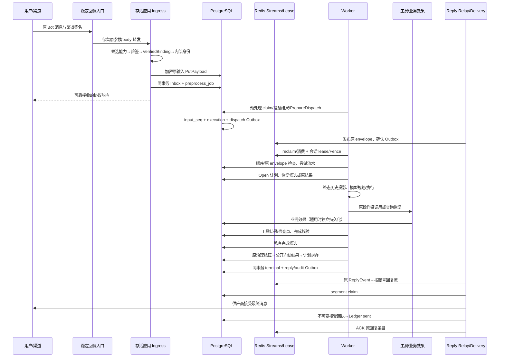

# 一条消息从接收到最终投递的完整数据链路

基线为 `0f53489`，迁移执行至 `000008_delivery_receipt`。本文以同一企业微信用户分别访问两个租户 Bot 为例，所有 ID 为说明符号，不是运行结果。字段逐项见 [DATABASE.md](DATABASE.md)，对象与接口见 [INTERFACES.md](INTERFACES.md)。

## 先固定六组身份

| 对象 | 组成 / 来源 | 在恢复中保护什么 |
|---|---|---|
| Bot Binding | 验签后的 tenant/app/binding/channel/account 及固定秘密引用 | 原输入归属、渠道身份及回送目标 |
| 外部消息键 | tenant + channel + external_account_id + external_message_id | 重复回调对应同一个原请求 |
| 内部用户/会话 | 租户身份/会话密钥的 HMAC，包含 channel/account 与用户或群坐标 | 不因换实例改变，也不把同用户访问两个账号混为一个会话 |
| 原请求 | StableInboxIdentity 派生的 request_id/payload_ref | 任一阶段恢复都继续该请求，不靠用户重新发消息 |
| 平台会话键 | tenant/app/session；input_seq 单调分配 | 同会话依次执行，不用消息到达某个容器的顺序代替持久顺序 |
| 回复键 | 原 request、input_seq、stage、ordinal 派生的逻辑 reply/delivery key，再加 segment_no | 区分最终回复、确认提示、流式更新与真正重复投递 |

SDK 的 app_name 为 tenant + `/` + agentApp，UserID/SessionID 映射到 SDK 原字段。两个 Bot 的 tenant、binding、外部账号、派生密钥作用域与实际 app 均须正确；模型自报身份或上游共用 API Key 不是隔离判据。身份密钥/会话密钥轮换若改变派生结果，会形成新用户/会话，不是“同会话自动恢复”；保留原版本是恢复依赖。

## 整体时序

图中多次数据库箭头不是一个总事务；Redis、SDK 事件、工具效果与渠道发送各有自己的边界。以下逐段说明任一位置退出后由谁负责。

## 逐步读写与崩溃后的责任

| 步骤 | 所属模块 / 输入 | 持久事实与写入边界 | 此刻退出后的动作 |
|---|---|---|---|
| 0. 启动 | 组合根、固定配置、密钥与共享依赖 | 迁移/引导内容先完成；运行实例使用独立 instance/process identity | 启动失败不能伪装 ready；不改任务归属来绕过配置错误 |
| 1. 路由候选 | Adapter.PublicRoute / ResolveCandidate | public route/locator/candidate 能力；还没有可信用户消息 | 不能仅凭 route_key 接受任意 tenant；重新进行协议验证 |
| 2. 协议验证 | AcquireVerifier → Adapter.Verify → PromoteVerified | 一次性验证回执与固定 Binding 身份 | 候选能力按状态/期限回收；未可靠接收的输入不在任务接管承诺内 |
| 3. 派生身份 | identity.Mapper.Map | HMAC 派生 u1_/s1_，不把实例 ID 加入会话身份 | 换节点用相同秘密版本得到同一坐标 |
| 4. 原内容写入 | ingress.Pipeline + PayloadStore | 先 PutPayload 加密原规范输入，tenant/request/ref/digest 幂等 | 可能只留下载荷而尚无可靠接收工作；此时不能把文件存在当作已可靠接收 |
| 5. 可靠接收 | ClaimInboxAndSchedule | 一次事务写/核对 Inbox 和 preprocess_job，原请求/路由相同 | HTTP 响应丢失后渠道重试仍命中原消息键；已接收原工作可回收 |
| 6. 预处理领取 | preprocess.Worker / ClaimJobs | 数据库 claim、attempt/version/owner/lease_until | lease 到期由存活实例领取，不能依赖死节点内存排队 |
| 7. 准备输入 | 文本校验或媒体下载、扫描、DLP、持久对象 | 原文本可沿原 payload；媒体 PutPreparedPayload 与附件引用持久化，再 FinishReady | 已有规范输入按摘要复用；不存在/错误的媒体不会以原 URL 直接交给 Worker |
| 8. 可靠派发准备 | ClaimReadyForDispatch → Dispatcher.PrepareDispatch | prepare_dispatch 固定 tenant/app/config/policy/预算，分配 input_seq，创建 execution 与 dispatch Outbox | 该事务之后可从数据库重建派发；重试不能再分配第二个输入序号 |
| 9. 发往执行队列 | DispatchRelay | 从 execution_record 重新加载 envelope，Outbox claim 后 XADD，最后确认发布 | XADD 成功但发布确认前退出，允许重复发布；数据库事实和执行幂等兜住重复 |
| 10. 消费与回收 | worker.Consumer / Redis consumer group | Redis PEL 保存投递责任；原 envelope 要再与数据库交叉核对 | 消费者退出、ReclaimIdle 达到后由新 consumer XAUTOCLAIM |
| 11. 会话执行资格 | LeaseManager + AtomicSessionStore | tenant/app/session lease；Fence 不低于 session_head.last_fence；OpenForRun 检查当前 input_seq | 后序输入持久停放/唤醒；旧 Fence 不得提交，不靠 readiness 认定执行者死亡 |
| 12. 尝试日志 | ExecutionAttemptStore / BeginExecutionAttempt | 同原请求尝试号、worker/Fence/状态流水 | 区分任务尝试、模型逻辑调用和 HTTP 尝试，不能用一次回复推断只执行过一次 |
| 13. 打开原任务 | taskflow.Store.Open / BindAcceptance / Recover | 固定 input_digest、key_version，提升 Fence；新任务冻结合同，恢复原工具证据 | 旧目标/步骤/预算不重置；unknown/manual 不能自报成功 |
| 14. 优先恢复完成事实 | recoverCompletion | 先私有 execution_completion，再旧公开 result；校验 envelope/PlanDigest/原治理/冻结字节 | 有候选不重跑模型；候选、结果或封存状态矛盾审计失败，不覆盖原证据 |
| 15. 构造本次上下文 | committedHistory + BufferedTurn | 最近最多100个原会话终态、原成功输入与精确公开结果；SDK 原事件仍独立保存 | 排除未提交草稿/被拒绝原输入；不能因原 SDK 事件存在就拼出错误历史 |
| 16. 进入新运行 | BeginAttempt / 原治理预约 / SDK runner | 原 StartedAt、尝试/停滞/期限；逻辑模型调用与 HTTP 尝试累计 | 超限收敛失败；不恢复模型生成中途的隐藏状态 |
| 17. 计划与工具前置 | task_checkpoint + GuardedCallable.BeforeTool | 先保存拓扑步骤、规范参数绑定、trusted_check/trusted_outputs，再申请原工具工作 | 没有绑定证据不能先执行；固定业务摘要不匹配时写入前拒绝 |
| 18. 确认（适用） | confirmation / grant / tool_attempt | 等待协调提交和提示 Outbox；用户决定与原 request/user/args/policy 绑定 | 重启后继续等待/沿原批准恢复，不再次消费已消费授权去盲写 |
| 19. 实际工具或恢复查询 | tool lease + RecoveryPolicy | replay_safe、原幂等键或可靠查询契约；业务效果在自己的系统持久化 | 未知效果优先查；pending/unknown 不降级为没执行；manual 安全停止 |
| 20. 工具完成事实 | GuardedCallable / DurableResults | 先基础断言、最终引用字段及适用的独立业务读回，再原子写 succeeded + 加密结果；随后 RecordTool | 效果已发生但结果未保存靠原恢复契约；结果已存但检查点未补，Recover 认证后补进度 |
| 21. 最终完成闸门 | ValidateFinal / OutputRenderer | 所有步骤和配置要求覆盖，检查实际渲染内容/真实引用；缺项记录 completion_issue | 不结算、不冻结错误新草稿；在原预算内补做，既有可信效果复用 |
| 22. 候选与治理 | saveCompletion / PreparedRunGuard | 准备审核/结算意图→保存私有候选→幂等原结算/决策 | 保存候选后故障，原 Permit/Usage/价格及输出可恢复；不新建预约 |
| 23. 公开结果与封存 | PutResult → SealFinal | 原 request/ref/type/digest 的不可变公开结果；Plan 固定 final_ref/final_digest | 接管核对候选/公开结果再继续；不把私有候选直接送给渠道 |
| 24. 平台终态提交 | commit_turn | 同事务幂等 session_commit、session_head 推进、execution 终态及 reply/audit Outbox | 唯一终态及原回复坐标保持；SDK 先前写入不能由该事务回滚 |
| 25. 回复队列 | ReplyRelay / ReplyRouteStore | 根据原 Inbox + execution 配置恢复 Binding/账号/用户/会话，发布原 ReplyEvent | XADD 与确认之间可重投；换节点仍向原目标发，不能用当前默认 Bot 替代 |
| 26. 分段领取 | delivery.Service | 冻结渲染/格式/整体摘要/分段数，逐 segment claim owner/version/client_request_id | 已 sent 只确认，failed 阻断后段；有效 claim 延后，过期 sending 转 ambiguous |
| 27. 供应商发送 | Adapter.Deliver | 外部渠道接受是外部事实，不能与本地 SQL 做原子事务 | 未分类/取消/失权/无结果保留 ambiguous，不当成明确未接受 |
| 28. 接受证据 | ProviderReceiptStore → FinishDelivery | 先不可变回执（含路由/计划/实际分段摘要），再 Ledger sent | 回执落库后中断：完整匹配只补 sent，不重发；回执前窗口须真实查询或外部证据 |
| 29. 队列确认 | delivery.Consumer ACK | 发送或持久终结后确认原 Redis 条目 | sent 后重复条目仍只确认；失败 ACK 不等价于用户得到完整答案 |

## 七个必须独立解释的事务

| 事务/原子单元 | 包含什么 | 不包含什么 |
|---|---|---|
| Inbox + 预处理任务 | 原消息去重与后续可回收工作 | 更早 PutPayload、模型执行、Redis |
| prepare_dispatch | 原执行快照、持久输入顺序、dispatch Outbox | Redis XADD/ACK |
| TaskPlan.Save | 当前密文、版本/合同标记、追加 checkpoint | 工具外部写入及 SDK 事件 |
| 工具 Complete | 工具 succeeded 与原加密结果 | 下游业务数据库/HTTP 写入、随后 Plan 更新 |
| 完成候选 Put | 原候选不可变、输入/计划/审核/用量绑定与写入资格 | 治理结算、公开结果和渠道发送 |
| commit_turn | 平台终态、会话推进和回复/审计 Outbox | 原 SDK 历史、原工具效果、私有候选/公开结果的较早写入 |
| 人工投递裁决 | Ledger CAS、处置证据与适用原 Outbox rearm | 渠道外部核验动作及客户端展示 |

数据库触发器为成功 terminal 检查已封存计划的原引用/Fence/写入契约；业务层还需校验密文内部目标、步骤、原结果及可信断言，不能以“触发器通过”代替所有业务检查。

## 一次故障的四种执行恢复入口

1. **只有接收/工作事实：** 回收预处理或 Redis pending，按原 request 顺序执行。
2. **已有可信工具结果：** 补检查点/复用证据；对未知效果按工具契约查询或安全终止，不改原参数/业务键。
3. **已有完成候选或公开冻结结果：** 认证原候选/审核/结算与结果，继续提交；跳过新模型机会，不重算账。
4. **已有 terminal 与待发回复：** 从原 Outbox/ReplyRoute/Ledger/Receipt 恢复投递，不重跑业务。

这些入口互相衔接，但不是“选一个看起来成功的记录”即可继续；相互矛盾时保留证据并失败。Cancelled/Denied/ConfirmationDenied 等终态不被新节点恢复成成功任务。

## 历史为什么能回忆而不夹带错误草稿

ListTerminalHistory 只按原 tenant/app/session、before input_seq 读取有序最近终态；要求前一输入已有终态、返回序列连续，不能发现缺口后假装历史为空。成功历史重新载入原规范输入并核对 user/session/request/seq、固定密钥和结果；被拒绝/取消的原输入不重新注入模型。失败可携带服务端明确的安全失败结果，其他终态使用明确状态说明。SDK 的模型草稿/工具轨迹仍可用于执行诊断，但不作为过去用户可见答案。

最多100个已提交输入是当前读取上限，不是无限记忆承诺；实际模型上下文与内容理解能力另有边界。服务端 terminal 成功也不证明渠道已送达，所以历史投影和投递证据必须分别解释。

## Redis 的精确协调对象

| 对象 | 实际键/算法 | 故障后的职责 |
|---|---|---|
| 会话 lease | `trpc:<environment>:{<SHA256(tenant NUL app NUL session)>}:lease` | 值包含 WorkerID、随机 LeaseID、Fence；续租/释放精确匹配 |
| 会话 fence | 同前缀 `:fence` | 在接管时单调分配，并以数据库 last_fence 修复较低计数 |
| dispatch stream | `trpc:{<environment>}:<shard>:dispatch` | 当前4分片；ShardForSession 用 FNV-1a32(tenant NUL app NUL session) mod shardCount；PEL 可回收 |
| reply stream | `trpc:{<environment>}:reply:<前16字节SHA256的hex>` | 摘要输入 tenant/channel/binding/account，以 NUL 分隔；不把两个租户的账号流合并 |
| wakeup | `trpc:{<environment>}:wakeup` | 推进因顺序而停放的原请求，不重新产生输入 |
| tenant-control / execution-control | 同环境下对应流 | 持久控制事实的提示传递；数据库取消/版本状态仍权威 |

不同 Redis Hash Tag 和 PostgreSQL 之间不是一个事务。Redis 全丢与单应用节点退出是不同故障：仅有数据库 Outbox 并不自动证明所有已 ACK/已发布队列条目都能在任意 Redis 灾难中重建。该范围不能扩展为 Redis/数据库整体容灾承诺。

## 分段投递的动作矩阵

| 观察状态 | 动作 | 是否再次调用渠道 |
|---|---|---|
| sent 且适用回执一致 | 跳过本段，最终 ACK | 否 |
| failed | 返回持久终结错误，停止后段 | 否 |
| 有效 sending / 尚未到期 retry_wait | 延后，保留原条目 | 否 |
| 过期 sending | 原子转 ambiguous，再进入核对 | 不直接重发 |
| ambiguous + 匹配回执 | 校验 tenant/key/segment/client/plan/route/真实字节后补 sent | 否 |
| ambiguous + 查不到本地回执 + 可靠渠道结果已送 | 记录原 Provider ID 并确认 | 否 |
| ambiguous + 可靠渠道证明未接受 | 按原键转 retry_wait | 可依原协议重试 |
| ambiguous + 无查询/未知/读取失败 | 延后核对；耗尽 failed/reconcile_exhausted，等待外部证据处置 | 否 |

PutProviderReceipt 对 sending、版本、owner、client_request_id 与未过期 claim 取锁核验；FinishDelivery 的核心保护为当前状态、owner/client/version CAS，不能笼统说它也在同一位置执行完全相同的租期条件。新 owner 接管一旦推进版本，旧 owner 不能覆盖。回执不可变/错误证据冲突和外部协议仍是保证的一部分。

## 最小证据链与计数

按原 tenant/binding/session/external_message_id → request/input_seq → attempts/worker/fence → plan/version/checkpoint → tool operation/args/result/business key → candidate/result/commit → Outbox → delivery_key/segment/client/provider/receipt 关联。模型逻辑调用、模型 HTTP 请求尝试、Worker 尝试、工具执行尝试、实际业务效果、逻辑 reply、发送尝试和客户端可见最终答案必须分别统计。流式占位、确认提示与最终答案不可混为一次“最终回复”。

管理查询不替代外部事实：incident 的 SQL snapshot 内部同一观察点，解密检查点为独立读取；records 分页每页独立、按不可变主键前进，状态变化不导致重排，但并发插入可能落在已遍历范围。长任务诊断不等于一次全历史一致导出。

## 本地模式的真实故障域

当前 WeCom 是 HTTP callback，不存在迁移 Bot WebSocket 主连接的实现。稳定入口负责把新回调转给 ready 后端；多个应用实例可并行运行各账号流的 consumer，由 Redis consumer group 和逐段 Ledger claim 协调，不能把一个 Consumer 对象叫作全局独占 Bot 主连接。单机多容器保护应用进程/容器故障；同机电源、内核、Docker daemon、共享 PG/Redis、唯一入口与外部供应商故障分别有自己的边界。

## 容易混淆的两个当前实现细节

- 正常成功 terminal 更新 execution_record/session_commit/session_head，不要求把 Inbox 也改为 terminal。正常 Inbox 可以保持 dispatch_ready；不能以 Inbox.state 代替任务最终 outcome。
- 当前 WeCom 的 external_account_id 使用 CorpID，AgentID 属于固定验证/发送材料。同一 Corp 下不同 Agent 可属于两个不同租户 Binding；不能要求两 Bot 的 CorpID 必须不同，或只比较 CorpID 就判断租户隔离。

## 可复现的稳定键算法

`LP4(x)` 表示4字节大端的UTF-8字节长度加原字节；`LP8(x)` 为8字节大端长度加原字节。不能将这些算法简化成没有分隔/长度的字符串拼接。实现见 messaging/messaging.go 与 channels/identity/identity.go。

| 标识 | 实际算法 |
|---|---|
| 原 request_id | SHA256(LP4(tenant)+LP4(channel)+LP4(account)+LP4(external_message_id)) 的前16字节hex，加 req_ 前缀 |
| 原 payload_ref | inbound:// + tenant + / + request_id |
| 逻辑 reply key | SHA256 对 tenant/request/input_seq十进制/stage/ordinal十进制依次LP4编码，完整摘要RawURLBase64，加r1_前缀 |
| 分段 client_request_id | SHA256 对 tenant/delivery_key/segment_no十进制依次LP4编码，完整摘要RawURLBase64，加d1_前缀 |
| 内部 user_id | 租户身份密钥HMAC-SHA256，对 identity-v1/channel/account/external_user 依次LP8编码，RawURLBase64，加u1_前缀 |
| 内部 session_id（单聊） | 租户会话密钥HMAC-SHA256，对 session-v1/channel/account/dm/external_user 依次LP8编码，RawURLBase64，加s1_前缀 |
| 内部 session_id（群聊） | 同上，dm/user改为group/external_chat；缺群ID拒绝 |
| 普通工具操作 ID | JSON字符串数组 [tenant,request,toolID,toolVersion十进制,canonicalArgsDigest] 的SHA256全hex，加op_前缀 |
| 确认工具操作 ID | 沿原批准的ToolCallID；授权、工具版本、原参数和用户必须一致，不重建模型call ID替代 |
| 笔记业务键 | SHA256(tenant NUL request NUL tool_call_id NUL args_digest)的全hex；note_id为note_加该键前24字符 |

同一原输入可以包含多个合法工具操作/确认授权；效果去重的粒度是原业务操作键，不把所有输入中的全部工具调用都归为同一效果。普通同参数工具操作会稳定收敛，刻意区分的业务效果必须有自己的明确业务身份/授权，不能用换键掩盖一次未知效果。

## 预算、已完成事实和跨系统资格的限定

任务年龄/尝试预算约束新的模型运行与未完成任务的继续执行，不是渠道最终可见的硬时限。已持久完成候选/冻结答案优先沿原恢复分支续提交和发送，不为了重新开始预算而丢弃已完成结果。所有恢复分支仍核对取消、原版本、计划证据和当前写入资格。

Fence保护资源已经接受的单调执行代次，session_head.last_fence是数据库已接受的高水位；不能把Redis过期解释为外部系统已经回滚或撤销某个旧HTTP请求。旧owner的资格/版本和外部业务幂等必须各自核对。数据库写入契约标记可防不参与checkpoint版本更新的旧写入者，不能证明所有同标记旧二进制都理解新加密JSON字段，因此仍要求版本一致并按发布门禁排空旧执行者。
