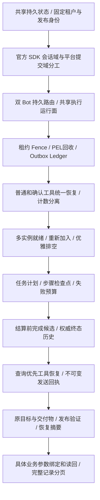

# 三项能力的实现演进与当前落点

本文依据可核对的 Git 提交、迁移和当前源码整理。代码阅读基线为 `0f53489`；本次文档修改不改变运行实现。提交短 SHA 可用 `git show <SHA>` 查看，标题不是验收结果。`000001_service_schema` 已合并过早期迁移历史，因此迁移序号不等于项目最初开发顺序，也不能把整个 000001 当成一次新功能提交。

## 演进地图

三个能力一直共用同一条消息链。后续增量解决的是原链路中未被覆盖的故障窗口、错误语义或业务完成标准；不能把某个早期里程碑的保证当成最新全部保证，也不能把现在的保证反写成早期版本已具备。

## 逐阶段的缺口、改动和证据

| 阶段 | 当时要解决的问题 | 可核对提交 / 迁移 | 当前留下的权威机制 | 对应能力 |
|---|---|---|---|---|
| 共享数据库基础 | 配置、输入、会话提交和待发布事实若仅驻内存，换节点无法继续 | `10c22c1`、`1db3362` 等历史压缩；当前 000001 | tenant/app/config/policy、Inbox、执行、session_head/commit、Outbox/Ledger 等基础模式 | 全部 |
| 官方 SDK 会话接入 | 应用自己复制历史会形成多个不一致权威域 | `cb66905`、`f1cdd2c` | 官方 session/postgres；app_name 编入 tenant/app；平台管理提交/顺序，SDK 管原事件 | 会话 |
| 收敛到三项能力 | 验证与运行范围需要落在同一套节点/数据环境 | `b83bdeb`、`d48872b` | 三个 feature 文档与同一共享运行面，其他历史模块不成为额外项目承诺 | 全部 |
| 双 Bot 固定归属 | 单 Bot 可用不能证明两租户并发接管不串扰 | `335f4a3`、`306e2cc` | 主/次 Bot 不同 tenant/app/binding/秘密作用域，原账号与路由持久化 | 会话/多实例 |
| 计数持久化 | 模型重试、HTTP重试和用户回复混成一个数字 | `7fd3fda`、`b3fc705` | execution_record 中逻辑调用与 transport 尝试分计数，后续增加 Worker 尝试流水 | 在途 |
| 工具原操作恢复 | 效果已发生、内存结果丢失时不能直接重做 | `2704448`；000002 | tool_execution，原稳定业务键、工具租约/Fence 和恢复策略 | 在途 |
| 业务就绪及异常裁决 | HTTP 活着不等于 Worker/Delivery 能工作；未知投递不能靠人工猜 | `64c3486`；000003 | 真实组件就绪、租约观察、带版本与证据的 delivery_resolution | 多实例/在途 |
| 普通与确认工具统一 | 只有 ask 工具受保护会遗漏普通 allow 工具；授权与重试次数容易混淆 | `e3b90f2`；000004 | execution_attempt、tool_execution_result、真实 local_note、allow/ask 共用 durable Guard | 在途 |
| P2/P4 精确命中 | 发送前暂停不能证明“下游已接受”窗口 | `e3b90f2` | 模型请求真实阶段、供应商接受后的 barrier；保留旧点但另名 | 在途 |
| 多实例生命周期 | 单次强杀能接管不代表重新加入、反向故障和停止时无振荡 | `9270cc4` | instance/process 身份、私有本地状态、真实 ready、入口恢复阈值和 bounded drain | 多实例 |
| 持久任务计划 | 原消息能重试不代表能理解已完成步骤与剩余业务义务 | `81c681e`；000005 | task_plan/checkpoint、步骤依赖、原工具绑定、成功终态封存门禁 | 在途 |
| 任务失败收敛 | 模型反复不推进或没有计划，可能永久重试 | `cbf5dfa`；000006 | RequirePlan、可信检查、持久尝试/停滞/期限、failed 计划与稳定失败回复 | 在途 |
| 治理结算前的完成候选 | 预约已结算但答案未公开时，重新 Begin 会失败；重生成也会改变原审核 | `286ed39`；000007 | execution_completion，加密保存输出及原 Permit/Usage/Finalization，重放原结算 | 在途 |
| 权威终态历史 | 最高 Fence 的 SDK 事件可能仍是草稿/被拒绝答案 | `286ed39`、`92c6edd` | session_commit + 原成功输入 + 精确冻结结果构造历史，校验序列连续 | 会话/在途 |
| 工具查询优先 | 供应商有原操作查询时，应先确认事实而非先调用写接口 | `7e527cc` | RecoveryLookup completed/not_found/pending/failed/unknown；原键安全恢复、精确 JSON 数字 | 在途 |
| 发送接受证据 | 渠道已返回成功、Ledger 尚未 sent 时仍缺可自动确认的本地证据 | `5cb8513`；000008 | 不可变 delivery_receipt，路由/计划/真实分段字节摘要，匹配后只补 sent | 在途/会话 |
| 冻结原目标与交付物 | 步骤全部完成仍可能遗漏原任务的一部分要求 | `5f56ecf` | Acceptance/Requirement、步骤覆盖、实际输出与回执引用、completion_issue/final_digest | 在途 |
| 发布和恢复解释 | 配置可写不代表工具存在/可验证；恢复上下文与问题定位需结构化 | `d29bd29` | 发布前精确强制工具及可信断言校验、recovery_summary、原任务 incident 查询 | 在途/多实例 |
| 具体业务闭环 | 只有工具回执不够，须核对实际持久效果和用户原参数 | `0f53489` | `/note` 明确命令、args_digest、独立读回、trusted_outputs、真实编号校验 | 在途 |
| 长任务记录完整读取 | 有界 incident 只能显示100条，不能把截断当完整历史 | `0f53489` | 原 tenant/request/kind 绑定的稳定主键游标分页；每页独立观察 | 在途/运维 |

## 从数据库增量看责任怎样补齐

| 迁移 | 新增 / 改动 | 它解决的故障窗口 | 不负责的边界 |
|---|---|---|---|
| 000001 | 压缩基础模式、受控函数、平台与官方 SDK 域 | 原输入、顺序、提交和待发事实可跨节点读取 | 外部效果/模型内部状态、所有供应商交付 |
| 000002 | tool_execution | 工具开始后退出可知道原操作与恢复策略 | 单靠本表不能知道外部是否已写成功 |
| 000003 | delivery_resolution | 不确定投递有版本化审计裁决入口 | 证据必须来自真实外部事实 |
| 000004 | execution_attempt、tool_execution_result、local_note、模型请求尝试字段 | 原工具结果、实际效果和执行计数可以独立核对 | 其他业务仍需各自幂等/查询契约 |
| 000005 | task_plan、task_checkpoint、成功终态计划门禁 | 重试可理解原计划、步骤及完成证据 | 不自动暂停/恢复任意进程栈 |
| 000006 | admission_version/checkpoint_version/verified_steps，failed phase 与约束 | 防旧参与写入者丢合同；预算失败可持久收敛 | 不能让完全不了解新合同的旧应用任意混跑 |
| 000007 | execution_completion | 审核/结算/公开结果之间中断可复用原答案 | 不是用户可直接投递的结果表 |
| 000008 | delivery_receipt | 接受回执已保存、Ledger尚未确认 | 接受响应尚未落库的 P4 剩余窗口 |

后续原目标、必需交付物、业务参数和工具最终引用保存在已有加密 Plan/Checkpoint，未增加 000009。字段进入 PlanDigest 或最终内容摘要的方式见[数据链路](END-TO-END-DATA-FLOW.md)及[对象合同](INTERFACES.md)。

## 能力一的实现历程如何阅读

最早的基础是相同租户/应用/会话键能读取共享存储；随后让渠道身份与回送目标固定到原输入，确保两个 Bot 不混。官方 SDK 接入后，原事件与平台提交分域；后续发现“历史有记录”仍不等于“模型应把它当作过去已成功回答”，因此增加了终态历史投影。现在换节点读取的是原会话已提交事实，而不是死进程内存或最高 Fence 的草稿。

完整顺序：可信 Binding → 稳定身份 → 原消息去重 → 顺序闸门 → 原版本 SDK 会话 → 权威终态历史 → 新输入执行 → 原回复目标。处理旧在途输入的动作由能力二继续解释，不能用新输入成功代替旧输入完成。

## 能力二的实现历程如何阅读

最早由 Inbox/Outbox、lease/Fence、Redis reclaim 和 Delivery Ledger 保住工作与终态；工具策略使“安全”不等于“任何操作都自动重做”。普通/确认工具统一后，进一步保存计划、步骤与证据，增加总预算和失败收敛，再用完成候选补齐治理窗口，用发送回执补齐 P4 的一部分窗口。最后把业务目标、原参数、读回和最终编号校验接到实际笔记场景。

当前恢复单位可以是原预处理工作、原执行尝试、一个工具操作、一个完成候选或一个回复分段；不是恢复模型内部 token 生成或任何工具的本地函数栈。缺少可靠外部查询时保留未知事实，是安全状态而不是成功完成。

## 能力三的实现历程如何阅读

基础共享状态允许节点更换，但实例身份、本地文件、入口和健康还需隔离。双实例运行后补充了进程启动代次，避免复用节点名继承旧 owner；组合根给每个角色命名，Compose 隔离 root/tmp，技能目录按不可变版本共享。稳定 callback 入口按实际 ready 摘除故障后端，并通过恢复阈值控制重新加入。计划停止则先停接新工作、保留活动 context 完成有限排空，强杀仍依赖持久回收。

当前 WeCom 是 HTTP callback 模式。连接稳定性指入口/backend/consumer 及相关网络运行稳定，不是实现了一个不存在的 Bot WebSocket 主连接选举。唯一稳定入口和同机共享依赖各有自己的故障域，不能由应用实例接管推导整机高可用。

## 为什么必须同时保留历史和当前说明

- 历史用于解释某张表/接口为何被引入，以及旧版本怎样升级；不能拿早期方案覆盖当前字段/状态约束。
- 当前字段只按迁移至000008解释，CREATE最初声明后的 ADD/DROP 约束须合并看。
- 代码存在、单元回归、真实供应商行为、真实故障演练是不同证据层；本文不写未执行的部署通过结论。
- 当需要复现某个历史版本时应 checkout 对应提交及当时迁移/配置；当前文档不是所有历史提交都可直接使用的通用说明。
