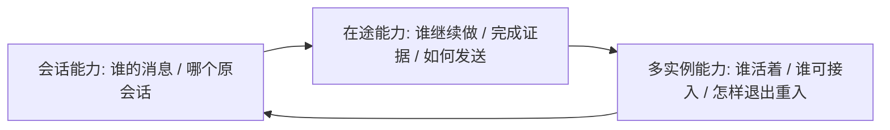

# 三项可靠性能力：完整实现文档

**代码基线：`0f53489`，数据库迁移至 `000008_delivery_receipt`，SDK 以 go.mod 中 v1.11.2 为准。** 文档描述已存在的代码及其前提，不将未执行的真实部署/供应商故障验收写成通过结论。

## 从哪里开始

| 要回答的问题 | 连贯阅读入口 |
|---|---|
| 这三个能力究竟保护什么、边界是什么 | 各能力 OVERVIEW；见下方文档地图 |
| 想先读懂每项能力的完整工作过程 | 三篇 FULL-GUIDE 的“连贯讲解”：原会话续聊故事、创建笔记长任务、双实例生命周期，先理解因果再查字段 |
| 从最初持久化到现在，为什么一层层补成这样 | [实现历程](IMPLEMENTATION-HISTORY.md)，按真实提交/迁移解释缺口和演进 |
| 一条消息从入口到最终答案，每一步由谁负责 | [完整数据链路](END-TO-END-DATA-FLOW.md)，30个阶段、7类独立事务和各故障分支 |
| 所有相关表、字段、默认值、主外键与索引 | [数据库字典](DATABASE.md)，65张相关表、789个字段，合并后续 ALTER 后解释 |
| HTTP参数、内部接口、加密对象、配置与启动顺序 | [接口与配置](INTERFACES.md)，实际挂载入口、58个相关 Go 合同、80个关键对象逐字段说明 |
| 想核对某个不变量的真实代码/DDL | 各能力 design / CODE-APPENDIX / REFERENCE-IMPLEMENTATION |
| 怎样判断成功、失败、未知和人工处置 | 各能力 testing-and-acceptance / release-and-operations |

数据库字典和接口册是三个能力共用的 L3 参考，避免同一张表在三个目录出现三种定义；每个能力的 design 给出自己使用的字段/状态含义。原 L1–L4 文件结构保留。

## 三项能力的当前范围

| 能力 | 已落入代码的主链路 | 保留的前提与边界 |
|---|---|---|
| [故障恢复后继续对话](conversation-continuity/README.md) | 可信 Bot Binding、稳定 tenant/user/session、Inbox 原消息链、平台顺序与 SDK 状态分工、权威终态历史、原回复路由 | 共享依赖/原配置密钥可用；最多100个输入终态的读取窗口，不承诺任意模型无限/完全记忆 |
| [在途任务接管与幂等投递](inflight-task-takeover/README.md) | 原请求回收、lease/Fence、任务计划/预算/检查点、可信工具结果/业务读回、完成候选、终态/Outbox、分段 Ledger/回执与处置 | 工具/渠道的外部效果需真实幂等或查询契约；未知不能谎报成功；P4 接受到回执落库前仍有协议边界 |
| [单主机多容器高可用](single-host-multicontainer/README.md) | 共享数据库/队列、实例与启动身份、私有本地状态、稳定 callback 入口、业务 ready、强杀回收、重加入、反向故障、有限排空 | 应用实例故障域；同机断电/内核/Docker/共享PG或Redis/唯一入口整体故障不由双应用副本消除 |

当前 WeCom 是 **HTTP callback + 官方发送 API**。没有迁移 Bot WebSocket 主连接的实现；入口转发、Worker 会话 lease 和 Delivery segment claim 分别控制自己的责任。两个 Bot 属于不同租户与绑定，存活应用实例须能处理两者，不能用两个互不共享业务状态的完整环境替代接管。

## 各能力 L1–L4 文档地图

| 级别 / 文件 | 会话连续性 | 在途任务 | 单机多容器 | 内容职责 |
|---|---|---|---|---|
| 导航 README | [入口](conversation-continuity/README.md) | [入口](inflight-task-takeover/README.md) | [入口](single-host-multicontainer/README.md) | 范围、角色与A1–A20问题定位 |
| 当前基线 CURRENT-IMPLEMENTATION | [基线](conversation-continuity/CURRENT-IMPLEMENTATION.md) | [基线](inflight-task-takeover/CURRENT-IMPLEMENTATION.md) | [基线](single-host-multicontainer/CURRENT-IMPLEMENTATION.md) | 当前代码状态，禁止把旧里程碑当最新结论 |
| L1 OVERVIEW | [概念](conversation-continuity/OVERVIEW.md) | [概念](inflight-task-takeover/OVERVIEW.md) | [概念](single-host-multicontainer/OVERVIEW.md) | 场景、承诺、数字和不包含项 |
| L2 FULL-GUIDE | [机制](conversation-continuity/FULL-GUIDE.md) | [机制](inflight-task-takeover/FULL-GUIDE.md) | [机制](single-host-multicontainer/FULL-GUIDE.md) | 演进因果、故障瞬间、为什么单做某一层不够 |
| L2→L3 design | [设计](conversation-continuity/design.md) | [设计](inflight-task-takeover/design.md) | [设计](single-host-multicontainer/design.md) | 本能力模型、真实字段、状态/竞态和不变量 |
| L3 implementation-walkthrough | [运行走读](conversation-continuity/implementation-walkthrough.md) | [运行走读](inflight-task-takeover/implementation-walkthrough.md) | [运行走读](single-host-multicontainer/implementation-walkthrough.md) | 按运行时顺序追 durable truth 与 kill 后动作 |
| L3 CODE-APPENDIX | [代码证据](conversation-continuity/CODE-APPENDIX.md) | [代码证据](inflight-task-takeover/CODE-APPENDIX.md) | [代码证据](single-host-multicontainer/CODE-APPENDIX.md) | 真实代码、状态变化及故障意义 |
| L3 REFERENCE-IMPLEMENTATION | [精确契约](conversation-continuity/REFERENCE-IMPLEMENTATION.md) | [精确契约](inflight-task-takeover/REFERENCE-IMPLEMENTATION.md) | [精确契约](single-host-multicontainer/REFERENCE-IMPLEMENTATION.md) | 原DDL、接口算法、参数与启动依赖 |
| L4 testing-and-acceptance | [判据](conversation-continuity/testing-and-acceptance.md) | [判据](inflight-task-takeover/testing-and-acceptance.md) | [判据](single-host-multicontainer/testing-and-acceptance.md) | 故障窗口、证据、反例与独立验收规则 |
| L4 release-and-operations | [运维](conversation-continuity/release-and-operations.md) | [运维](inflight-task-takeover/release-and-operations.md) | [运维](single-host-multicontainer/release-and-operations.md) | 迁移/发布/兼容/回滚与分场景处置 |

建议实现者先通读本能力 OVERVIEW → FULL-GUIDE 的演进和连贯讲解 → 共享完整数据链路 → design + 数据库/接口册 → 运行走读，怀疑某项不变量时再查源码附录和精确DDL。三篇连贯讲解分别串起身份到原路由回复、原任务到可信完成与投递、实例启动到故障与重新加入；后续专题提供更细的竞争和反例。验收者在L1边界之后直接读L4，但必须保留 request/Fence/结果/渠道证据链。

## 同一条链上的三项职责

当前数据边界不是一个总事务：先加密原载荷，再同事务建立 Inbox/预处理工作；prepare_dispatch 固定原执行与派发 Outbox；工具结果与业务效果分别处理；SDK 原事件可先于平台终态写入；完成候选先于结算；terminal 与回复 Outbox 同事务；最后才对外发送并保存接受回执。每个交接点都由自己的状态、幂等键和恢复协议负责。

## 计数与“成功”的层次

| 观察量 | 权威来源 | 不可推导的结论 |
|---|---|---|
| Worker 尝试 | execution_attempt | completed 只表示执行器正常返回，不必然代表业务成功 |
| 模型逻辑调用 | execution_record.model_call_count | 不代表只发一次供应商 HTTP 请求 |
| 模型 HTTP 尝试 | model_request_count | 不等于供应商接受/计费次数 |
| 工具尝试与业务效果 | tool_execution.attempt / 原业务键实际记录 | 多次尝试不等于多个效果，也不能仅凭账本证明未知业务没写入 |
| 原有效终态 | session_commit + session_head | 不代表渠道已经送达 |
| 逻辑回复与分段 | reply coordinate / delivery_key / segment | 多个合法段不等于多条重复最终答案 |
| 发送与接受 | Ledger attempt/state / ProviderReceipt | 本地 sent 或 Provider ID 不单独证明客户端只显示一次 |
| 用户可见最终回复 | 真实客户端及可关联渠道证据 | 不以流式占位或后续新消息成功替代原消息完成 |

## 验证入口与文档维护

- 代码回归源及最小证据闭环见各L4文件；真实故障脚本位于 [scripts/e2e](../../../scripts/e2e)。本文不运行或记录实际容器/渠道通过结果。
- 单位/时间口径、TTL、默认预算、实际端口和启用条件统一在 [接口与配置](INTERFACES.md#环境配置与固定运行参数)；它们不是确定RTO或容量保证。
- 阅读/审查继续按 [四级深度与20角度](DOCUMENTATION-METHOD.md)。数据库字段须按当前迁移全部ALTER合并；加密JSON和Redis键也属于数据模型。
- 增量实现要同步其字段/状态/接口/数据链路/故障动作及边界；历史只进入演进表，当前基线不要堆成多段没有时间坐标的“本轮新增”。
