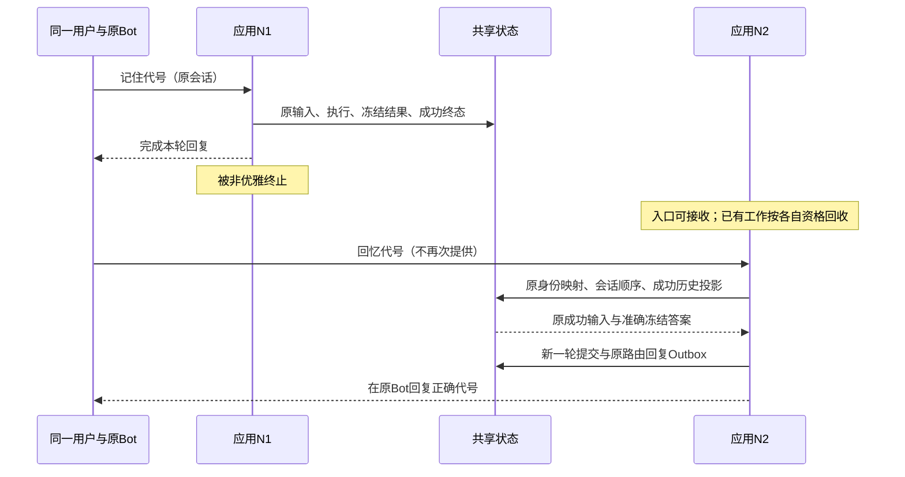
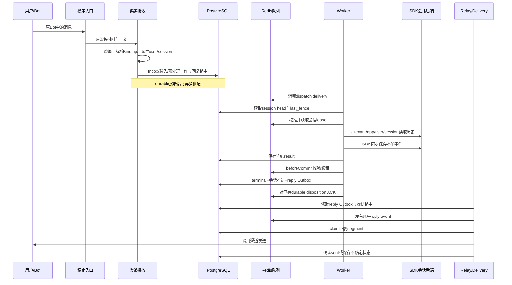

# 故障恢复后继续对话 — 完整实现说明

## 从基础持久化到当前续聊：演进主线

| 阶段 | 新增的因果环节 | 代码/提交落点 |
|---|---|---|
| 共享会话可读 | 先把租户、原输入、顺序及提交事实持久化，进程退出不丢恢复依据 | 000001；session_head/commit、Inbox/Outbox |
| SDK状态分域 | 固定SDK app_name=tenant/app，不用平台自造的事件表替代官方会话 | f1cdd2c；session/postgres/official.go |
| 两Bot归属 | 主/次Bot使用不同tenant/app/binding和秘密作用域，回复回原输入目的地 | 306e2cc；组合根与ReplyRoute |
| 原任务与候选可恢复 | 旧输入可回收、工具/候选可复用，后续输入不能越序 | 000002..000007；Consumer、Runner、Completion |
| 历史真正可用 | 用原成功输入与终态固定答案组成读取投影，排除失败草稿和不完整重试 | 286ed39、92c6edd；terminal_history.go/history.go |
| 回复确认可续办 | 已接受回执独立保存，接管只补确认；剩余窗口保留协议边界 | 5cb8513；000008、delivery.Service |

完整提交轨迹见[实现历程](../IMPLEMENTATION-HISTORY.md)。本能力的从头到尾顺序是：验证绑定→派生身份→可靠接收→输入顺序→会话执行资格→终态历史→处理新输入→原回复目标。全部事务和故障点见[30阶段数据链路](../END-TO-END-DATA-FLOW.md)；下文继续展开机制及反例。


## 连贯讲解：用户为什么能在换节点后继续原会话

### 1. 先把用户看到的故事和服务器事实分开

同一个企业微信用户先对 Bot A 说“记住代号 A”，再对 Bot B 说“记住代号 B”。两边都完成回复后，处理业务的 N1 被强杀。用户没有换 Bot，也没有重新提供代号，接着问“刚才的代号是什么”。目标是让存活的 N2 给出各自正确的回答。

这个故事并不要求 N2 恢复 N1 的内存。它要求 N2 能回答四个问题：**这是谁的输入、属于哪段会话、哪些过去回答已经成立、这次结果应发给谁**。数据库保存这些事实，稳定的身份算法让新进程重新找到它们，执行与投递协议则让新进程有资格继续工作。

两个 Bot 可以属于同一个企业、使用相同 CorpID；WeCom 的 `external_account_id` 不能被误解成天然区分所有 Agent 的键。隔离依赖可信 Binding、独立 tenant/app 和秘密作用域等完整约束，不能只比较 CorpID，也不能听模型自报“我属于租户 A”。

### 2. 第一层：先证明消息从哪个 Bot 来，再分配内部身份

公开回调地址中的路由信息只帮助服务找到候选配置。入口按 `PublicRoute → ResolveCandidate → AcquireVerifier → Verify → PromoteVerified` 验证渠道签名，得到可信 Binding 后，才接受其中的 tenant、app、账号和配置版本。正文里写“切换到租户 B”不能替换这些身份。

`identity.Mapper.Map` 使用租户作用域的身份密钥与会话密钥派生内部标识。用户身份和会话身份分开计算；单聊会话包含渠道、账号、`dm`、外部用户，群聊会话包含渠道、账号、`group`、外部群。字段使用长度前缀编码，再做 HMAC，避免不同字段拼接成相同字节。

因此 N1 与 N2 在相同秘密和输入下得到相同的 `user_id`、`session_id`。实例名、容器名、启动时间均不参与派生。若把实例名拼进 session，故障后即使历史完整，新节点也会查到另一个会话；若省略租户秘密作用域，同用户访问两个 Bot 又可能被错误合并。

| 本次必须保持的坐标 | 稳定依据 | 换节点后重新取得的内容 |
|---|---|---|
| tenant/app/binding | 验签与固定配置版本 | 原 Bot 的可信归属，不从聊天正文推断 |
| user/session | 相同 HMAC 算法、密钥与渠道坐标 | 原内部用户和会话，不创建“故障专用会话” |
| request | 原渠道消息唯一键；新消息则派生新 request | 区分回调重传与用户下一次提问 |
| SDK 会话键 | `app_name=tenant/app` 加 SDK 的 user/session | 正确后端中的同一命名空间 |
| reply 目标 | 原 Inbox、execution 与原配置 Binding | 原账号、用户或群，不选当前默认 Bot |

### 3. 第二层：可靠接收意味着已留下可推进的工作

入口先用 `PutPayload` 保存原规范输入，再以 `ClaimInboxAndSchedule` 的一个事务写入或核对 Inbox 与 `preprocess_job`。这两步不是同一个事务：如果只有 payload 而没有后续工作，不能宣称已可靠接收。反过来，一旦 Inbox 和预处理工作提交，应用响应丢失也不应该让用户创建第二份任务。

渠道重传时，tenant、channel、external account、external message 构成的唯一键命中原请求；预处理者根据持久工作重新领取。它准备文本或处理媒体，再由 `prepare_dispatch` 固定配置、输入摘要、预算和执行信息，分配一次 `input_seq`，同时写派发 Outbox。Relay 可重复发布，但不能重复分配业务序号。

这里保护的不只是文本。“代号 A”必须始终与 A 的 tenant、原会话、原请求及回复目标一起保存。如果只把文本放进共享库，恢复时临时选择一个 Bot 发回，仍然会串扰。

### 4. 第三层：先确定这一轮能否执行，再决定读哪份历史

Worker 从 Redis 取到工作后，不立刻调用模型。它核对数据库中的权威 envelope，取得 tenant/app/session 维度的 lease，并以 Fence、会话版本、`input_seq` 检查执行顺序。数据库的 `last_fence` 是已经接受的提交水位；Redis 计数需要先校准到至少该水位，避免依赖重建后倒退。

假设“记住代号”是序号 7，“回忆代号”是序号 8。即使序号 8 先到某个 Worker，也不能绕过尚未终结的 7；后序任务可以持久停放、等待唤醒。这样模型不会在前一轮尚无确定结果时错误构造下一轮历史。另一个租户或另一个会话仍可并行，不需要全系统串行。

lease 限制当前竞争，数据库提交条件拒绝失权者的迟到写。N1 暂停后苏醒并不自动恢复原资格；它即使拿到一个模型回答，也不能覆盖 N2 已接受的较新终态。外部工具是否已产生效果还要由工具协议判断，Fence 本身不能撤销远端写入。

### 5. 第四层：历史必须是已成立的对话，而非所有尝试的混合

官方 SDK 的会话后端同步保存事件与状态，平台的 `session_head`、`session_commit` 负责顺序和提交裁决；二者不在同一个总事务里。SDK 曾保存一个“成功”草稿，不能单独证明平台已经接受该回答；新尝试的 Fence 更高，也不能证明它比旧尝试更正确。

当前 `RunnerExecutor.committedHistory` 按平台终态定位过去轮次，读取原成功输入和终态所引用的冻结结果，核对身份与摘要后构造模型读取投影。投影不修改原始 SDK 事件，也不伪造“没有发生过重试”。它只是明确告诉下一轮：哪些过去输入与答案可以作为已经成立的对话使用。

| 过去轮次的事实 | 下一轮应看到什么 | 为什么 |
|---|---|---|
| 原输入成功且 terminal 指向冻结结果 | 原成功输入及该准确答案 | 把用户真正完成的一轮保留下来 |
| 模型写过草稿，尚无成功 terminal | 不能当成过去成功回答 | 生成过不等于提交成功 |
| 拒绝或取消 | 明确状态；不重新注入未经允许的原始输入 | 防止把未通过内容治理的信息带回历史 |
| 安全失败且有允许展示的结果 | 按失败语义展示安全结果 | 不把失败前的成功宣称当事实 |
| 窗口内必需的终态记录或引用缺失 | 中止本轮构造并保留错误 | 空历史继续生成会把数据问题伪装成忘记上下文 |

当前最多读取最近 100 个终结输入，不提供无限记忆保证。数据库存在代号、投影包含代号、实际模型使用代号是三个不同事实；真实长会话还受模型上下文窗口影响。密钥、SDK backend、app 命名空间与历史保留策略均属于连续性依赖。

### 6. 第五层：把“记住”落成终态，把“回复”落成待办

模型完成当前轮次后，成功路径先完成证据检查及结果冻结，再调用终态提交。`commit_turn` 在一个数据库事务中推进会话头、写 `session_commit`、更新执行结果并生成 reply/audit Outbox。它防止“任务标为完成，却没有留下回复责任”的窗口。

正常成功提交不要求 Inbox 随之变成某个 terminal 状态；Inbox 可能仍是 `dispatch_ready`。判断任务是否完成，要看 execution 与 session_commit，不能仅凭 Inbox 状态重跑模型。SDK 事件保存、结果冻结、终态事务和渠道发送仍是不同边界，不能把一个表的状态解释成整条链路已完成。

回复 Relay 根据原请求与原 Binding 解析路由，Delivery 按逻辑回复及 segment 领取发送资格。已经确认发送的分段只补 ACK，不因换实例再发一次；发送不确定则读取回执或按渠道契约核对。WeCom 当前缺少可靠的请求级去重/查询，无法确认的 P4 窗口需要保留可审计处置，不能通过盲发换取表面完成。

### 7. 把 N1 强杀放回整条故事



这是故障发生在前一轮已经完成之后的连续性故事。如果故障时前一轮尚未完成，应先依据在途接管协议续办原请求；新消息成功不能代替旧请求完成。入口恢复、Worker 取得资格、原任务终结与客户端可见回复也可能发生在不同时间，没有一个全局“接管完成”字段可以包办所有结论。

### 8. 从现象回到数据，再回到源码

| 现象 | 先查的关联事实 | 主要阅读落点 |
|---|---|---|
| 换节点后“失忆” | 验签 Binding、密钥版本、user/session、SDK app_name 是否保持 | `channels/identity/identity.go`；本篇身份章节 |
| 租户正确但回答用了失败草稿 | 原请求 terminal、result 引用/摘要、历史投影 | `worker/terminal_history.go`；`storage/session/history.go` |
| 新消息一直等待 | 前序 input_seq、会话头、lease、持久停放与唤醒 | Worker Consumer 与 session store；运行走读 |
| 回答正确却发错 Bot | 原 Inbox、execution、原配置 Binding 和 reply route | Reply Relay 与 Delivery；设计文档 |
| 服务显示成功但用户没看到 | terminal、Outbox、Ledger、回执分别处于哪一步 | 投递 incident；在途接管的 P3/P4 讲解 |

上表路径均以仓库的 `trpcservice/` 为起点。字段完整定义见[设计](design.md)、[数据库字典](../DATABASE.md)与[运行走读](implementation-walkthrough.md)，接口与授权见[接口契约](../INTERFACES.md)。阅读顺序是先找到不成立的事实，再定位负责它的模块，不用重新生成一次回答来掩盖数据问题。

## 为什么后续历史不能只取最高 Fence

较高 Fence 只能说明一次较新的执行资格，不能证明那次草稿提交成功。原答案可能由旧尝试生成、由新 owner 续提交；也可能新尝试最终被拒绝或取消。当前 Worker 用 session_commit 的 terminal 作为过去轮次裁决，核对原请求输入和该终态引用的最终结果，再构造读取副本。过去草稿即使 Fence 更高也不能替换已提交答案；失败和取消呈现明确状态，不借用失败前的成功宣称。当前在途任务的真实工具记录及批准调用仍按原恢复协议处理。

投影读取既有输入/结果和终态，不把原 SDK 事件改写成“从未发生”，也不宣称跨库原子回滚。最多读取最近 100 个完成轮次，窗口内记录缺失或身份/摘要不一致时停止本轮构造，不能静默空上下文继续。详见[设计与状态表](design.md#重试历史的读取视图)。

## 先确定“继续”的四个独立条件

一次接管后的回答，需要以下四个条件同时成立。它们没有互相替代关系；排障时也应逐项检查。

| 条件 | 具体含义 | 缺失时的表现 |
|---|---|---|
| 原身份可重建 | 原 Bot 的可信 Binding、租户密钥和身份派生输入仍可取得。 | 同一用户进入另一个内部 user/session，历史还在但读不到。 |
| 历史可读取 | 新实例使用相同 SDK app/user/session 访问共享历史后端。 | 路由正确，但上下文为空、读取失败或落在另一个命名空间。 |
| 原输入有推进者 | 未完成输入有持久记录，Worker 能取得当前会话执行权。 | 新回调能接收，原任务却长期停留在队列或顺序闸门前。 |
| 原回复可投递 | 原结果、原路由和投递状态仍可解析，由发送角色继续。 | 模型已经结束，但用户未收到答案或目的地错误。 |

其中第一、二项是“故障后新消息仍能回忆”的核心，第三、四项与在途接管共享机制。故障前已完成的输入不需要再次执行；恢复后发出的新消息应取得新的消息/request 身份，同时保留原会话身份。

## 将一条业务故事拆成可核查事实

假设同一企业微信用户分别向两个 Bot 发送不同代号。下表中 A/B 是示意标签，不是运行常量。

| 阶段 | Bot A 的事实 | Bot B 的事实 | 接管时必须保持什么 |
|---|---|---|---|
| 验签与路由 | Binding A 指向 tenant A、app A、账号 A。 | Binding B 指向 tenant B、app B、账号 B。 | 消息正文不能改写可信归属。 |
| 内部身份 | 由 A 的身份/会话密钥与渠道字段派生。 | 由 B 的身份/会话密钥与渠道字段派生。 | N1/N2 及启动次数不参与派生。 |
| 历史写入 | SDK key 中 app_name 编码 A 的 tenant/app。 | SDK key 中 app_name 编码 B 的 tenant/app。 | 新实例读取同一完整 key。 |
| 输入推进 | A 会话自己的 input_seq 与 head。 | B 会话自己的 input_seq 与 head。 | 一个会话的前序阻塞不授权另一个会话越权读取。 |
| 答案输出 | 原输入关联的账号和用户/群。 | 原输入关联的账号和用户/群。 | 答案内容及路由同时正确，不能只看模型自报租户。 |

“正确回忆”包含两层：存储层提供正确历史，模型在实际上下文限制下使用它。持久化不会使模型拥有无限上下文，也不保证任意遥远信息永不被截断或压缩；代号用例验证的是规定历史范围内的具体信息。若问题涉及很长会话，应另外记录历史截取、摘要和模型输入范围，不能只查数据库存在原文便断言该原文已进入本次推理。

## 接管不是传递进程内对象

N1 的 goroutine、模型连接、工具函数栈、SDK 内存对象和临时文件不会转交给 N2。N2 重新接收工作，读取稳定业务身份和各层权威记录，决定从哪一个持久化边界继续。

```text
N1 内存消失
  ├─ 已完成输入 → 不重演已完成业务
  ├─ 原输入未完成 → 按执行记录、顺序和 lease 继续
  ├─ 原结果已冻结 → 验证并提交同一结果
  └─ 故障后新输入 → 原 session + 新 request + 已保存历史
```

这解释了为什么不用恢复旧进程也能继续对话，同时解释了为什么工具调用必须另外声明恢复协议。历史可以描述“正在调用工具”，但一条描述不证明外部操作究竟成功还是失败。

## 有顺序不等于全系统串行

会话 lease 的维度是 tenant、agent app、session。相同会话的输入受到 `next_input_seq` 限制；不同会话可以由不同 Worker 并行处理。一次队列读取顺序不等于业务完成顺序，Worker 取得后序输入时应停放或依据最新状态重试，不能自行把后序当作当前序号执行。

例如同一会话 r1 尚在工具执行，r2 已入库：r2 的持久化不表示可以忽略 r1；r2 的队列项被 ACK 也可能表示后续责任已转交持久停放记录。判定是否卡住应同时看前序状态、停放期限和唤醒责任。跨会话总输出顺序没有在此承诺，跨渠道最终显示顺序也不能仅由 Worker 的执行顺序推出。

## 活性与安全性分别由什么保障

| 目标 | 机制 | 仍需满足的前提 |
|---|---|---|
| 旧实例不能随意推进终态 | 提交前续租检查、数据库 fence/version/input_seq。 | 各写路径确实使用受控 store；外部效果另受工具契约约束。 |
| 存活实例最终能继续 | pending 回收、持久工作扫描、可重试的角色循环。 | 共享依赖可用，存在有效消费者与处理容量，错误未进入需处置的安全终态。 |
| 新实例读到原历史 | 稳定 key、同步 SDK 持久化、每轮作用域检查。 | 历史与旧密钥保留，配置兼容，实际模型输入包含所需上下文。 |
| 回复不跨租户 | 原配置版本、Inbox 路由事实、发送目标校验。 | 对应版本和账号凭据仍可解析。 |

安全性可以在依赖故障时表现为拒绝提交或保持不确定；这不等于业务已完成。文档中的“自动恢复”也不是无限期成功承诺：当依赖一直失败、容量不足或工具不可安全重放时，系统必须保留可解释状态。

## 对共享依赖故障的精确边界

只丢失应用节点内存与丢失 Redis 数据是不同故障。前者依赖既有队列、pending 和协调状态接管；后者可能同时丢失派发事件、消费者组和 fence 计数。`EnsureFenceAtLeast` 从 PostgreSQL 已提交的 `last_fence` 校准后续计数，作用是防止 fence 从已提交水位倒退；它不是所有队列事件的自动重建证明，也不覆盖 Redis 分裂出两个独立权威主节点的情形。

PostgreSQL 整体不可用时，入口不能把尚未持久化的消息宣称为可靠接收，Worker 也不能以本地缓存代替终态事务。恢复依赖后，应检查原消息是否已经有 Inbox、后续责任是否仍存在；没有可靠接收证据的消息不属于“原消息无需重发”的已接收集合。

## 从渠道身份到持久化会话

本能力保护 身份映射与官方会话后端。BindingRoute 先由 opaque route key 定位渠道配置，协议验签后才形成可信 Binding。用户不能通过正文任意选择租户。身份映射按租户 identity/session 密钥做 HMAC，字段按长度前缀编码，避免拼接碰撞：单聊 session 使用 channel/account/dm/user，群聊使用 channel/account/group/chat。映射密钥版本、账号或身份维度改变可能改变会话，发布时必须保持兼容。

SDK app_name 用 TenantKey 编码 tenant 和 agent app，生产每轮由BufferedTurn的checked facade检查app/user/session；TenantGetSessionHook为单作用域调用提供相应hook。聊天内容由官方SDK session_events保存；平台session_head/session_commit管理输入顺序、提交和fence。BufferedTurn.Commit不再给平台session_event写第二份聊天真相；平台LoadSession方法存在，不代表生产上下文从它加载。

## 为什么消息和路由必须同时保存

验签完成后先保存 Inbox、加密输入与预处理工作，并冻结 ReplyRoute。Inbox 的渠道消息唯一键防止入口重试或 provider 重传创建新任务。request_id 在 dispatch、worker、result 和 reply event 之间贯穿。若只保存消息文本而恢复时重新猜 Bot/tenant，节点接管可能把结果发往错误账号；冻结路由避免这一问题。

## 故障瞬间发生什么

1. 稳定入口发现故障节点 ready 失败或转发失败，后续回调选择存活节点；两 Bot 仍使用相同公开 origin。
2. 未确认工作保留在 Redis pending；Worker reclaim 后读 PostgreSQL last_fence，校准 Redis 计数，再取得会话 lease。
3. 原会话持久历史被新运行读取，input_seq 与 session version 限制顺序；旧 owner 失权后取消执行，迟到写入仍须通过数据库 fence 校验。
4. 已 terminal 的输入直接识别终态，不重跑模型。未 terminal 但已有冻结 result 的输入校验原答案后续提交；其余进入模型/工具恢复。
5. terminal commit 与 reply Outbox 同事务产生。Relay 和 Delivery 可由其他节点继续，不要求执行节点也持有发送职责。

## 为什么 lease、fence、Inbox、Outbox 都要有

| 只保留一个机制 | 会遗漏什么 |
|---|---|
| 只健康探测 | 入口摘除不能撤销旧 Worker 的写权限。 |
| 只 lease | 旧进程在暂停后恢复可能迟到写，必须用数据库 fence/version 拒绝。 |
| 只数据库 fence | 无法限制并发昂贵执行，也需要校准 Redis 计数以避免回退。 |
| 只队列 | 无法原子保存业务结果与“应发回复”，提交后崩溃可能漏发。 |
| 只 Ledger | 不保存身份、上下文或结果；唯一行也不能让无幂等协议的渠道实现 exactly-once。 |

## 稳定入口的当前算法

`wecomHAEntry` 对每个后端并行执行有超时的 `/readyz` 探测。HTTP 200、响应有效且探测 context 未失效才算成功；探测 body 最多读取 1024 字节。每次探测记录开始时的 epoch，较新的失败会递增 epoch，旧结果因 epoch 不匹配被丢弃。

路由须满足健康且 `checked_at` 未过期。初次成功可立即纳入；探测/转发失败或健康过期后需连续成功次数达到阈值。健康有效期为 `3 × (ProbeInterval + ProbeTimeout)`。epoch 是进程内竞态控制字段，不在 /statusz 中公开。

`serveHTTP` 只为 callback 路径做转发。正文上限 2 MiB；按轮转起点选择有效健康节点，每次回调对每个节点最多一次。网络失败、502/503/504、非 4xx 的响应读取失败或超限会摘除该后端并尝试另一节点。4xx 拒绝不切换，4xx body 读取失败时仍返回该状态；客户端取消不据此惩罚后端。完整响应缓冲成功后才写给客户端。

`forward` 保留 RequestURI、正文和签名相关头，`copyHeaders` 去掉逐跳头及 Connection 指定的头，不新增 X-Forwarded-*，也不跟随重定向。入口重试靠后端 durable Inbox 去重；不能代替投递端的幂等协议。

## SIGTERM 排空顺序

`signalCtx` 接收 SIGTERM/父 context 取消；活动工作使用独立 `processCtx`。主运行时先 `health.beginDrain()`，再 `drainGate.Begin()`，同时调用 HTTP Shutdown 并等待参与排空的角色退出。业务 HTTP 在排空期间返回 503，live/ready/status 路径可检查；ready 不会被迟到的成功轮询恢复成 true。

Worker、Delivery 和 Wakeup 的读取 context 先取消，活动工作 context 保留。预处理和 Relay 通过 drainPoll 停止下一批；Delivery Supervisor 停止 refresh/新建消费者，runUntilDrained 不重启已排空的消费者。活动进度发布在最终 processCtx 取消时退出。

默认排空 30 秒；Worker/Delivery 的局部超时装配为应用时限加 1 秒，让主运行时先控制全局期限。正常结束后取消 processCtx；超时则报告排空超时、取消工作并退出。未完成的 durable 工作留给存活节点。排空不是共享队列清零，也不会人工删除 lease。SIGKILL 完全跳过本流程。

## 回复承诺与故障假设

内部保证与外部交付分别判定：同一输入只有一个有效 terminal commit；每个回复 segment 在 Ledger 中只有一行权威状态，`sent` 后自动路径只跳过发送。该行唯一不等于渠道只接收一次。P4 中若匹配的 provider receipt 已落库，可直接补齐 Ledger；回执也未落库的剩余窗口仍需下游可靠去重/查询或外部处置证据。当前 WeCom 没有请求键查询适配器，内容级有限时间去重不足以提供永久请求级幂等；取消、HTTP 5xx 和响应丢失均可能留下不确定结果。系统不盲目补发，先保留 `ambiguous`；核对次数耗尽可转为 `failed/reconcile_exhausted`，仍需运维查证。

| 计数 | 权威记录 | 解释 |
|---|---|---|
| Worker 尝试 | `execution_attempt` 的行数 / `attempt_no` | 每次进入执行器一行；新尝试把旧 `running` 标为 `superseded`。completed 仅表示执行器正常返回。 |
| 逻辑模型调用 | `execution_record.model_call_count` | 进入模型适配器的逻辑调用，可因恢复增加。 |
| 模型 HTTP 尝试 | `execution_record.model_request_count` | transport 尝试，含连接失败及内部重试；不等于接受数或计费数。 |
| 工具尝试 / 业务效果 | `tool_execution.attempt` / 外部业务幂等记录 | 同键工具重试可大于一次，业务效果应按工具契约去重。 |
| 回复发送 / 用户可见答案 | Ledger `attempt`、`segment_no/count` / 客户端证据 | 一条答案可有多个分段；唯一 Ledger 行不能单独证明用户只见一次。 |

| 参数 | 当前本地组合根装配 | 意义 |
|---|---|---|
| Worker lease / renew | 30s / 10s | 失权取消执行；lease 到期才可换 owner。 |
| Worker reclaim / limit | 5s / 100 | 扫描 pending；不代表 5 秒内必完成恢复。 |
| Relay claim / renew / poll | 30s / 10s / 100ms | 先发布，再标记 published；发布后崩溃可重发同一事件。 |
| Delivery claim / renew | 30s / 10s | 每分段发送权。 |
| Delivery reclaim / limit | 5s / 100 | 回收账号回复队列 pending。 |
| Delivery retry | 初始 1s，最大 1m，最多 8 次 | 明确可重试错误的有界退避。 |
| Delivery reconcile | 最多 8 次 | 无查询能力或核对失败最终保留 failed/reconcile_exhausted 事件。 |
| 工具 lease / renew | 默认 30s / TTL÷3 | PostgreSQL 工具 lease，与会话 lease 是两套执行权。 |
| 应用排空 | 默认 30s，可配置 1s–5m | 停止新领取，保留已接纳工作，超时再取消。 |
| Compose 停止宽限 | 默认 45s | 必须比应用排空更长并留退出余量。 |

这些值是当前 `webui-local`/`wecom-local` 装配值，不能与 Consumer 未配置时的包级兜底值混用。恢复耗时还包含排队、上游延迟、退避和采样误差，不能把 TTL 相加写成已验证的 RTO。

## 验证含义

双 Bot 需要不同随机代号，原会话恢复后提问不得再带代号；服务端租户/会话/路由和客户端回复一起核对。基线全部交付后强杀属于本能力；任务处理期间强杀要按在途窗口独立判定。ready/脚本成功只证明各自可观察项，不能替代真实上下文和最终可见性证据。

## 正常一轮的完整时序

下面的图按持久化职责拆开组件。省略的验签细节并不表示允许绕过验签；图中所有内部身份均来自可信Binding和固定配置。



图中的SDK事件写入和terminal提交是两次持久化边界。如果后者失败，前者可能仍在历史中；这正是恢复时不能把SDK转写当作“本轮最终业务已经成功”的原因。

## 会话身份为什么在节点更换后不变

### 用户身份与会话身份分开派生

identity密钥用于派生用户标识，session密钥用于派生会话标识。使用不同purpose可以避免一个用途的密钥被不恰当地用于另一个用途。派生输入带channel、account和会话类型，单聊与群聊的命名空间不会仅因一个字符串恰巧相同而合并。

### 长度前缀避免字段拼接歧义

例如(account="ab",user="c")和(account="a",user="bc")若直接拼接都会得到"abc"。当前derive在每个字段前写入固定宽度长度，再写字段内容，因此这两组输入不同。HMAC又使用租户作用域密钥，使相同外部用户在不同租户中形成不同内部身份。

### 节点身份不能参与业务身份派生

process_start_id用于owner和日志，不能加到session_id里。否则同一用户在N1与N2之间切换会出现两套历史。恢复正确性依赖业务身份稳定、执行身份更新，这两件事同时成立。

## 为什么Bot凭据与数据库tenant都要核对

外部请求只证明“某个渠道消息通过某个Binding验签”。它没有权限直接声明任意内部tenant。持久route把验签配置与tenant/app绑定，后续查询又用tenant筛选，密钥解析再次限定tenant/purpose/version。

这些检查是串联的防线。仅检查一次路由而后续用无tenant条件的结果查询仍会串数据；仅在数据库带tenant而让外部任意填写tenant，也会形成越权入口。ReplyRelay还校验result与route的tenant/request一致，避免最后一跳重新放开隔离。

## 故障恢复的分支树

```text
收到可恢复的原delivery
├─ authoritative输入/版本/租户不匹配 → 拒绝，保留错误证据
├─ 输入已terminal → 读取终态，不重跑模型
├─ 前序输入未完成 → durable停放/阻塞，由唤醒链路继续
└─ 当前输入可执行
   ├─ 有冻结result → 校验后续提交
   └─ 无冻结result → 读取SDK历史并运行模型/工具
      ├─ 已完成工具结果 → 复用
      ├─ 可恢复外部操作 → 按契约恢复
      └─ 无安全恢复契约 → 明确不确定/安全终结
```

这棵树解释了为什么“节点恢复后继续”不等于每次都从模型入口重新做一遍。系统优先使用更靠后的durable事实，但不会跨过尚未满足的权限、取消或顺序条件。

## 排他执行与拒绝迟到提交如何配合

假设N1持有fence=41，在网络异常后停止续租。N2取得新lease的fence=42，不表示数据库立即把所有状态都改成42。旧N1提交前的beforeCommit必须匹配旧lease并续租；旧lease失效时该检查失败。N2提交后，数据库last_fence推进，旧41即使迟到到达数据库也会被拒绝。

这里有两道条件：lease控制当前执行资格，数据库fence/version控制状态推进。不能只看“新节点拿到42”就省略旧节点提交前的检查，也不能认为fence会撤销已经写入外部系统的效果。

## SDK历史与平台协调分别承担什么

| 问题 | SDK历史 | 平台协调 |
|---|---|---|
| 用户此前说过什么？ | 保存并加载消息/状态。 | 不复制第二份完整转写。 |
| 哪条输入现在允许执行？ | 不作为唯一顺序裁决。 | session_head的输入闸门。 |
| 哪个owner可提交业务结果？ | 不能替代lease/fence。 | lease、beforeCommit、commit_turn。 |
| 某个答案是否已经成为最终结果？ | 一条assistant事件不足以证明。 | terminal commit与result_ref。 |
| 最终结果是否需要发出？ | 不负责可靠发送调度。 | reply Outbox与Ledger。 |

平台Rollback不会撤销SDK已同步写入的事件。重试中可能出现重复输入或孤立工具调用痕迹；不能把这些记录机械地计为多条最终回复。反过来，发生SDK会话读取失败时也不能用空历史“正常继续”并声称上下文恢复成功。

## 新消息可用与原任务恢复的分界

节点故障前基线已完成、故障后才发的新问题，主要验证身份映射与历史读取。故障时已经持久接收的旧问题，必须按同一个request_id追踪到完成或明确失败。这两种场景需要分别有证据。

例如N2能回答“你好”只能说明新消息链路可工作，不能证明N1上的长任务没有丢。代号回忆能证明某些历史被加载，也不能证明尚未发出的旧答案已经送达。

## 配置变更可能破坏连续性的方式

| 变更 | 可能结果 | 发布时的要求 |
|---|---|---|
| 更换session派生密钥 | 同一外部会话映射成新session。 | 设计兼容/迁移，不能当普通滚动重启。 |
| 更换Bot Binding或账号 | 路由、权限和目的地变化。 | 保留在途冻结版本可解析，核对新旧Bot。 |
| 删除历史数据/旧key version | 旧上下文或加密结果无法读取。 | 保留覆盖恢复窗口的历史与密钥。 |
| SDK app_name编码变化 | 命中另一个历史命名空间。 | 同步迁移/兼容，不静默创建空会话。 |
| renderer/format变更 | 旧结果分段计划冲突。 | 已冻结投递计划不能被重新解释。 |

## 常见反例的定位顺序

如果“回忆不正确”，先核对session是否相同，再核对SDK作用域和原历史是否存在，最后区分模型回答质量；不要先归因模型。如果“回忆对但发错Bot”，检查冻结ReplyRoute与DeliveryTarget，不能用答案正确掩盖路由错误。

如果“故障后一直处理中”，从原request查execution/input_seq、lease/fence、Outbox和Ledger，不只看HTTP健康。恢复到哪个durable边界，就由哪个模块负责下一步，避免所有问题都落到Worker重试上。

## 一条输入的状态快照：从记住代号到故障后回忆

下面使用示意身份tenant-A/app-A/session-A。它们不是仓库常量，也不是实际运行结果，用来解释字段如何关联。

### 写入代号时

用户向Bot A发送“记住代号M7”。验签后的身份指向tenant-A；Inbox保存外部消息m1与内部request r1。Dispatch为原会话分配input_seq=1，Worker获得会话lease后运行。

| 层 | 示意记录 | 含义 |
|---|---|---|
| Inbox | tenant-A / m1 → r1 / session-A | 原输入身份。 |
| execution_record | r1 / input_seq1 / 固定配置版本 | 该轮执行责任。 |
| SDK会话 | app_name=tenant-A/app-A，session-A | 用户原文和本轮事件。 |
| result_payload | r1 → result-ref-1 | 冻结回复内容。 |
| session_commit | r1 / seq1 / terminal | 第一轮已经成为权威结果。 |
| reply Outbox/Ledger | 原reply键 / segment0 / sent | 发送调度和本地确认。 |

此时即使N1内存完全丢失，代号仍在SDK会话后端。终态和投递完成不需要保存在N1本地目录中。

### N1被强杀时

本用例先确认r1最终交付，再强杀。因为故障时没有未完成测试输入，本轮主要验证后续身份与历史连续性。入口摘除N1，N2能够继续接收；各角色由自己的健康与共享协调正常工作。

这里不必凭空“恢复r1的工具进度”，因为r1已经完成。将这轮结果写成覆盖全部P2工具故障会扩大验证范围。

### 故障后第二条输入

用户仍在Bot A原会话问“我刚才告诉你的代号是什么”，形成m2/r2/input_seq2。m2是新消息身份；session-A和SDK app_name必须保持不变。

N2读取该原会话历史，模型才有条件回答M7。r2产生自己的结果和reply身份，但回复目的地仍来自Bot A原输入及固定配置，而不是从模型输出决定。

## 并发租户对照为什么有用

同时让Bot B记住另一个代号Q9，可以发现全局变量、默认配置或缓存key缺失tenant维度的问题。若只测A，即使历史被放在全局共享对象里，也可能偶然答对。

对照负载还可以揭示“其中一个租户永远无法领取工作”的问题。A成功不应被当成B也能被接管；两个Bot都要有独立request、session和最终投递证据。

## 历史里出现重试痕迹时怎样解释

SDK可能已经保存用户输入和部分助手/工具事件，而平台terminal尚未完成。故障重跑可能让转写出现第二条同内容输入，或上次工具调用缺少配对结果。它说明运行发生过中断，不能直接等同用户看到了两次最终答案。

检查时先用request/input_seq及terminal判断业务结果，再看冻结结果和Ledger，最后对客户端。仅按SDK某类事件行数统计“任务完成次数”会把重试和中间事件误算进去。

同样，只有终态唯一并不能反向证明历史事件从未发生重复。文档将这两个事实分开，便于定位未来的上下文质量优化，而不是把所有问题都归到投递幂等。

## 网络隔离时的安全边界

应用进程可能没有退出，只是暂时访问不到Redis或PostgreSQL。无法续租时取消执行，提交前检查应拒绝旧资格；健康检查也可能撤销ready。另一节点只有在共享协调允许后才能取得执行权，不能因为“感觉N1坏了”立即抢占。

如果共享协调服务本身不可用，两个实例可能都无法继续处理；这属于共享依赖故障，不是“应用冗余保证仍能服务”的情形。安全失败比在没有执行权时继续写更重要。

## 为什么最终路线使用原配置版本

节点切换可能恰好遇到配置更新。若发送者只加载最新默认Binding，一条早先受理的消息可能被新配置发到另一账号。ResolveReplyRoute读取execution_record的原config_version，联结原Inbox与该版本Binding，使路由随原输入稳定。

保留旧配置版本可读是这个机制的前提。版本不可读时明确报错，让运维恢复正确配置；静默回退到最新配置虽然“看起来恢复了发送”，却可能产生跨Bot错误。
