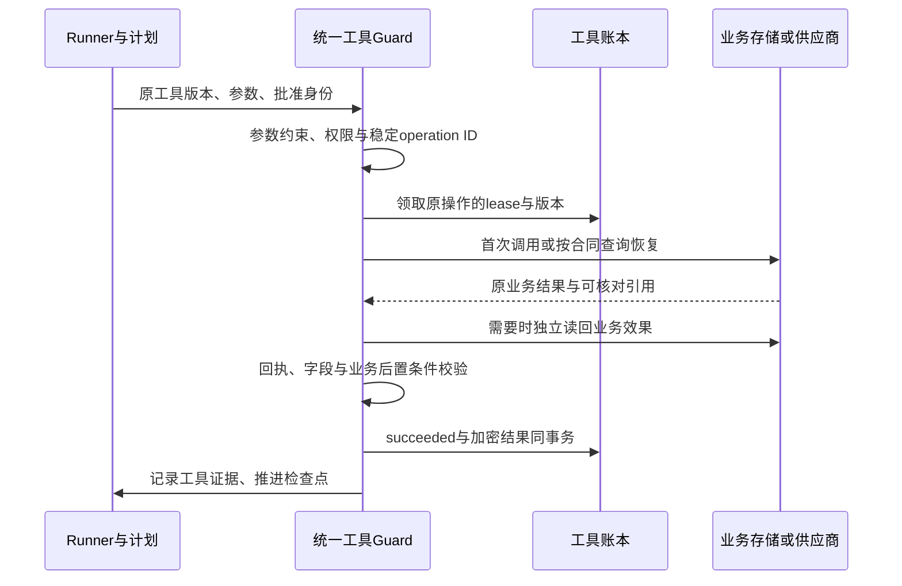

# 在途任务接管与幂等投递 — 完整实现说明

## 从原消息接管到业务完成：演进主线

| 阶段 | 补齐的问题 | 提交/数据落点 |
|---|---|---|
| 持久工作及唯一终态 | 节点死亡后仍能找到原消息，提交与待发事实不分离 | 基础001；Inbox/execution/session_commit/Outbox/Ledger |
| 原工具操作身份 | 效果已发生但本地函数退出，不能直接换新调用重做 | 2704448；000002 |
| 带证据的异常处置 | 不确定发送不能由超时猜测未接受 | 64c3486；000003 |
| allow/ask统一与计数分离 | 普通工具和已消费确认授权都需同一恢复合同 | e3b90f2；000004 |
| 持久计划和失败预算 | 能重跑模型还不代表知道剩余任务或能有限收敛 | 81c681e/cbf5dfa；000005/6 |
| 完成候选和权威历史 | 结算后崩溃不能丢答案或重新审核，草稿不能变历史答案 | 286ed39/92c6edd；000007及终态投影 |
| 查询优先及持久回执 | 利用真实业务事实避免重复效果，已接受回执可恢复sent | 7e527cc/5cb8513；000008 |
| 原目标、业务与诊断 | 防漏需求、工具声明不可执行、错误原参数、假成功和摘要截断 | 5f56ecf/d29bd29/0f53489；原加密Plan与新接口 |

[实现历程](../IMPLEMENTATION-HISTORY.md)逐项给出缺口、提交和边界。[30阶段链路](../END-TO-END-DATA-FLOW.md)串联原消息到发送；下文机制与反例继续解释每个局部为什么不可省略。


## 连贯讲解：一个长任务怎样跨节点完成且不盲目重复

### 1. 从一条有业务效果的原消息讲起

用户在原 Bot 中提交明确的 `/note` 创建请求，要求按给定标题和内容保存笔记，并拿到可识别的笔记编号。N1 可能在等待批准、调用工具、写入业务表、生成答案、结算或发送时退出。系统的目标不是再创建一条新任务，而是继续同一个 tenant/request，复用可信成果、补做剩余步骤，并保留不能安全自动判断的情况。

这是比“重新调用模型”更强的目标。模型重跑只能重新生成文本；如果没有原目标和步骤约束，它可能漏掉业务操作，或者再次执行已经成功的写入；如果没有输出检查，它还可能保存了正确笔记却回复错误编号。因而本能力同时保护**任务进度、外部效果、完成事实与最终投递**。

以下用笔记说明已接入的完整业务契约。普通聊天仍受计划与终态门禁约束，但系统不会自动为任意自然语言生成不可辩驳的业务验收标准；其他工具必须实现自己的可信检查、恢复与必要的读回协议。

### 2. 恢复先问“已有哪个可信结果”，再问“还能重跑几次”

任务从可靠接收边界进入持久工作链：Inbox 与预处理工作同事务，派发准备事务生成 execution、input_seq 与 Outbox，Relay 发布后交给 Worker。Worker 校验原 envelope、顺序和 lease，之后检查已有 terminal、完成候选和冻结结果等恢复事实。

**已经完成的候选或答案优先恢复，不先消耗新的模型尝试额度。** 否则最后一次尝试明明生成了答案，只因节点在提交前退出，下一节点却会用“次数耗尽”丢掉成果。只有确实需要进入新的模型运行时，才按原任务年龄、尝试次数和无进展次数准入。

| 恢复时读到的事实 | 下一步 | 不应该做什么 |
|---|---|---|
| 已有合法 terminal | 承认原终态，续办尚未完成的投递 | 重开任务、再次调用模型 |
| 已有有效 completion candidate | 用原决定续办结算、结果晋升与提交 | 重新审核后换一个答案 |
| 已有可验证的冻结成功结果 | 交叉核对任务证据，封存并提交原结果 | 因换 owner 重新生成 |
| 只有计划、检查点和部分工具结果 | 恢复已完成部分，补做缺项 | 把所有步骤重置为未开始 |
| 存在未知外部效果 | 按工具恢复合同查询或处置 | 仅因超时再次执行写操作 |

### 3. 目标、步骤、证据为何要分开保存

`task_plan` 的加密计划不是一段待办文本。它保存原输入绑定、冻结的 Acceptance、步骤与执行合同；`task_checkpoint` 保存阶段进展。SQL 中的版本、水位和摘要参与并发约束，加密 JSON 中的业务结构负责说明“要完成什么、已完成什么”。两者的字段清单分别见数据库字典与接口字典。

原目标绑定完整输入摘要；供模型使用的目标摘录有大小边界，不能用摘录替换原输入身份。必需交付物来自版本化 `runtime_policy.task_requirements` 和可信业务解析器，模型只能规划如何实现，不能自行删去必须完成的要求。

以笔记为例，服务端解析明确命令，冻结原始 title/content 的规范参数摘要，增加创建义务及真实 `note_id` 证据要求。步骤关联 `requirement_ids`、精确工具版本与依赖；写入前再次比较原参数摘要，不能让模型用另一标题保存，再靠一句“已完成”通过检查。

| 对象 | 回答的问题 | 如何阻止错误完成 |
|---|---|---|
| Acceptance / Requirements | 用户和服务端要求的交付物是什么 | 不允许模型只规划容易做的子集 |
| Steps / Dependencies | 为交付物安排哪些步骤、先做什么 | 依赖未满足不能直接完成后续步骤 |
| TrustedCheck / trusted_outputs | 什么结果才算该工具成功 | 可信检查由代码提供，模型不能自填认证 |
| Tool execution / result | 某个精确操作到底执行到哪、有何回执 | 恢复复用原成果，未知效果不伪装成功 |
| Checkpoint / recovery_summary | 当前已完成、阻塞、缺项及建议动作 | 给新模型可读进度，但不增加权限 |
| Final evidence | 实际对外答案是否兑现必需交付 | 正确业务结果不能配一个遗漏或虚假的答案 |

已绑定的旧任务保持其原合同；不能在恢复时偷偷追加新的必需条件，导致原来合规的结果突然不再可提交。新任务使用新版本配置，旧任务按冻结版本恢复。

### 4. 一个工具调用实际跨越哪些写入边界



普通工具的 operation ID 绑定 tenant、request、工具、版本与规范参数摘要；经用户批准的调用保留原批准 ToolCallID。allow 与 ask 走统一恢复保护，但 ask 仍需要原授权，换节点不能制造第二次批准或扩大参数范围。

工具账本租约保护单个操作，会话租约保护整个会话推进。会话失权的旧进程不能随意提交终态；工具资格失效也不能随意覆盖该操作结果。它们保护的粒度不同，不能删掉其中一个。

`Complete` 将工具成功状态与加密结果原子保存，再把工具证据记到计划。如果节点恰好在两者之间退出，新 owner 可以从已认证的工具结果补回计划；若顺序反过来，计划会声称工具完成，却找不到可复用结果。

### 5. 最危险的窗口：业务成功了，工具结果尚未保存

假设 N1 已把笔记写入业务表，随后被强杀。`tool_execution` 可能仍显示 running；这一状态只证明旧 owner 领取过，不证明请求没发出。N2 必须使用原业务键和原参数处理该窗口。

local_note 的业务键绑定 tenant/request/ToolCallID/args digest。N2 查询到原业务行后，校验其作用域、参数摘要和认证密文，取得原编号；即使走同键创建，唯一业务身份也使其返回同一成果，而不是另一份笔记。成功前还会独立读回实际存储的标题、内容、编号与状态，对照原批准参数和创建回执。

这层读回解决的是“工具返回成功但真实内容不对”。回执非空、HTTP 200、模型说保存成功都不能替代实际业务检查。读回失败时保存 `EffectUnknown` / `business_verification_unconfirmed`，不写 succeeded。它是当时的后置条件检查，不代表以后持续监控外部对象是否被修改。

通用工具根据合同分别处理：可安全重放的只读操作可以重试；支持可靠幂等键的操作沿用原键；queryable 优先查询 completed/pending/not_found/failed/unknown；manual 保留证据并停止不安全重放。查询 not_found 也不当然允许换键执行，旧写请求仍可能稍后到达。代码执行的未知副作用不能凭通用任务计划恢复，当前仍按 manual 边界处理。

### 6. 为什么“工具都完成”之后还要检查最终答案

模型可能漏写笔记编号，也可能把真实编号拼成另一个字符串。新操作开始前，代码定义的 `FinalEvidenceDescriptor` 已将可信输出字段冻结到步骤 `trusted_outputs`；完成门禁从真实工具证据取标量引用，检查最终渲染答案确实包含这个引用。编号检查有标识符边界，不能用 `note_abc_extra` 冒充 `note_abc`。

门禁同时要求计划步骤、必需交付物覆盖、工具可信证据和输出条件成立。新草稿缺项返回 `ErrIncomplete`，记录 `completion_issue`，复用已完成工具成果，在原预算内补写答案或补做未完成步骤。它不会为了补一个编号再创建笔记。

如果已经持久化的完成候选与证据冲突，则进入审计失败路径，不能生成另一个答案覆盖原证据。这里区分“尚未接受的草稿可修正”和“已经冻结的完成意图不能被悄悄替换”。检查覆盖的是已配置的明确条件，不是任意自然语言任务的全部语义正确性。

### 7. 为什么需要私有候选、公开结果和 terminal 三个阶段

一个完成答案还涉及治理预约、用量、价格和输出决定。若先结算再存答案，节点退出会留下“钱已结算、答案找不到”；若保存后任意重审，又可能在新规则下把同一完成过程变成另一个结果。

`execution_completion` 先冻结原 envelope/input、输出、用量、permit、原决定和 PlanDigest。恢复时验证这些内容，沿原治理决定完成幂等结算，再晋升公开结果、封存计划、提交 terminal 与回复 Outbox。PlanDigest 覆盖原目标、合同、步骤和 Acceptance，不把会随恢复变化的 Fence、诊断或计数当成业务事实变化。

| 持久阶段 | 是否可以供最终回复发送 | 故障后的合法动作 |
|---|---|---|
| 工具结果 / 检查点 | 不可以，任务未必完成 | 复用证据并继续剩余步骤 |
| 私有 completion candidate | 不可以，尚需原结算和输出决定续办 | 校验后推进同一候选 |
| 公开冻结 result | 仍不能只凭存在就宣布已交付 | 原终态和封存校验后提交 |
| terminal + reply Outbox | 可以由原回复链路领取 | 无需再次调用模型，继续投递 |
| Ledger sent | 当前分段的发送确认已成立 | 只补 ACK，不重新发送该分段 |

这些阶段不组成跨模型、SDK、Redis、业务系统和渠道的总事务；每段依靠自己的不可变身份、持久记录和幂等动作衔接。

### 8. 有限修复：让任务收敛，也保留最后一次成果

默认任务合同要求计划和工具检查，最多 8 次任务尝试、3 次无进展、原任务年龄 1800 秒。年龄起点不会因重试、换节点或改计划重置；第一次 admission 的无进展数为 0，持续无进展到门限后拒绝下一次运行。一次任务尝试内部可能有多次模型请求，不能把 MaxAttempts 当成模型 HTTP 次数上限。

`recovery_summary` 根据持久事实给出已完成步骤、可开始步骤、阻塞原因、缺失要求、未知效果、最终答案修复需要和剩余预算。它帮助模型理解执行过程，不能代替工具认证或授予权限。最后一次已准入的运行即使剩余未来次数为 0，仍可完成当前工作；已有完成候选也应优先续办。

真正耗尽预算时，按持久失败阶段收敛：保存失败计划、记录治理中止、保存固定安全失败结果，再提交失败终态及适用回复责任。依赖暂时错误与无法证明的恢复矛盾采用不同分支，不能把所有失败都设置成无限重试，也不能声称所有审计失败都已经给用户发了失败回复。

### 9. 最后一道窗口：答案已被渠道接受，确认却没落库

terminal 与 reply Outbox 保证发送责任存在；Ledger 按 delivery key/segment 防止本地发送者任意并发。发送得到明确接受及 Provider ID 后，先将包含原计划、路由、内容摘要和客户端 ID 的不可变 `delivery_receipt` 保存，再将 Ledger 标记 sent。

N1 若在回执提交后退出，N2 可核对原回执并补 sent，不再调用渠道。若 N1 在渠道接受后、回执保存前退出，数据库仍可能无法区分“已接受”和“没接受”。此时先使用真实下游查询；没有可靠查询/去重能力就保持 ambiguous，按上限收敛到需审计处置的状态，不能换 client ID 重发。

当前 WebUI 有可靠持久唯一键及完整目标/内容核对，WeCom、Feishu 没有同等请求状态查询适配。**内部唯一成功终态不等于任意渠道恰好一次可见交付。** 多分段答案还要求失败段阻断后续段，已确认段不重发；多段正常展示与重复最终答案应分别计数。

### 10. 用一张表把 P1～P4 与长任务接起来

| 故障位置 | 接管者先读 | 继续做什么 | 成功判据中的独立计数 |
|---|---|---|---|
| P1 已可靠接收、未执行 | Inbox/preprocess、execution、派发 Outbox | 回收持久工作、继续原 input_seq | 原请求数不变，任务尝试按实际记录 |
| P2 模型请求中 | 计划/检查点、工具结果、候选与原预算 | 复用成果；确需生成时新建尝试 | 模型请求可增加，不等于多一个最终答案 |
| P2 工具效果窗口 | 原操作身份、恢复合同、业务键与实际效果 | 查询、同键恢复或停止不安全重放 | 工具尝试与业务实际效果分别统计 |
| 完成校验/结算窗口 | Acceptance、候选、permit、公开结果 | 修复未冻结草稿或续办原完成意图 | 不能靠换答案消除证据冲突 |
| P3 terminal 已提交、尚未发送 | reply Outbox、冻结结果、Ledger | 发送原答案，无需用户重发 | 一个逻辑最终回复，可含合法分段 |
| P4 已接受、确认未完成 | 回执、Ledger、真实下游证据 | 补确认、可靠核对或审计处置 | 客户端可见次数另证，不由 ACK 推导 |

实现入口主要位于 `trpcservice/worker/runner.go`、`worker/completion.go`、`taskflow/`、`tool/execution/`、`tool/localnote/` 和渠道 Delivery 模块。字段、精确方法与时序分别见[设计](design.md)、[运行走读](implementation-walkthrough.md)、[接口字典](../INTERFACES.md)和[代码附录](CODE-APPENDIX.md)。这条主线解释机制成立的原因；后续专题逐项展开竞争、反例和恢复边界。

## 从业务回执到真实业务效果

以明确创建笔记为例，先冻结用户给出的原 JSON 参数；模型规划必须覆盖创建义务，写入前还必须匹配原参数摘要。创建后独立读取业务表，将实际存储内容与批准参数、创建回执完整比较，才保存工具成功。节点在业务写入后退出时，新 owner 查询同一个业务键并核验原效果，不通过换键创建另一份笔记。最终答案必须引用真实笔记编号，省略或拼造另一编号都不能进入成功终态。

这组规则针对已接入的具体业务契约。它不把普通聊天变为写入，也不意味着任意工具或自由文本请求都自动具备完整业务验收。对于超过 incident 摘要上限的记录，可使用按原请求和稳定主键分页的只读 records 接口继续排查。

## 从配置可执行到接管可理解

完成条件写对 JSON 还不够：所要求的工具可能不在发布版本中，或者没有可信完成断言。现在发布先检查精确、强制的工具引用，再读取部署工具目录；失败不会推进发布。统一解析器也让 Worker 与发布使用同样的条件格式。

接管时，完整计划和工具结果之外，还投影已完成、活动、失败、未知效果、可开始步骤、未覆盖要求及阻塞原因。这样模型无需从一长段历史猜下一步，但摘要不增加权限、不替代证据校验。管理端通过原 tenant/request 查询同一条链路，只返回元数据，并区分数据库快照与独立检查点读取。

## 为什么步骤全部成功还不够

模型可能只声明请求的一部分步骤，因此“步骤都完成”不能等价于“原需求都满足”。现在先保存原始目标和服务端配置的必需交付物，再让步骤关联这些独立义务；最终对实际渲染答案检查必含内容及可信回执引用。缺项只拒绝当前草稿，保留已经完成的工具结果，在原预算内补做；已保存完成候选中的矛盾则走审计失败，不能重新生成来覆盖证据。

条件由发布配置或可信业务解析器提供。未配置业务条件时仍不会自动获得任意自然语言任务的完整语义证明；详细边界与字段见 design。

## P4 现在先看哪份证据

正常渠道响应回来后，先保存 Provider ID、原路由/计划与分段字节摘要，再完成 Ledger。接管者若找到匹配的持久回执，只补本地确认；不需要借助渠道重发验证成功。回执尚未保存就退出时，系统仍不能推断没发出去：未分类错误、取消、失权及服务端错误按不确定处理，没有可靠查询就保留事件并走证据化处置。

这也解释了为什么“有 uuid/内容去重”不足以承诺任意晚到重试安全。当前仅对持久回执或真实查询证据自动确认；不会给 WeCom/Feishu 发明不存在的请求状态 API。WebUI 的查询具有本地持久唯一键，并核对完整目的地与内容。失败段会阻断剩余分段，运维确认已送达后才沿原 Outbox 继续。详情见 [P4 状态与数据模型](design.md#000008p4-持久回执保守判定与受控处置)。

## 为什么有幂等键还要先查询

幂等键限制重复业务效果，但每次直接重放仍可能重复调用供应商、得到处理中回执或依赖已改变的本地期望值。local_note 现在先查已提交业务行并认证原密文，再补回工具结果和检查点。MCP 可配置同端点只读查询：completed 不再写，pending/unknown 不猜测，not_found 也仍须同幂等键继续，因为旧请求可能在查询后才到达。

业务回执同时在保存成功前验证，避免“HTTP 成功/JSON 非空”被当成业务完成。已保存结果的复用也执行相同检查；不能通过换节点绕开结果契约。状态表、实际工具清单及协议边界见 [设计](design.md#状态查询优先与可信回执前置校验)。pending 仍受原任务预算约束，查询能力不等于无限异步等待；代码执行中断仍是 manual。

## 为什么结算前还要保存完成候选

有公开结果也不能跳过候选：恢复会交叉核对原审核、实际预约、用量、任务证据摘要及结果字节/引用。新候选绑定 PlanDigest；事实冲突时保留证据并结束为恢复失败，不能重新推理覆盖原事实。计划封存却找不到答案、预约关闭却没有候选等异常也有独立原因码及重入路径；临时依赖错误继续原阶段重试。恢复失败的异常分支只发终态 audit，不声称已经给用户回复。

只有 result_payload 还不够：若先关闭治理预约、再保存答案，崩溃会令下一 owner 得到“预约关闭”而无答案可续提交。`execution_completion` 保存已审核但尚未公开的完成意图：先冻结输出、用量、价格计算和输出决定，再执行幂等结算及决策写入，最后晋升公开结果。故障后使用原决定推进，不再次 Begin，也不因为价格有效期或审核器变化生成另一份答案。内部候选不参与 Delivery，拒绝内容不能成为可见成功回复。

这不是把结算、SDK、终态和渠道发送放入一个大事务。每一段仍依据不可变记录及自身幂等协议续办。工具侧也必须有真实契约：MCP 默认 manual，仅审核过的只读/供应商幂等键操作可自动重放；代码执行提供成功回执校验，但不把未知外部写操作标为可重放。历史整理改善模型重试输入，不替代工具完成证据或外部事实核对。字段和各窗口见 [设计](design.md#000007完成候选与治理结算恢复)。

## 按三种对象分别定义“没有丢”

| 对象 | 正确含义 | 不能拿什么替代 |
|---|---|---|
| 原始输入 | 已持久接收的同一 tenant/request 有后续处理责任，最终有可解释处置。 | 用户另发一条新消息后成功。 |
| 任务结果 | 有一个有效终态；成功结果可从原冻结引用恢复。 | 模型请求发出过，或日志里打印过答案。 |
| 用户交付 | 按同一 reply 和 segment 记录发送、确认或不确定。 | terminal、Outbox published、Redis ACK 中任意一个。 |

系统优先使用已完成的持久事实。能复用冻结结果就不再生成；能复用工具结果就不再产生效果；不能确认外部效果时按恢复契约处理。安全失败、取消、工具效果不确定和成功交付是不同结论，应分别计数。

## 责任转移表：每个 ACK 后还剩谁负责

| 所处阶段 | 当前权威事实 | 下一步责任 | 当前处理者消失后 |
|---|---|---|---|
| 输入持久接收 | Inbox、密文输入、preprocess_job。 | 预处理与派发链路。 | 由未完成 job 的共享持久状态继续。 |
| dispatch 准备完成 | execution_record、原 input_seq、dispatch Outbox。 | Dispatch Relay 发布事件。 | claim 到期或未发布记录重新领取。 |
| dispatch 已发布 | Redis 工作事件与数据库执行身份。 | Worker 消费/回收 pending。 | 以原 request 重新获取会话资格。 |
| 输入暂不能执行 | durable parked/blocked 等协调状态。 | 对应唤醒或异常处理链路。 | 不通过伪造前序完成来释放后序。 |
| 已有结果未终结 | result_payload。 | Runner 校验后继续 terminal。 | 复用原答案，不重新解释其内容。 |
| terminal 已提交 | session_commit 与 reply Outbox。 | Reply Relay。 | 无需恢复原 Worker 即可发送。 |
| reply 已发布 | 原 reply event 与 Ledger。 | Delivery 消费者。 | 对未完成分段取得发送资格或核对未知结果。 |
| 已确认/明确失败 | Ledger sent/failed。 | 自动路径结束，必要时异常处置。 | 重复事件不重新开放已发送分段。 |

表中“责任”是状态与消费者协议的对应关系，不是说数据库和 Redis 处于同一分布式事务。跨后端窗口通过先保存、可重复发布、后续幂等与回收处理；整个 Redis 数据集丢失不等于单 Worker 消失，不能直接套用同一恢复结论。

## 长程工具执行的六个检查点

```text
规范化参数/稳定操作身份
  → 工具账本 running 与 lease/fence
  → 外部请求发出
  → 外部效果发生
  → 成功结果密文与 succeeded 同事务
  → 模型使用结果并冻结最终答案
```

| 被杀位置 | 接管者已知什么 | 合法继续方式 |
|---|---|---|
| 工具账本建立前 | 没有该操作被平台领取的事实。 | 在原权限和参数检查后首次领取。 |
| running 后、无法证明请求发出前 | 只知道旧 owner 曾获执行资格。 | 租期回收后按策略；不能从 running 推断“未调用”。 |
| 外部执行中 | 请求可能已被接受，可能仍在运行。 | queryable 查询句柄/业务键，或用可靠幂等键恢复；未知保持未知。 |
| 外部已成功、平台结果未落库 | 外部效果与平台结果之间存在窗口。 | 同业务键重试或查询已完成结果；manual 不能盲重放。 |
| succeeded 与密文已提交 | 有受 fence 保护的成功结果。 | 解密、校验、复用；ask 的辅助结果可由主结果恢复。 |
| 工具完成、模型尚未冻结 | 工具效果可恢复，模型的内部推理未保存。 | 模型可重跑；相同操作再次进入工具门面时受账本保护。 |

工具“理解之前过程”来自已保存输入、历史、工具身份及可读取结果。若工具内部有多个远端步骤，而只在函数返回时保存一个结果，平台不能凭空恢复中间每一步。需要更细恢复粒度的工具，应在自身协议内提供稳定步骤键、进度查询或检查点；当前通用账本并不代表任意工具函数已经具备这些能力。

## 恢复策略的证明义务

| 策略 | 工具实现者必须能证明 | 典型反例 |
|---|---|---|
| replay_safe | 任意次数重复执行不会增加不可接受的业务效果。 | 名称叫“查询”却同时递增计费或发通知。 |
| idempotent_key | 所有重试发送同一稳定业务键，外部在所需恢复期内可靠去重。 | 每次 HTTP 重试生成新 UUID，或外部幂等键过期早于接管。 |
| queryable | 能定位原操作，并区分已完成、明确未接受、仍在执行与未知。 | 查询暂时没有记录就断言未执行，而写入尚未可见。 |
| manual | 系统承认不能自动判定，停止不安全重放并保留证据。 | 仅因业务希望自动完成，把未知工具标为 replay_safe。 |

租户作用域、工具版本、参数摘要和恢复策略属于同一逻辑操作的不可变身份。相同普通工具与参数被合并为同一操作时，故意要求两次不同业务效果必须体现在业务参数或键中；不能把“模型又调用了一次”当作新的业务授权。

## 分段交付的承诺应怎样表述

一份逻辑答案可能因渠道长度限制产生多个 segment。Ledger 的保护粒度是每个 segment；用户看到的气泡数量与最终答案数量需要分开统计。

假设答案有三段：0 已 sent、1 ambiguous、2 尚未发送。重新收到原 reply 时，0 跳过发送，1 进入核对，未知不能被当作“没发”直接重发。第 1 段被证据确认后，重调度原 Outbox 可以让尚未完成的分段沿原计划推进。分段循环遇到已 failed 的段会返回 TerminalError 并停止，重复事件也不能绕过失败段发送后段；不能把单段 failed 解释为整个答案完整送达，需要逐段检查状态与客户端内容。

还必须区分下游两种能力：可靠请求键去重能够让同键重试不重复产生可见消息；可靠查询只有在能证明原操作已送达或明确未被接受、且旧发送不会随后生效时，才足以指导安全重试。普通最终一致查询、“当前没查到”或仅有内容级短期去重都不足以自动推出至多一次。

## 三组竞争时序与裁决点

| 竞争 | 可能同时发生什么 | 当前裁决依据 |
|---|---|---|
| 旧 Worker 与接管 Worker | 旧模型迟到返回，新 Worker 已取得新 lease。 | beforeCommit 检查当前 lease，terminal 再校验数据库 fence/version/序号；SDK 历史独立持久，不由此自动回滚。 |
| 工具续租与结果完成 | 续租更新租期，返回结果准备落库。 | 调用完成后先停止续租，再以工具 owner/fence/未过期条件原子保存结果。 |
| 自动核对与人工处置 | 都读取同一 ambiguous 版本并提交不同判断。 | Ledger expected_version CAS；冲突方重新读取证据和当前状态，不覆盖成功方。 |

数据库事务失败或客户端没有收到成功响应，并不能一律推出事务没提交。应按原稳定身份重读结果；重试时不能更换 request、operation、reply 或 delivery 键来绕过冲突。

## 失败分类决定下一步，而不是统一重试

| 事实 | 下一步 | 为什么 |
|---|---|---|
| 原输入或冻结内容身份不匹配 | 拒绝并定位配置/数据问题。 | 重跑不能修复租户或摘要不一致。 |
| lease 丢失 | 停止旧执行并交由有效 owner。 | 继续执行不能取得提交资格。 |
| 前序未完成 | 持久停放与后续唤醒。 | 立即重试可能形成忙循环与重复模型开销。 |
| 明确限流或可重试失败 | 按当前退避和尝试上限。 | 退避保护依赖并使积压可观测。 |
| 外部结果未知 | 查询、同键恢复或保留不确定。 | 超时没有说明效果未发生。 |
| 结果不可解密 | 修复密钥/版本读取。 | 生成另一个答案可能与已有效工具效果或既有交付冲突。 |
| 用户已有取消意图 | 由取消与 terminal 协议裁决。 | 冻结结果存在不意味着可以忽略取消；取消也不会撤销已经产生的外部效果。 |

## 五段持久化因果链

持久输入（Inbox/payload/job）→ dispatch（input_seq/execution/Outbox）→ 运行（session lease/fence、工具账本）→ 终态（冻结结果、commit 与 reply Outbox）→ 交付（reply stream、Ledger、provider）。每层有独立恢复所有权；ACK 不能提前代替 durable 业务完成。

## 每个故障窗口如何恢复

| 窗口 | 丢失的进程内状态 | 恢复依据与动作 |
|---|---|---|
| P1 | 尚未开始的工作 | job/Outbox lease 到期后领取；dispatch 重复调用复用原 input_seq。 |
| P2 模型 | provider 的生成、SDK 当前调用栈 | pending reclaim、更高会话 fence、同一原始输入；模型可重新调用。 |
| P2 工具 | 工具函数执行栈 | tool_execution lease/fence、策略与 encrypted result；按策略复用/查询/重试。 |
| result-before-commit | 尚未提交 terminal 的栈 | 校验冻结 result 的 tenant/request/key/digest，检查取消及 beforeCommit，续同一结果。 |
| P3 | Relay/发送 goroutine | reply Outbox 重新发布冻结结果；模型调用不增加。 |
| P4 | provider 接受后的本地确认 | 过期 sending 转 ambiguous；按下游能力查询或持久化异常待处置。 |

## 执行权与提交权

Worker 先 ReadLastFence → EnsureFenceAtLeast → Acquire，再进入 ExecuteWithLease。续租失败标记 leaseLost、取消执行；每次提交前 beforeCommit 再续租校验。commit_turn 锁定 session_head，检查 terminal 幂等、输入顺序、expected_version 与 fence；成功更新 execution/Inbox/会话头、插入 terminal commit 和 Outbox。SQLSTATE 40001 的 stale fence 映射 ErrStaleFence，其余版本竞争映射 ErrVersionConflict；23505 映射 ErrCommitConflict。

fence 约束有效提交，不会撤销已经发生的外部副作用，也不保证模型从未并发请求。外部副作用须使用工具恢复协议。

## 工具恢复的执行顺序

1. `GuardedCallable.callDurable` 校验租户执行上下文、payload key version、规范化参数及工具版本。普通 allow 的 operation ID 是 tenant/request/tool/version/参数摘要的 SHA-256；同一输入的同工具同参数视为同一逻辑操作。需要不同效果时必须带不同业务参数/键。ask 使用确认中的持久化调用 ID。
2. 读取 tool_execution。已 succeeded 且不可变字段一致时，LoadResult 解密、校验结果引用摘要与代码自有可信断言后复用；failed 拒绝继续。未知新工具默认 manual。
3. Claim 首次创建 running，或领取 pending/effect_unknown/过期 running；attempt 和工具 fence 增加。未过期 running 不可抢占。
4. 启动工具续租。ask 消费 grant；遇到已消费冲突时仅允许恢复同 request/tool-call 且 effect_unknown 的 attempt，不再次消费授权。
5. idempotent_key 若启用 RecoveryLookup，恢复先查原业务键：completed 复用回执，not_found 同键继续，pending/unknown/查询错误不写，failed 终结工具；未配置时保持原同键调用。旧 queryable 协议仍要求 false 证明未接受，未知不得当 false；replay_safe 重放；manual 接管保留 effect_unknown 并安全停止。
6. 外部调用错误可将 tool_execution 标为 effect_unknown；lease 丢失立即取消 call context。外部系统若不响应取消，仍由其幂等/查询协议避免重复业务效果。
7. 实际调用或查询补回结果先验证 JSON 与代码自有可信完成断言；拒绝回执标为 failed/tool_receipt_rejected，不创建成功结果。校验通过后停止续租，Complete 在同一 PG 事务中验证 owner/fence/有效租期并写 succeeded 和加密结果。失败/未知状态落库也先停止续租。
8. ask 再把结果镜像至 tool_result_payload 并完成 tool_attempt；镜像前故障可从 tool_execution_result 重建。业务效果与平台结果是两个事务；local_note 用 (tenant_id,business_key) 唯一键覆盖这段窗口。

恢复的是已保存结果或外部操作的协议状态，不会恢复工具函数体的内存/指令位置。未冻结最终结果时模型可能重新推理；相同逻辑操作重新进入 GuardedCallable 时复用或安全恢复。任意 Graph 检查点也不能据此推断为自动恢复整张图的执行栈。

## 发送的状态与顺序

Delivery 先解析持久化内容和冻结路由，固定 renderer/format/内容摘要和分段计划，再 ClaimDelivery。仅领取成功才调用 adapter；发送期间续 claim。成功接受且有 ProviderMessageID 后才 FinishDelivery(sent)；已 sent 分段跳过发送。短暂错误进 retry_wait，永久或尝试耗尽进 failed。不确定错误进 ambiguous，禁止因超时推断未送达。

内部保证与外部交付分别判定：同一输入只有一个有效 terminal commit；每个回复 segment 在 Ledger 中只有一行权威状态，`sent` 后自动路径只跳过发送。该行唯一不等于渠道只接收一次。P4 中若匹配的 provider receipt 已落库，可直接补齐 Ledger；回执也未落库的剩余窗口仍需下游可靠去重/查询或外部处置证据。当前 WeCom 没有请求键查询适配器，内容级有限时间去重不足以提供永久请求级幂等；取消、HTTP 5xx 和响应丢失均可能留下不确定结果。系统不盲目补发，先保留 `ambiguous`；核对次数耗尽可转为 `failed/reconcile_exhausted`，仍需运维查证。

### 为什么不能只做发送重试

Outbox 解决结果提交后的漏发调度，Ledger 解决本地多 sender 的条件领取与状态幂等，下游协议解决跨系统接受/确认的不确定窗口。重复发布 reply event 是允许的，重复外部效果不因此安全。Ledger 一行多次更新不能证明 provider 接受次数为一。

| 测试路径名 | 实际边界 | 证据 / 使用限制 |
|---|---|---|
| p1 | 预处理持久领取后、执行前 | 原输入/job 已持久化；不能代替所有 P1 子窗口。 |
| p2 | 模型成功响应头返回后、SDK 消费结果前 | 请求尝试与成功头状态；不证明 provider 内部仍在生成。 |
| p2-commit | 模型/工具完成、terminal 结果提交前 | 旧边界，不能代替执行中的 P2。 |
| result-before-commit | 冻结结果保存后、terminal/Outbox 提交前 | 原 result_ref/digest 不变，接管不再调用模型。 |
| p3 | terminal 已提交、reply PublishReply 前 | session_commit、result_payload、已领取 reply Outbox。 |
| p4-before-send | Ledger claim 后、provider 调用前 | 旧发送前边界，不能证明 P4 已接受。 |
| p4 | provider 成功接受且返回消息 ID 后、回执落库前 | barrier 快照 Evidence；进程内快照需在 kill 前采集，非 durable receipt。 |
| p4-receipt | delivery_receipt 已落库、Ledger sent 前 | 接管后核对摘要，只补 sent，不再次调用渠道。 |
| tool-effect | 工具业务效果完成后、工具结果提交前 | 按业务键查外部效果，恢复不能增加效果数。 |

仅 `TRPC_WEBUI_LOCAL_FAILOVER_TEST_ENABLED=true` 注册 `/test/failover/<point>/arm|status|release`，用本地 WebUI token 鉴权。arm 可带 tenant_id/request_id 过滤；status 回显命中身份/evidence。暂停控制面是进程内测试设施，不续 lease、不修改业务状态、不替系统重投。标准接管在命中后杀 owner，不对 survivor release。

| 计数 | 权威记录 | 解释 |
|---|---|---|
| Worker 尝试 | `execution_attempt` 的行数 / `attempt_no` | 每次进入执行器一行；新尝试把旧 `running` 标为 `superseded`。completed 仅表示执行器正常返回。 |
| 逻辑模型调用 | `execution_record.model_call_count` | 进入模型适配器的逻辑调用，可因恢复增加。 |
| 模型 HTTP 尝试 | `execution_record.model_request_count` | transport 尝试，含连接失败及内部重试；不等于接受数或计费数。 |
| 工具尝试 / 业务效果 | `tool_execution.attempt` / 外部业务幂等记录 | 同键工具重试可大于一次，业务效果应按工具契约去重。 |
| 回复发送 / 用户可见答案 | Ledger `attempt`、`segment_no/count` / 客户端证据 | 一条答案可有多个分段；唯一 Ledger 行不能单独证明用户只见一次。 |

| 参数 | 当前本地组合根装配 | 意义 |
|---|---|---|
| Worker lease / renew | 30s / 10s | 失权取消执行；lease 到期才可换 owner。 |
| Worker reclaim / limit | 5s / 100 | 扫描 pending；不代表 5 秒内必完成恢复。 |
| Relay claim / renew / poll | 30s / 10s / 100ms | 先发布，再标记 published；发布后崩溃可重发同一事件。 |
| Delivery claim / renew | 30s / 10s | 每分段发送权。 |
| Delivery reclaim / limit | 5s / 100 | 回收账号回复队列 pending。 |
| Delivery retry | 初始 1s，最大 1m，最多 8 次 | 明确可重试错误的有界退避。 |
| Delivery reconcile | 最多 8 次 | 无查询能力或核对失败最终保留 failed/reconcile_exhausted 事件。 |
| 工具 lease / renew | 默认 30s / TTL÷3 | PostgreSQL 工具 lease，与会话 lease 是两套执行权。 |
| 应用排空 | 默认 30s，可配置 1s–5m | 停止新领取，保留已接纳工作，超时再取消。 |
| Compose 停止宽限 | 默认 45s | 必须比应用排空更长并留退出余量。 |

这些值是当前 `webui-local`/`wecom-local` 装配值，不能与 Consumer 未配置时的包级兜底值混用。恢复耗时还包含排队、上游延迟、退避和采样误差，不能把 TTL 相加写成已验证的 RTO。

## 恢复前提

共享依赖和兼容配置/密钥必须可用。未声明恢复契约的工具不会被当作安全写操作；queryable 的 false 必须可证明“未接受”。没有 provider 去重/查询的真实 WeCom P4 属于已实现的异常处置路径，严格的自动唯一可见交付要求仍受协议边界限制。

## P1的两个接收子窗口

“消息已持久化未执行”还可分为接收节点已把原输入保存、以及某个处理者已经领取但未开始。前者验证输入不会随接收进程消失；后者验证过期领取可回收。

当前p1挂点在预处理工作持久领取后执行前。它能稳定命中第二种情况，但不能据此推断所有接收确认顺序都已外部验证。严格证据需要看到原Inbox/payload/job以及故障目标承担的真实职责。

## P2模型执行中的完整推演

模型请求发出后，节点无法可靠迁移provider内部生成状态。进程被杀意味着HTTP读取和SDK调用栈丢失；pending消息及原始输入仍在。新Worker取得更高lease fence后重新进入执行器，若没有冻结答案可重新发起模型调用。

p2挂点在成功响应头返回后、SDK消费结果前。它证明应用已经跨过“上游返回成功头”这一可观测边界，不证明服务商还在何种内部计算阶段。只保存一个model_request_count也不能提供该接受证据，计数包含连接失败。

## P2工具窗口的分段状态

| 崩溃位置 | 工具平台记录 | 恢复可能动作 |
|---|---|---|
| 工具claim前 | 无running owner | 新owner首次领取。 |
| claim后，外部调用前 | running、attempt/fence、恢复策略/键 | 租期到期后按契约决定是否可调用。 |
| 外部调用过程中 | 同上，可能无外部结果 | queryable核对或同键重试；manual拒绝不安全重放。 |
| 外部效果完成，Complete前 | 业务效果可能存在，结果未入库 | 业务键/查询能力覆盖该不确定窗口。 |
| Complete事务中 | 成功状态和密文未全部提交 | PostgreSQL要么全提交、要么回滚。 |
| Complete成功，ask镜像前 | succeeded及tool_execution_result存在 | 复用主结果并补齐确认结果镜像。 |
| 工具结果已保存，模型总结前 | 工具结果可复用，最终答案未冻结 | 模型可能再运行；相同逻辑操作不再重复效果。 |

“记录保留下来”不表示工具每次的全部参数原文和内部进度都有专门字段。账本固定版本、参数摘要、策略、恢复键和执行状态；恢复调用的参数由原任务/模型或确认continuation提供，并与摘要匹配。任意外部工具的中间进度仍要由其自己的持久协议保存。

## 普通工具operation ID的价值与限制

模型重试通常会生成不同call ID。若平台直接以provider call ID作为唯一恢复键，同一“创建笔记”可能被误当作两次业务操作。当前普通工具按tenant、request、tool/version和规范化参数摘要生成稳定operation ID。

这意味着同一输入、同一工具版本、相同参数代表同一逻辑操作。用户确实要创建两份内容相同的对象时，应由业务参数明确区分业务键；不能依赖随机call ID表达业务差异。模型恢复后改变参数也会形成不同操作，所以输入提示、工具定义和业务幂等键仍须共同约束业务意图。

## 为什么两个lease都要有

会话lease覆盖一轮输入的执行权，工具lease覆盖具体逻辑外部操作。新会话owner可能在旧工具lease尚未到期时进入同一操作，工具claim此时会冲突，不允许抢走。

即使会话fence递增，外部系统也未必理解该fence。工具自己的owner/fence保护平台结果，业务键或queryable保护外部效果。两者的作用域不同，不能用一个数字替代全部检查。

## 冻结答案以后为什么禁止再生成

最终输出已经渲染并PutResult后，SDK事件通常也已同步保存。若terminal/Outbox事务尚未完成就退出，新节点再生成可能得到不同文本，并与同request下原result_ref/内容摘要冲突。

当前恢复先读取冻结答案，验证tenant/request/key_version/content_digest，再重查取消意图和提交资格，直接commitFrozenSuccess。若取消已经请求，就不以“已有答案”为由忽略取消。这条分支保护的是结果一致性，不只是节省模型成本。

## P3的发布重复为什么是允许的

ReplyRelay先成功发布reply event，再把Outbox标记为published。若两步之间故障，恢复时会再次发布同一个DeliveryKey。反过来先标记published再发消息，会在两步之间故障时漏掉调度。

选择允许重复event意味着下游必须幂等。Delivery以tenant/delivery_key/segment_no为唯一身份、固定内容计划并条件领取，才不会因队列重投直接再发送已sent段。Outbox和Ledger必须一起理解。

## P4的两种不可区分事实

```text
应用本地看到：Ledger=sending，本地没有sent确认
├─ 事实一：请求尚未被渠道接受
│  └─ 重发才可能让用户收到
└─ 事实二：渠道已接受，确认在落库前丢失
   └─ 重发可能让用户看到重复
```

仅增加数据库锁、fence或等待时间，无法区分这两种外部事实。下游查询返回可信已交付时记录sent，可信未交付时才可再发；没有查询能力就保留不确定状态并有界核对，最终可进入reconcile_exhausted异常。

p4-before-send也可能在claim过期后被保守记为ambiguous，因为另一个进程仅从Ledger无法证明旧owner真的尚未调用provider。测试挂点能观察该事实，不代表生产恢复算法可以绕过所有权协议获得同等知识。

## 一个答案有多个segment时的恢复

假设冻结答案分成三段，0和1已sent，2仍pending。重投整个reply event时，前两段跳过发送，继续第三段。如果第1段处于ambiguous，流程需要先解决该段，不能任意当作成功。

分段总数、renderer_version、format_version和内容摘要属于冻结计划。版本升级若改变相同DeliveryKey的计划，claim会发生碰撞/校验错误，而不是静默发送新分段。这防止同一原答案在不同节点上被解释成两套内容。

## 安全终结与自动完成的判定

manual工具恢复为tool_effect_unknown是安全终结；它没有承诺外部操作未发生。reconcile_exhausted是发送异常终态；它没有承诺用户没收到。两者都需要证据和业务处置，不能简单映射成“可随意重新执行”。

同样，execution_attempt.completed只表示一次执行器调用正常返回。确认等待、停放等状态可能已有后续durable责任，不能据此认定用户收到最终答案。完整任务判定应沿execution→terminal→Outbox→Ledger→客户端检查。

## 不能只做X的扩展反例

| 简化方案 | 崩溃反例 | 当前职责分工 |
|---|---|---|
| 只在工具返回后写成功日志 | 外部已成功、日志未写就退出 | 工具lease+业务键/查询+原子结果。 |
| 所有工具错误都当失败重跑 | 响应丢失但写入已成功 | 不确定状态和恢复契约。 |
| 只用唯一request_id | 同一请求可有多工具、多segment | 每层逻辑身份分别唯一。 |
| 发送成功就ACK，稍后补Ledger | ACK后退出，确认事实丢失 | Ledger完成后消费确认；仍承认P4跨系统窗口。 |
| 看到pending就删除重入队 | 原input_seq与当前会话顺序断裂 | 原记录reclaim/停放/唤醒。 |
| 让模型“自己理解上次进度” | 模型无法证明外部是否生效 | durable事实和工具协议先裁决。 |

## 四份状态快照读懂接管

以下均为示意，不是固定测试数值。每个场景先列出durable事实，再说明下一owner的合法动作。

### 场景一：已入库、未执行

Inbox和payload存在，preprocess_job已由N1领取但还未执行。N1退出后job lease不会继续续期；存活预处理者扫描到可领取状态，取得工作继续。

此时可能还没有execution_record和input_seq，不能因为查不到执行尝试就判输入丢失。应从Inbox/job阶段开始追踪。当前p1覆盖这类领取窗口。

### 场景二：模型请求中断

原dispatch entry在pending，execution_record属于原request。N1曾发出HTTP请求但没有冻结答案；模型计数可表明尝试，不能证明最终输出。

新Worker取得会话lease，记录新attempt，再读取权威输入和SDK历史。没有冻结结果才调用模型；新的输出仍必须进入同一输入的terminal条件提交。

### 场景三：笔记已写、工具结果未写

local_note已有tenant/business_key唯一记录，tool_execution仍running。N1在tool-effect点退出，平台尚无加密成功结果。

恢复用相同operation和业务键。业务store的同键写返回相同笔记，并检查request/digest/note身份一致；随后新工具owner提交成功结果。这里可能有两次工具调用，但业务效果仍只有一份。

如果换成没有业务幂等能力的任意外部工具，不能照抄这个结论。平台只能依该工具的queryable或manual等声明处理。

### 场景四：答案已冻结、尚无terminal

result_payload保存了原答案，SDK事件已写，session_commit尚无最终terminal。新Worker不进入Run，而是校验原result，检查取消及lease后续提交。

这一场景应观察模型计数在恢复期间不因重新推理增加；若原任务还有其他内部HTTP活动，需按具体计数口径关联，不能只看整个租户累计量。

## 外部接受凭据与本地状态谁更权威

ProviderMessageID可作为接受/交付关联证据，但客户端最终显示仍要核实。Ledger sent表示本地已经确认该段，不能独立证明服务商从未重复接受。

P4 barrier将接受ID放进快照，方便在kill前保存；快照属于测试控制面进程内状态，不是新的业务事实表。正常恢复仍基于Ledger与provider能力，不会自动从故障进程内读取该快照。

## 取消意图与恢复结果的先后

任务可能在答案冻结后、terminal之前收到取消。若恢复分支只看到result就提交成功，会让用户的取消被忽略。commitFrozenSuccess再次读取权威execution，检查CancelRequested，再调用beforeCommit。

取消自身也是durable意图并通过带fence的终态路径推进。不能让故障恢复的新owner只依赖旧内存里的“用户当时还没取消”判断。

## 为什么不能把所有失败都设为永远重试

无上限重试会造成永久积压、上游成本和外部副作用风险。当前发送有发送/核对上限；工具manual有明确安全终结；输入停放也有阻塞和期限语义。

“无需用户重发”不等于“任何外部系统永远故障都必须最终成功”。系统的责任是保留原输入和可解释状态，在允许恢复时自动推进，在无法安全推进时明确终结或处置，而不是吞掉失败。

## 任务质量与一致性的取舍

复用已保存结果可以减少恢复后答案漂移，但也意味着不会因为换节点就自动生成“更好的答案”。结果一旦冻结，必须先保持它的身份与内容一致；要重新生成应是明确的新业务操作。

工具稳定operation让同参数效果幂等，但不能自动保证模型总是按同样顺序决策。更细粒度长程计划/步骤持久化属于另一类增强，不能从现有tool_execution表推断出完整工作流解释器。
