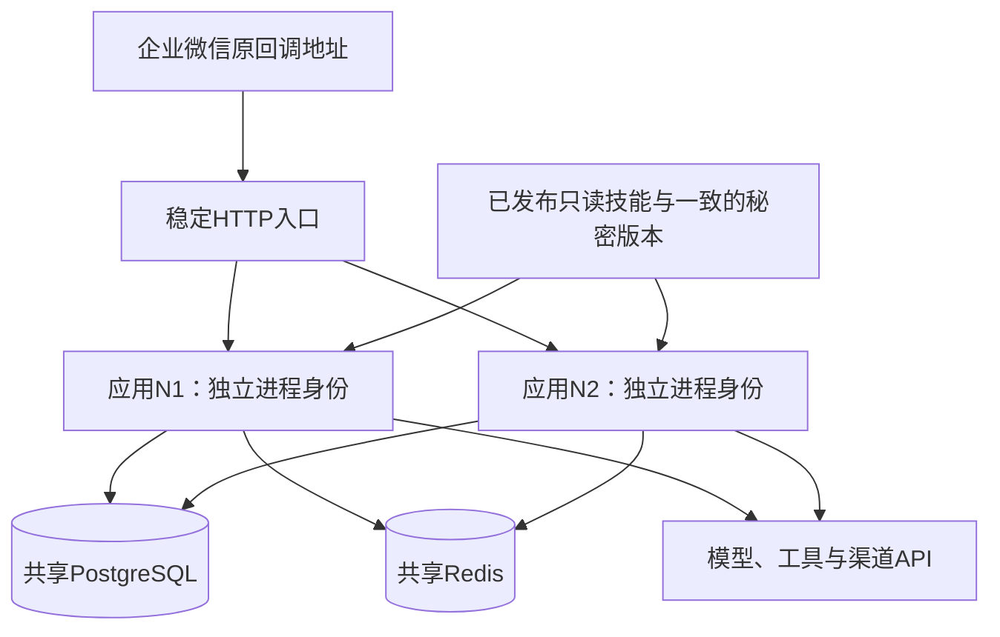
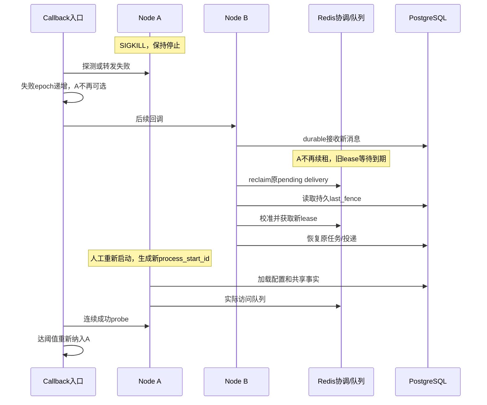

# 单主机多容器实例可用性 — 完整实现说明

## 从共享运行到完整生命周期：演进主线

| 阶段 | 为什么需要这一层 | 当前代码落点 |
|---|---|---|
| 共享PG/Redis与原版本 | 换节点后仍要读到同一输入、会话、结果与配置 | 共享组合根、平台Store及SDK backend |
| 两Bot共享运行面 | 一个存活实例必须能处理两租户，不能用两套环境冒充接管 | 306e2cc；主/次租户引导、目录和绑定 |
| 组件真实就绪 | HTTP活着不代表队列/Worker/Delivery已经工作 | 64c3486；runtime_health及ready探测 |
| 进程代次与本地隔离 | 稳定节点名重用不能继承旧owner，本地文件不能并发踩写 | 9270cc4；ProcessStartID、角色owner、Compose私有tmpfs |
| 稳定callback入口 | 外部地址不随故障节点改变；恢复后的后端要避免抖动 | wecom_ha_entry_role.go；健康新鲜度、重试、连续恢复阈值 |
| 重加入和反向故障 | 接管不应依赖固定节点或一次偶然成功 | 同一reclaim/Fence/claim协议与生命周期脚本 |
| 有限优雅排空 | 维护时先停接新工作，不立即取消已持有工作 | 9270cc4；Gate、独立context、Shutdown、超时移交 |

完整提交来源见[实现历程](../IMPLEMENTATION-HISTORY.md)。本能力的启动/停止与所有数据库字段应结合[接口配置](../INTERFACES.md)和[完整数据链路](../END-TO-END-DATA-FLOW.md)阅读；下文继续解释故障域、责任与反例。


## 连贯讲解：两个容器如何成为可接管的同一套服务

### 1. 先分清“两份程序”与“同一服务的两个实例”

在 H1 上运行 N1、N2，只有代码相同还不够。若 N1、N2 各用自己的数据库、队列、密钥和会话目录，N1 停止后 N2 只能处理自己的新业务，无法继续 N1 的原会话和任务。本能力要求两个实例读取同一权威数据、同一环境的协调空间、兼容的配置和密钥版本，同时各自具有独立进程身份和本地运行资源。

因此设计同时解决两个相反方向的问题：**业务事实需要共享，进程执行资格与临时资源需要区分**。共享使接管者有据可查；隔离使两个进程不会争用同一个本地文件、冒充同一个 owner 或互相覆盖状态。

当前企业微信接入是 HTTP callback 加官方发送 API。这里没有“两个容器轮流建立同一 Bot 长连接”的主备选举。接管渠道入口意味着稳定公开 URL 把后续回调交给存活实例；任务执行与回复投递分别依靠各自的租约、claim、版本和账本继续。

### 2. 把部署拓扑映射到实际职责



每个应用实例都组合 HTTP 接收、预处理、派发 Relay、Worker、reply Relay、唤醒、Delivery 与确认过期等角色。角色使用带组件名的独立 owner；一个请求由 N1 接收，不要求后续模型和投递也全部由 N1 完成。数据库与 Redis 的竞争协议决定谁有资格推进当前阶段。

稳定入口是独立进程，负责后端候选选择，不保存业务终态，也不授予 Worker 执行权。它和共享依赖本身的高可用属于另一层；两个应用容器不能消除入口、主机、数据库或 Redis 的共同故障。

### 3. 启动之前，先把资源分成三类

| 类别 | 当前做法 | 为什么不能混用 |
|---|---|---|
| 共享权威业务状态 | PostgreSQL 中的输入、会话头、终态、计划、工具结果、Outbox、Ledger/回执 | 单节点退出后，这些事实仍必须能读到 |
| 共享协调与通知 | 同环境 Redis Streams、consumer group、会话 lease/fence、唤醒 | 使用不同环境前缀会变成两个不能接管的调度孤岛 |
| 一致的不可变输入 | 固定配置版本、已发布技能、可解密历史的秘密版本 | 同一个 request 不能因落到不同节点而换配置或无法解密 |
| 独立实例资源 | InstanceID、每次启动的 ProcessStartID、角色 owner、私有临时目录和宿主机端口 | 新进程不应继承旧进程资格；本地写入不应互相踩踏 |

InstanceID 标识稳定实例槽位，ProcessStartID 每次启动重新生成，角色 owner 组合组件、实例和进程代次。格式检查不等于全局实例名唯一性约束；部署仍须正确分配不同实例名。当前没有额外的节点注册表来代替工作级 lease/claim。

容器内均监听 8080 是允许的，因为网络命名空间不同；默认示例在宿主机使用 A `58088`、B `58089`、入口 `58087`。若改成同一网络命名空间的进程部署，则实际监听端口必须不同。容器私有 `/tmp` 可以随进程消失；原输入、业务成果和唯一恢复句柄不能只放在那里。

只读根文件系统、私有 tmpfs、只读技能卷限制本地冲突。技能由引导阶段原子发布，运行节点只读内容；`SKILLS_READ_ONLY` 并不禁止运行时所有数据库引导检查。多实例还必须关闭单进程独占运行模式，不能一边要求共享运行，一边用独占 advisory lock 拒绝第二个实例。

### 4. 启动成功为何不等于已经能接业务

进程可以已监听 HTTP，但预处理者还没连上数据库，Worker 没有成功读队列，Delivery 也未建立消费循环。入口若在此时转发，应用虽然“活着”，却不能完整推进业务。因此当前把健康分成不同用途。

| 观察面 | 回答的问题 | 不回答什么 |
|---|---|---|
| `/livez` | 进程是否存活并能响应 | 不证明数据库、Worker 或模型可用 |
| `/readyz` | 依赖探测及必要组件的真实轮询是否满足就绪要求 | 不证明任意租户任务完成，也不证明有足够吞吐容量 |
| `/statusz`（按配置开放） | 哪个组件、哪个进程 owner 最近成功或失败 | 是观察快照，不是整个业务链路的原子证明 |
| 原 request 的 incident / records | 某个已接收请求推进到了哪里 | 不替代客户端最终可见性或整机容量证明 |

空队列上的成功 poll 可以证明消费者访问链路有效，不需要等模型完成一轮才 ready；反过来，一次成功探测也不能证明下一秒依赖不会故障。停止中的组件忽略迟到成功，避免排空后又被标成可用。

### 5. 稳定入口如何决定发给 N1 还是 N2

入口对后端 `/readyz` 进行有界探测，维护健康状态、检查时间、连续恢复次数与 epoch。一个后端必须健康且检查结果仍新鲜，才能接收请求；旧的 healthy 结果不能永远有效。

假设 N1 某次探测已经发出，但随后真实转发失败。转发失败推进 epoch；旧探测即使迟到返回成功，也因版本不同不能让 N1 立即复活。曾失败或健康过期的后端需要达到连续成功阈值后重新加入，减少短暂抖动带来的反复切换。

默认探测间隔 1 秒、探测超时 1 秒、单次转发超时 2 秒，健康有效期为 `3 × (间隔 + 探测超时)`，默认 6 秒；恢复连续成功阈值为 2。它们约束入口算法，不代表所有原任务必在 6 秒内完成。任务还可能等待会话 lease、队列回收、前序输入或外部模型。

网络失败及指定的 502/503/504 可触发切换重试；入口保留原参数和签名 body，不重新生成一个外部消息。N1 可能已经持久接收，只是响应丢失，因此 N2 仍必须依靠 Inbox 去重。代理不是以“HTTP 没收到响应”证明“后台没执行”。

### 6. 强杀 N1 后，三条恢复线并行推进

| 恢复线 | N1 消失后留下什么 | N2 凭什么接手 | 何时仍需等待 |
|---|---|---|---|
| 新回调 | 原公开 URL 与 N2 的就绪状态 | 入口摘除失败候选，后续回调到 N2 | 入口探测/转发预算；不能只看容器状态 |
| 原在途任务 | Inbox、execution、队列 pending、计划和已完成成果 | 重新领取/回收工作，取得会话 lease，读取原事实 | 原资格到期、队列回收周期、会话顺序及工具恢复合同 |
| 原回复 | terminal、reply Outbox、Ledger 与接受回执 | Relay 竞争未完成工作，Delivery 领取原分段 | 原发送 claim 到期；未知发送按 P4 核对或处置 |

这三条线没有统一“连接主节点”。所有应用都可以承担符合协议的账号消费职责，具体任务或分段由协调协议裁决。N2 可以先发完一份已保存答案，再回收一个模型任务；HTTP 已恢复也不表示所有旧任务都完成。

SIGKILL 不执行清理，所以实现不能靠退出钩子删租约或重入队。原资格过期后，新 owner 按版本取得资格；数据库 Fence、version 和 input_seq 检查拒绝旧执行者迟到提交。外部工具请求和渠道发送可能在进程退出后仍已产生效果，应走对应恢复合同，不由容器重启策略推断结果。

### 7. 重新加入为什么不是“把旧任务还给原节点”

N1 恢复后仍是同一实例槽位，但已经是新进程。它重新读取共享配置、校验秘密、建立角色循环，完成真实就绪检查，再由入口按恢复阈值纳入。新 owner 不继承旧 lease/claim，也不会根据实例名强行接回旧任务。

如果原请求已由 N2 终结，N1 看到 terminal 后不得重跑；如果原工具成功结果已保存，它复用结果；如果某个分段已 sent，它只确认旧消息。N1 只竞争当前仍可领取的工作。正因为归属以业务状态和有效资格为准，重新加入才不需要“迁移回原主机”的额外阶段。

反向故障继续使用同一协议：重新稳定后再停止 N2，N1 应当能够独立承载两租户。这一阶段可以发现新进程没加载完整配置、只读卷挂载错误、秘密版本不一致、某角色只在初始节点启动等问题。代码路径对称是设计依据，真实环境是否稳定仍需独立证据。

### 8. SIGTERM 为何需要另一套顺序

计划维护有机会减少中断，但不能等待无限长任务。当前停止流程先将健康状态置为 draining、关闭准入 Gate，随后停止 HTTP 新接收及消费者新领取；已接纳的工作仍使用工作 context，在全局期限内继续完成。

```text
收到SIGTERM
  → beginDrain：撤销ready与新准入
  → 停止HTTP接收及角色新的poll/claim
  → 已有workCtx继续运行、续租和提交
  → 在期限内结束则退出
  → 到期取消进程context，剩余工作由持久协议恢复
```

读取 context 和工作 context 必须分开，否则“停止读新消息”会同时取消所有在途模型和工具。Gate 的接纳与 Begin 原子协调，不能只先读一个 draining 布尔值再无保护递增活动数；否则停止线程可能漏等刚刚进入的工作。

默认全局期限 30 秒，可配置范围 1 秒到 5 分钟；它是本进程退出预算，不是把共享队列全部排空的承诺。到期保留未完成的持久事实，不删租约掩盖状态，也不假设取消 context 已撤销远端副作用。Compose 停止宽限须给应用期限及退出动作留出余量。

### 9. 持续负载下，“能接管”还需要哪些解释

两个实例原本分担负载，故障后只剩一个。如果输入速率大于存活实例处理能力，队列会继续增长；这是容量不足，不能通过缩短 lease 或重启容器解决。应同时看接收速率、完成速率、最老任务年龄、前序阻塞、错误和未知副作用，而不只看队列条数。

| 观察结果 | 解释与处置方向 | 不应误判为 |
|---|---|---|
| pending 短暂升高后下降 | 有限回收等待与积压消化 | 只要短时积压就接管失败 |
| ready 正常，最老任务持续变老 | 容量、前序任务、外部依赖或安全处置阻塞 | 健康检查已经证明端到端完成 |
| 模型请求次数增加，最终终态仍唯一 | 允许的执行重试，继续核对业务效果与投递 | 模型重试次数等于重复回复数 |
| 某段发送未知，后续段停止 | P4 保守策略保护顺序和重复风险 | 自动把未知当作未发送并重发 |
| N1/N2 后端不断上下线 | 资源竞争、依赖抖动或探测预算问题 | 当前 WeCom Bot 长连接互踢 |

积压治理在这里首先是持久工作不丢、可回收、有预算与可诊断，并不等于已经实现自动扩容、无限容量或任意租户的吞吐公平性。低流量下成功也不能扩大成单实例可以承担原双实例峰值的结论。

### 10. 把部署故障与业务事实对应起来

| 想确认的问题 | 证据入口 | 实现落点 |
|---|---|---|
| 两实例是否真的共用同一套状态 | 配置中的 PG/Redis 环境及相同请求记录 | 组合根与共享 Store |
| 当前身份是否来自新进程 | InstanceID、ProcessStartID、各角色 owner | `webui_local_role.go` 与状态输出 |
| 入口是否已停止选 N1 | 后端探测/转发时间线及原地址请求 | `wecom_ha_entry_role.go` |
| 原请求是否由存活者续办 | 相同 tenant/request、attempt、lease 与 terminal | Worker、taskflow、incident/records |
| 原回复是否安全续投 | 原 delivery key、segment、claim、receipt | Delivery Ledger 与回执恢复 |
| 排空是否停止新增却允许在途完成 | draining、Gate 活动数、角色退出及期限 | `runtime_health.go`、`reliability/drain/gate.go` |

表中组合根文件位于 `cmd/trpc-service/`，Gate 位于 `trpcservice/`。精确配置及 HTTP 授权见[接口与配置](../INTERFACES.md)，资源隔离和状态归属见[设计](design.md)，逐步启动停止见[运行走读](implementation-walkthrough.md)。本能力的代码闭环是职责可重新领取、身份与资源不冲突、重新加入不破坏已成立事实；主机或共享依赖整体故障、实际容量与渠道 P4 边界仍需单列判断。

## 一次请求跨过的四个故障域

```text
企业微信 → 稳定 HTTP 回调入口 → 应用 N1 / 应用 N2
                                  ↓         ↓
                         共享 PostgreSQL / Redis
                                  ↓
                           模型、工具与渠道服务
```

| 故障域 | 本地冗余做了什么 | 需要另行设计什么 |
|---|---|---|
| 单个应用容器/进程 | 另一个应用可接收回调、回收工作、处理回复。 | 存活者容量与实际接管时间验证。 |
| 稳定回调入口 | 在应用后端间探测、摘除、重试和重新纳入。 | 入口自身冗余与统一域名接入的可用性。 |
| 共享依赖 | 两应用读取同一权威状态和协调空间。 | PG/Redis 的高可用、备份恢复及数据丢失处理。 |
| 宿主机及外部服务 | 应用冗余不能分散整机与上游共同故障。 | 跨主机容灾、上游可用性与渠道协议能力。 |

应用实例冗余保护的是第一行。入口、数据库与队列保持运行是单应用故障用例的前提；把它们一并停掉后仍要求双容器继续服务，已改变故障模型。

## 三类“所有者”各自如何迁移

| 所有者 | 权威所在 | 迁移触发 | 与其他所有者的关系 |
|---|---|---|---|
| HTTP 后端候选 | 入口内存健康状态。 | 探测、转发失败、健康过期与恢复阈值。 | 只决定下一次回调发给谁，不授予任务写权限。 |
| 会话执行者 | Redis lease/fence 与 PG 提交校验。 | lease 可重新领取，队列工作可被消费/回收。 | 不要求是最初接收回调的实例。 |
| Outbox/分段发送者 | PG claim/version 与发送消费者。 | 未领取或过期的工作可被竞争处理。 | 不要求与模型执行者同实例；发送未知仍按 P4 处理。 |

因此 HTTP 已切到 N2 时，旧任务可能还在等待 N1 租约过期；N2 也可能先完成一个已有 reply，而后才回收模型任务。没有一个全局“切主成功”标志可以代替全部角色的证据。

## 入口状态变化的完整推演

下面是算法解释，不是实际计时结果。初始 N1/N2 都健康，某次回调发到 N1。

1. N1 在处理前退出：入口遇到网络失败，记录失败并换到另一个有效候选。若 N1 在退出前已持久接收但响应丢失，N2 接到同一回调也必须由 Inbox 去重。
2. 原先正在飞行的 N1 成功探测可能迟到：探测携带旧 epoch，不能覆盖更晚记录的失败。
3. N1 停止期间：它不再因一条历史 healthy 记录被无限保留；路由同时检查健康新鲜度。
4. N1 重新启动：实例槽位可以复用，进程启动身份改变；它必须加载共享配置、完成组件真实轮询，再让 `/readyz` 成功。
5. 入口对曾失败的 N1 累积连续成功：达到配置阈值后重新纳入。中途失败会中断恢复累计。
6. 再故障 N2：此前重新加入的 N1 必须独立承担工作。只验证第一轮无法发现 N1 新进程配置或只读卷错误。

响应缓冲限制的是一次 HTTP 代理响应，不能保证所有模型结果已经生成。入口对 callback 返回成功也只应按渠道接收语义解释；终态和可见回复仍走异步链路。

## ready 的真实性与观察边界

当前组件状态来自实际轮询成功/失败，空队列的成功 poll 也可证明消费者能访问其依赖。它无需等待一条长模型任务结束才报告消费者活着。`/readyz` 还检查相应依赖，`/statusz` 则提供便于诊断的组件观察快照。

观察快照没有宣称对未来作出保证：探测成功后依赖仍可能立即故障；一次成功 poll 也不证明每个租户的历史、每条外部路由或所有工具业务效果都正确。状态端点是分层定位入口，业务路径应以原 request 的实际完成记录核对。

## 双实例共存需要共享与隔离同时成立

| 资源 | 应共享什么 | 应隔离什么 | 错误配置的后果 |
|---|---|---|---|
| PostgreSQL | 权威业务数据与兼容 schema。 | tenant 查询与密钥作用域。 | 两套独立库只能形成两个孤岛；无 tenant 条件可能串扰。 |
| Redis | 同一环境中的队列与会话协调。 | 不同测试/生产环境命名空间。 | 两实例不同命名空间无法接管；不相关环境误共享会竞争工作。 |
| 配置与技能 | 相同冻结版本可读取，bootstrap 发布的只读内容。 | 读节点与发布者写权限。 | 节点现场修改共享包引发跨实例版本不一致。 |
| 本地运行文件 | 不承载唯一业务真相。 | 私有 `/tmp`、临时文件和监听映射。 | 相同文件路径或端口让实例冲突；临时进度随容器消失。 |
| 节点 owner | 可识别实例槽位。 | 每次启动和每个角色的唯一身份。 | 新进程冒充旧 owner，使证据与 claim 归属混淆。 |

容器内都监听 8080 可以共存，因为容器网络命名空间不同；冲突检查应覆盖宿主机映射端口与实际网络模式。不能单凭容器内部端口相同判定配置错误，也不能忽略宿主机端口重复映射。

## 在持续负载下区分四种问题

| 观察现象 | 可能的机制解释 | 需要的判据 |
|---|---|---|
| 故障后 pending 短期上升后回落 | 租约等待、回收与单实例消化旧任务。 | 最老年龄、输入/完成速率与最终收敛。 |
| 容器 ready，但最老任务持续变老 | 长任务阻塞、外部依赖或处理容量不足。 | 按 session/request 追踪，不能只看全局队列条数。 |
| 后端 healthy 反复变化 | 依赖抖动、探测预算不足或资源争抢。 | 连续 checked_at/failure 时间线与节点状态。 |
| 相同输入多次模型调用 | 接管/重试可能允许。 | 对照任务尝试、工具业务效果、terminal 与客户端最终回复。 |

设输入速率为 λ，存活实例在当前工作负载下完成速率为 μ。只有长期 μ 大于 λ，才有消化故障积压的条件；两者差越小，恢复积压越慢。`积压量 / (μ-λ)` 只是在速率近似稳定时的容量估算，不是保证时限，未计入前序阻塞、限流、重试与 P4 处置。λ、μ 必须在同一计数口径下统计，不能拿 HTTP 回调数与模型 HTTP 尝试数相减。

## 维护与故障走不同路径但共享恢复事实

计划停止先撤销准入并排空，目标是减少正在执行的工作被打断。SIGKILL 没有清理机会，目标是依靠持久记录和过期资格恢复。二者最终都不能依赖旧内存继续存在。

排空等待当前已接纳工作，并不等待别的实例把整个共享队列清零。若全局期限到达，未结束的工作交由后续恢复处理；发送或工具请求已发出时，取消 context 不代表远端撤销效果。Compose 的退出宽限应晚于应用期限，并留 HTTP 关闭及日志等退出余量。

## 拓扑为什么能接管

两个应用容器共享 PostgreSQL、Redis 和已发布技能内容。节点可看到同一 Inbox、session、execution、Outbox 和 Ledger，才有可能从故障实例的 durable 事实继续。若每实例使用独立业务数据库，只是两套环境。共享可写的临时目录也不能代替支持事务的状态后端。

WeCom 使用 HTTP callback。独立 wecom-ha-entry 固定公开 URL，节点端口仅用于观测；应用实例故障不会要求用户改地址。入口自身仍是单点，不由双应用节点获得冗余。

## 稳定入口的当前算法

`wecomHAEntry` 对每个后端并行执行有超时的 `/readyz` 探测。HTTP 200、响应有效且探测 context 未失效才算成功；探测 body 最多读取 1024 字节。每次探测记录开始时的 epoch，较新的失败会递增 epoch，旧结果因 epoch 不匹配被丢弃。

路由须满足健康且 `checked_at` 未过期。初次成功可立即纳入；探测/转发失败或健康过期后需连续成功次数达到阈值。健康有效期为 `3 × (ProbeInterval + ProbeTimeout)`。epoch 是进程内竞态控制字段，不在 /statusz 中公开。

`serveHTTP` 只为 callback 路径做转发。正文上限 2 MiB；按轮转起点选择有效健康节点，每次回调对每个节点最多一次。网络失败、502/503/504、非 4xx 的响应读取失败或超限会摘除该后端并尝试另一节点。4xx 拒绝不切换，4xx body 读取失败时仍返回该状态；客户端取消不据此惩罚后端。完整响应缓冲成功后才写给客户端。

`forward` 保留 RequestURI、正文和签名相关头，`copyHeaders` 去掉逐跳头及 Connection 指定的头，不新增 X-Forwarded-*，也不跟随重定向。入口重试靠后端 durable Inbox 去重；不能代替投递端的幂等协议。

| 配置 | 默认值 | 校验 / 行为 |
|---|---|---|
| TRPC_LISTEN_ADDRESS | :8080 | 非空，无首尾空白。 |
| TRPC_WECOM_HA_ENTRY_BACKENDS | 必填 | 至少两个不同 http origin；拒绝 user/query/fragment/path，含尾斜杠路径也拒绝。 |
| TRPC_WECOM_HA_ENTRY_PROBE_INTERVAL | 1s | 100ms–1m。 |
| TRPC_WECOM_HA_ENTRY_PROBE_TIMEOUT | 1s | 100ms–30s。 |
| TRPC_WECOM_HA_ENTRY_REQUEST_TIMEOUT | 2s | 100ms–30s，每后端一次转发。 |
| TRPC_WECOM_HA_ENTRY_RECOVERY_SUCCESSES | 2 | 1–10，仅恢复阶段要求连续成功。 |
| HealthTTL | 派生值 | 3×(interval+probe timeout)，没有单独环境变量。 |

## live、ready 与状态的分工

节点 /livez 表示 HTTP 进程存活；/readyz 检查共享依赖与运行时组件，组件必须至少成功完成实际轮询，空闲轮询也计成功。Delivery Supervisor 必须观察账号消费者访问队列成功，创建 goroutine 不算就绪。长模型请求不直接作为组件故障；该机制不是任意线程死锁探测器。/statusz 的 components_ready 不代替 /readyz 的实时依赖检查。

入口 /livez 表示入口存活；/readyz 要求至少一个有效健康后端；/statusz 是健康快照，不是任务完成证据。

## 身份、文件与重新加入

每个实例有固定 instance_id，启动时新生成 process_start_id，角色 owner 含二者。重新加入必须获得新启动身份，以普通竞争者参与 lease/claim，不复用旧 owner，也不主动抢占未过期工作。

四个多实例应用服务使用 read_only 根文件系统、独立 256MiB /tmp tmpfs、只读共享技能卷。bootstrap 是技能写入者；读节点只校验，缺包/内容不符即失败。ensureSkillFile 在摘要根之外创建临时文件、写入同步后原子 link；已发布内容不可覆盖。密钥投影在各自 /tmp，不共享可写工作目录。

## SIGTERM 排空顺序

`signalCtx` 接收 SIGTERM/父 context 取消；活动工作使用独立 `processCtx`。主运行时先 `health.beginDrain()`，再 `drainGate.Begin()`，同时调用 HTTP Shutdown 并等待参与排空的角色退出。业务 HTTP 在排空期间返回 503，live/ready/status 路径可检查；ready 不会被迟到的成功轮询恢复成 true。

Worker、Delivery 和 Wakeup 的读取 context 先取消，活动工作 context 保留。预处理和 Relay 通过 drainPoll 停止下一批；Delivery Supervisor 停止 refresh/新建消费者，runUntilDrained 不重启已排空的消费者。活动进度发布在最终 processCtx 取消时退出。

默认排空 30 秒；Worker/Delivery 的局部超时装配为应用时限加 1 秒，让主运行时先控制全局期限。正常结束后取消 processCtx；超时则报告排空超时、取消工作并退出。未完成的 durable 工作留给存活节点。排空不是共享队列清零，也不会人工删除 lease。SIGKILL 完全跳过本流程。

## SIGKILL、重加入与反向故障

SIGKILL 后 readiness 转发失败/探测失败先摘除入口；业务工作等 lease/claim 到期后由 pending reclaim 与持久扫描接管。故障实例须保持停止，才可归因于存活节点。重新启动故障实例属于新阶段，不能拿重启结果证明此前自动接管。

重新加入后等待预设稳定窗口，检查 process_start_id 变化、入口连续成功重新纳入、无持续抖动和旧任务重复回复。然后故障另一实例，区分当轮任务实际 owner，不能凭节点名推断受影响任务。

## 为什么不能只依赖容器重启

restart 成功只证明运行时能重建进程；原任务是否完成仍由 execution/commit/Ledger 和渠道证据判断。Compose restart:no 专用于接管演练。优雅停止、强杀、容器自动重建及共享依赖故障必须独立判定。

| 参数 | 当前本地组合根装配 | 意义 |
|---|---|---|
| Worker lease / renew | 30s / 10s | 失权取消执行；lease 到期才可换 owner。 |
| Worker reclaim / limit | 5s / 100 | 扫描 pending；不代表 5 秒内必完成恢复。 |
| Relay claim / renew / poll | 30s / 10s / 100ms | 先发布，再标记 published；发布后崩溃可重发同一事件。 |
| Delivery claim / renew | 30s / 10s | 每分段发送权。 |
| Delivery reclaim / limit | 5s / 100 | 回收账号回复队列 pending。 |
| Delivery retry | 初始 1s，最大 1m，最多 8 次 | 明确可重试错误的有界退避。 |
| Delivery reconcile | 最多 8 次 | 无查询能力或核对失败最终保留 failed/reconcile_exhausted 事件。 |
| 工具 lease / renew | 默认 30s / TTL÷3 | PostgreSQL 工具 lease，与会话 lease 是两套执行权。 |
| 应用排空 | 默认 30s，可配置 1s–5m | 停止新领取，保留已接纳工作，超时再取消。 |
| Compose 停止宽限 | 默认 45s | 必须比应用排空更长并留退出余量。 |

这些值是当前 `webui-local`/`wecom-local` 装配值，不能与 Consumer 未配置时的包级兜底值混用。恢复耗时还包含排队、上游延迟、退避和采样误差，不能把 TTL 相加写成已验证的 RTO。

内部保证与外部交付分别判定：同一输入只有一个有效 terminal commit；每个回复 segment 在 Ledger 中只有一行权威状态，`sent` 后自动路径只跳过发送。该行唯一不等于渠道只接收一次。P4 中若匹配的 provider receipt 已落库，可直接补齐 Ledger；回执也未落库的剩余窗口仍需下游可靠去重/查询或外部处置证据。当前 WeCom 没有请求键查询适配器，内容级有限时间去重不足以提供永久请求级幂等；取消、HTTP 5xx 和响应丢失均可能留下不确定结果。系统不盲目补发，先保留 `ambiguous`；核对次数耗尽可转为 `failed/reconcile_exhausted`，仍需运维查证。

## 容量和可观测边界

单个存活实例必须承担预定两租户负载。输入速率持续大于处理速率会形成积压；模型恢复重试也增加上游请求。低流量生命周期脚本不证明峰值容量或长期连接稳定性。当前为 callback，没有 Bot 长连接踢出指标；应检查入口健康震荡、组件错误、pending/Outbox 积压、迟到回复和业务效果。

## 一次故障中的两条恢复时间线



入口恢复可以早于旧任务lease到期，后续新消息也可能等待原会话前序输入。此时“入口已经ready”和“所有任务已经恢复”是不同事实。测量时分别记录，不能用一次HTTP200代替整个业务恢复时延。

## 三种健康状态为何不能合并

| 状态 | 谁判定 | 能证明 | 不能证明 |
|---|---|---|---|
| 容器进程Running | 容器运行时 | 进程没有退出 | 依赖、Worker和发送可工作。 |
| 应用/readyz | 应用实时依赖与组件观察 | 该实例具备当前装配要求的服务条件 | 任意线程无死锁、所有旧任务已完成。 |
| 入口backend healthy | 入口probe与转发结果 | 最近有可信且未过期的成功观察 | 本轮原任务由该节点执行。 |

组件OnPoll允许空闲成功，避免低流量时无法进入ready；依赖的实时检查补足历史观察。反过来，组件没有成功访问过队列前不能仅凭启动goroutine就ready。

## epoch如何解决迟到成功探测

以下是机制示例，数字仅说明顺序：

1. 对A开始probe，记录epoch=7。
2. callback转发到A发生失败，入口把A标为失败并递增为8。
3. 先前probe迟到返回200；recordProbe发现开始epoch7与当前8不同，丢弃。
4. 后续新probe按epoch8继续，只有满足恢复窗口才重新放行。

如果只保存atomic healthy布尔值，第3步会把刚失败的节点重新标为健康。锁保护状态快照，epoch保护时间顺序；两者都不是数据库任务fence。

## 健康过期解决“很久没探测却一直可用”

仅保存最后一次成功布尔值，会让探测循环阻塞或调度暂停后仍向过时后端转发。当前路由还检查checked_at与HealthTTL；超过期限即不可选。

后续probe恢复时，代码先识别旧观察过期、清零连续成功，再按恢复阈值累计。因此长时间没有观察后的一次成功不会绕过恢复稳定要求。初次启动从未失败的后端例外，首次成功即可纳入。

## 为什么探测和请求要分别限时

慢节点不应阻塞健康peer的探测，所以各后端probe并发执行。probeTimeout约束健康检查成本；requestTimeout约束一次真实callback转发，二者业务含义不同。

如果每个请求最多尝试两个后端，入口延迟可能包含两个尝试而不是单个requestTimeout。还存在读取原请求、响应处理和应用本身耗时，不能把默认2秒写成最终回复上限。用户答案经异步模型/工具和投递链路完成。

## 为什么要完整缓冲后端响应

一旦入口把部分响应写给客户端，再发现后端连接中断，就无法安全换一个后端重写同一个HTTP响应。当前限制响应体大小并先完整读入，成功后才写响应头和正文。

这改善callback入口的失败切换，不使下游主动发回复变成幂等。入口重试可能让应用收到同一callback多次，由Inbox去重；主动发送的P4仍由Ledger与渠道协议处理。

## 重新加入不应“拿回原来的任务”

新进程没有权利继承同槽位旧进程的未过期lease。否则N1重启会与已经接管的N2同时推进。新的process_start_id让consumer/owner可区分；业务记录仍指向原request，执行者由竞争协议选择。

如果N2正在处理某个会话，N1加入后等待或处理其他可领取工作。并不要求连接/任务立刻重新均分，也不因“原来是N1的任务”而主动抢占。

## 排空为何必须区分读取消与工作取消

收到SIGTERM时若直接取消唯一根context，正在发送的HTTP调用可能被立即中断，从一个可完成操作变成不确定投递。当前先取消读取，让已经进入的发送或工具工作继续。

排空截止后仍未完成，主运行时才取消工作。超时是有界退出的必要边界，不承诺能终止不响应context的外部效果。其记录仍受恢复契约保护，peer后续不能盲目重放。

## 文件只读与bootstrap写入的分工

原子发布保证读者看见完整文件或看不见文件；不会把正在写的内容计算成正式包摘要。发布临时文件放在摘要根之外，已有目标只接受完全相同内容，避免两个版本覆盖。

只读节点启动失败是配置/发布错误的明确信号。如果让每个节点启动时自动chmod、创建或覆盖共享包，重新加入会悄悄改变其他实例正在使用的内容，破坏不可变版本假设。

## 持续负载下如何理解三种退化

输入积压表示推进速率不足，应区分模型延迟、工具延迟、数据库竞争和发送退避。健康振荡表示入口或组件状态反复变化，应检查依赖和超时，不能只不断降低恢复阈值。重复回复则必须按原request和segment追踪，不能用“流量大”解释。

这些退化可能同时出现，但修复动作不同。单实例资源测试、反向故障和较长稳定窗口才有条件区分趋势；默认脚本的短观察窗口只覆盖生命周期基本路径。

## 用一组示意状态观察重新加入

初始A/B均健康。A故障后，entry的A失败计数增加、基础健康标记撤销，B仍有效。A重新启动的URL可以保持不变，但应用process_start_id不同；entry的backend槽位并不会因此自动算健康。

| 观察时刻 | A应用状态 | entry对A | 任务关系 |
|---|---|---|---|
| A停止期间 | 无进程 | 不健康/观察过期 | B按lease/claim继续。 |
| 新A启动 | starting | 尚未满足恢复窗口 | 不继承旧owner资格。 |
| 新A ready后首次成功probe | ready | 默认恢复阈值2，尚未重新纳入 | 可参与内部可领取工作。 |
| 连续第二次成功probe | ready | 重新纳入callback | 处理新回调，但不强抢B。 |
| 后续某probe失败 | 可能degraded或网络异常 | 再摘除并清连续成功 | 任务仍按各自租约裁决。 |

表中“第一次/第二次”指默认配置下故障后的连续成功，不是所有启动都固定要两次。初次从未失败后端可首个成功纳入。

## 反向故障为什么不能省略

只测N1退出可能掩盖N2配置更完整、N1缺凭据或某些角色只在N2装配的问题。反向故障要求重新确认N1已经就绪且拥有兼容配置，再关闭N2。

若上一轮靠人工改N2配置才恢复，之后反向成功也不能把第一轮改判通过。每轮固定版本与配置，修复后应重新开始基线，并保留失败轮证据。

## 常驻入口与共享依赖的生命周期

应用节点更新不应连带停止入口和数据库。对单个实例注入故障，使用确认过目标的单容器动作；整套compose down会关闭共享依赖，已经不再是单应用实例故障。

脚本结束时清理其独立测试项目是收尾动作，与故障期间自动接管不同。持久卷清理发生在验收结束后，不能用来修复运行中的幂等或租约状态。

## 本地临时状态为什么允许丢失

secret投影可由安全配置重新产生，临时文件可由相应工作重新创建；它们不应成为原输入、工具结果或待发回复唯一副本。只读root帮助暴露意外写入，私有tmpfs避免两个容器互相覆盖。

如果未来新增工具把长程进度只写/tmp，该工具仍没有跨节点进度恢复能力。容器隔离不会自动把该文件变成共享durable状态，必须另行设计业务持久化与恢复契约。

## 入口限时与下游超时如何区分

入口只处理接收callback，模型/工具通常在异步链路执行。callback返回快不等于最终答案快；入口2秒单次尝试也不应作为模型生成超时。

相反，主动发送回复时的HTTP超时发生在Delivery/provider链路，可能形成P4不确定。运维应从请求路径区分入口故障、模型失败和投递失败，而不是统一称“HTTP超时重试”。

## 单实例承载的资源推演

两个实例稳定时总吞吐满足需求，但故障后一个实例承担全部计划流量，还可能处理旧任务重试。CPU、内存、PG连接、Redis队列、模型并发额度和工具外部限制都可能成为瓶颈。

如果到达速率持续高于处理能力，积压不会因HA机制自动消失。应将容量结论限定为实际测试的并发、速率和窗口，观察最老未完成任务年龄是否恢复，而不是只数容器是否活着。

## 持续稳定应能给出的证据

健康快照需要时间序列：一次healthy无法说明没有振荡。积压需要输入和完成速率及年龄：一次count低无法说明没有长期饥饿。重复回复需要原消息和客户端关联：一次sent无法说明没有迟到重复。

因此生命周期脚本、代码竞态测试和真实业务负载分别提供不同证据，文档不会把其中任意一个扩大成全部稳定性保证。
